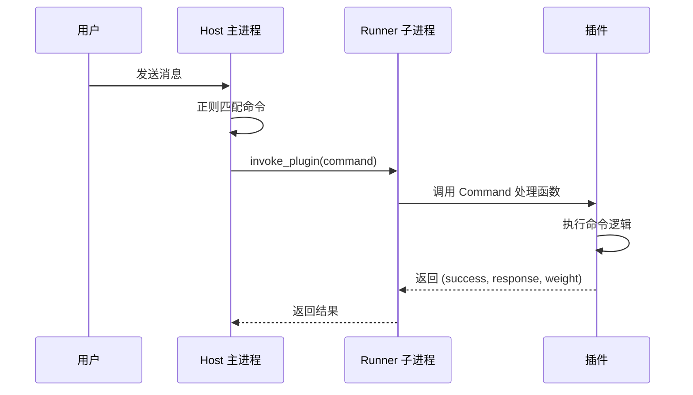
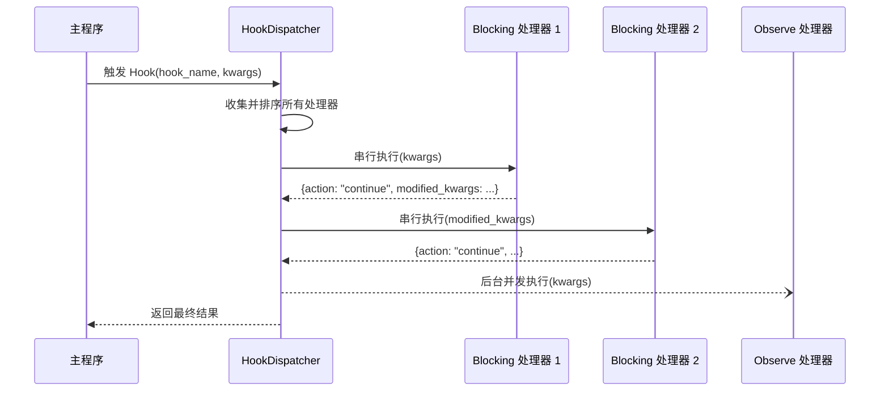
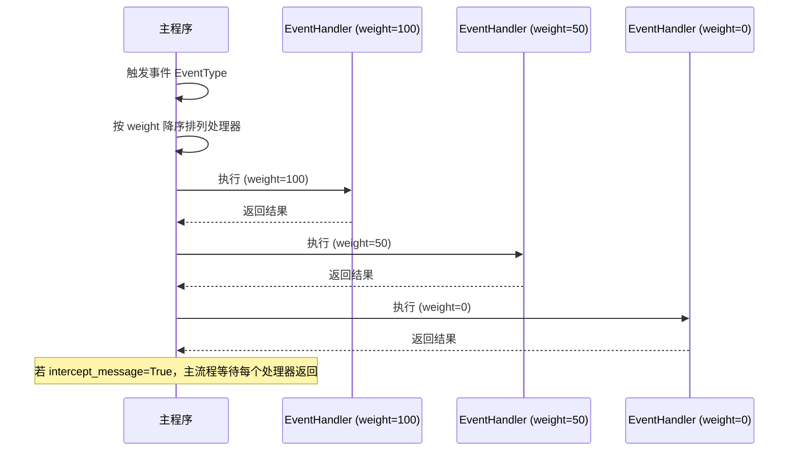

# MaiBot 插件开发与 DeepSeek 联网搜索 API 完全指南

> 一份合并文档：把 DeepSeek 官方 Search / Fetch API 文档与 MaiBot 官方插件开发文档整合到同一处，既讲「接口怎么调」，也讲「插件怎么写、怎么发布」。
>
> **适用版本**：MaiBot 1.3.x、`maibot-plugin-sdk` 2.14.x、DeepSeek Search / Fetch API（2025 年上线版）。
>
> **资料来源**：DeepSeek 官方文档 3 页（`guides/search`、`api/search`、`api/fetch`）+ MaiBot 官方插件文档 19 页（`/plugin/` 与 `/develop/plugin`）。每个部分开头都标注了自己的来源 URL，正文中的签名、JSON、配置片段均从原始文档逐字转写。
>
> **作者**：BlackBee114514 · <https://space.bilibili.com/1041748349>
>
> **配套插件**：`blackbee114514.deepseek-search`（本仓库），实现见第 0 部分与附录 A。

## 目录

- 第 0 部分 DeepSeek Search / Fetch API
- 第 1 部分 插件接入视角
- 第 2 部分 插件体系总览与运行架构
- 第 3 部分 快速开始与 AI 协作规范
- 第 4 部分 Manifest 参考
- 第 5 部分 生命周期与热重载
- 第 6 部分 配置系统
- 第 7 部分 Tool 组件
- 第 8 部分 Command 组件
- 第 9 部分 Hook 处理器
- 第 10 部分 事件处理器
- 第 11 部分 消息网关
- 第 12 部分 API 组件
- 第 13 部分 LLMProvider
- 第 14 部分 回复扩展
- 第 15 部分 首页卡片
- 第 16 部分 自定义 WebUI 页面
- 第 17 部分 Action 迁移
- 第 18 部分 能力 API 参考摘要
- 第 19 部分 提交与发布
- 附录 A 本插件速查
- 附录 B 常见错误与排错

---

## 第 0 部分 DeepSeek Search / Fetch API

> 来源：https://api-docs.deepseek.com/zh-cn/guides/search/ 、https://api-docs.deepseek.com/zh-cn/api/search 、https://api-docs.deepseek.com/zh-cn/api/fetch

DeepSeek 平台在对话补全（Chat Completions）之外，另提供两个独立的 **工具型 API**：`search` 负责「检索网页并返回结构化结果」，`fetch` 负责「把指定 URL 的正文转成 Markdown」。二者都是普通 HTTP POST 接口，与 OpenAI 兼容接口共用同一个 API Key 与同一个域名，但**不经过模型**：你输入查询词或网址，直接拿回原始数据，由你自己的程序（或你的大模型）决定如何使用。

### 0.1 两个接口一览

| 接口 | 方法与路径 | 作用 | 典型用途 |
|---|---|---|---|
| 联网搜索 | `POST https://api.deepseek.com/v1/tools/search` | 按关键词/语法检索网页，返回标题、链接、摘要、可选正文 | 给聊天机器人提供实时信息、新闻、行情、文档检索 |
| 网页抓取 | `POST https://api.deepseek.com/v1/tools/fetch` | 抓取单个 URL，抽取正文并转 Markdown | 已知网址时读取全文；搜索结果的二次精读 |

两者互相独立：计费独立、限速独立（各自 5 QPS），可以单独使用，也可以串起来用（先 `search` 得到 `url`，再对高价值 `url` 调 `fetch`）。

### 0.2 通用约定

**鉴权**：请求头携带 `Authorization: Bearer <DeepSeek API Key>`，Key 在 DeepSeek 开放平台创建。**Key 属于机密**，只能出现在服务端配置里，绝不能写进代码、日志、文档或提交到仓库。

**请求头**：

```http
Authorization: Bearer sk-xxxxxxxxxxxxxxxx
Content-Type: application/json
```

**请求体**：JSON 对象，字段见下文。未知字段会被**忽略**（不报错），但拼错必填字段会得到 400。

**响应体**：成功时 HTTP 200，JSON 对象；失败时使用 OpenAI 兼容的错误结构：

```json
{
  "error": {
    "message": "Authentication Fails, Your api key: ****abcd is invalid",
    "type": "authentication_error",
    "param": null,
    "code": "invalid_api_key"
  }
}
```

排查时优先读 `error.message`（人类可读），程序分支判断用 HTTP 状态码 + `error.type`。

**超时与重试约定**（官方建议，本插件遵循同一策略）：

| 状态码 | 含义 | 建议动作 |
|---|---|---|
| 400 | 请求不合法（参数校验失败） | 不重试，修正参数 |
| 401 | Key 无效 | 不重试，提示配置 Key |
| 402 | 余额不足 | 不重试，充值后重试 |
| 403 | 请求被安全策略拒绝（仅 fetch） | 不重试，换来源 |
| 404 | 抓不到可用内容（仅 fetch） | 不重试，换 URL |
| 408 | 读取请求体超时 | 退避重试 |
| 413 | 请求体过大（仅 fetch） | 不重试 |
| 429 | 触发限速（QPS 或目标域名限速） | 退避重试，尊重 `Retry-After` |
| 500 | 服务内部错误 | 退避重试 |
| 504 | 下游超时 | 退避重试 |

**计费**：Search 与 Fetch 分别按 **5 元 / 1000 次成功请求** 计费。只有「HTTP 200 且确实返回了结果」的请求才计费；失败、无结果、超时都不计费。`count` 参数的大小**不影响**单次价格（一次请求算一次）。

**限速**：每个账号的 Search 与 Fetch 各自 **5 QPS**，两者独立计算，且与「用哪个 API Key」无关（同账号多 Key 共享额度）。`fetch` 另有**按目标站点的 QPS 限制**，同一站点被高频抓取时先收到 429 的是它。

### 0.3 联网搜索 Search

#### 请求参数

| 参数 | 类型 | 是否必填 | 默认值 | 说明与校验 |
|---|---|---|---|---|
| `query` | string | **必填** | — | 搜索关键词。按 Unicode 字符计数，长度 1–128；不能是纯空白；超出或为空返回 400 |
| `count` | integer | 可选 | `10` | 返回结果条数，取值 1–50 |
| `ori_question` | string \| null | 可选 | `null` | 用户原始问题（≤128 字符），用于重排参考；只影响排序权重 |
| `localization` | string | 可选 | `""` | 本地化倾向，传 IP 字符串；用于偏好本地区结果 |
| `need_content` | boolean | 可选 | `false` | 是否为每条结果附带完整正文（`content` 字段）。默认 `false` 时 `content` 恒为空串 |

请求示例：

```bash
curl -X POST https://api.deepseek.com/v1/tools/search \
  -H "Authorization: Bearer $DEEPSEEK_API_KEY" \
  -H "Content-Type: application/json" \
  -d '{
    "query": "site:docs.python.org asyncio task group",
    "count": 5,
    "ori_question": "asyncio TaskGroup 怎么用？",
    "need_content": false
  }'
```

#### 查询语法

`query` 不只是关键词，支持一组搜索引擎式语法，可组合使用：

| 语法 | 含义 | 示例 |
|---|---|---|
| `关键词` | 普通检索，空格分隔多词 | `DeepSeek API` |
| `site:域名` | 只在该站点内检索 | `site:github.com maibot plugin` |
| `-site:域名` | 排除该站点 | `ai 编程 -site:csdn.net` |
| `"短语"` | 精确短语匹配 | `"plugin manifest"` |
| `-词` / `-"短语"` | 排除词/短语 | `python -java` |
| `lang:zh,en` | 限定结果语言，可多值 | `lang:zh,en` |
| `after:YYYY[-MM-DD]` | 只要该日期之后的内容 | `after:2025-01-01` |
| `before:YYYY[-MM-DD]` | 只要该日期之前的内容 | `before:2026` |

实用建议：查官方文档优先 `site:<官方域名>`；查时效性内容叠加 `after:`；查教程排除低质聚合站用 `-site:`。

#### 响应字段

```json
{
  "results": [
    {
      "rerank_score": 2.31,
      "title": "Example Page Title",
      "url": "https://example.com/page",
      "snippet": "……100~200 字的检索摘要……",
      "summary": "……600~800 字的结构化摘要……",
      "content": "",
      "site_name": "Example",
      "site_icon": "https://example.com/favicon.ico",
      "date": "2025-11-20T00:00:00Z",
      "authority": 3
    }
  ]
}
```

| 字段 | 类型 | 说明 |
|---|---|---|
| `results` | array | 结果列表；**无结果时为空数组 `[]`**（此时不计费） |
| `rerank_score` | number | 相关性得分，范围 0–3；实践上 **≥ 1.5 可视为优质结果**，低于 1.0 多半是弱相关 |
| `title` | string | 页面标题 |
| `url` | string | 页面地址 |
| `snippet` | string | 检索摘要，约 100–200 字，适合直接展示 |
| `summary` | string | 结构化摘要，约 600–800 字，适合喂给大模型做二次加工 |
| `content` | string | 网页正文；仅当 `need_content=true` 时有内容，否则为空串 |
| `site_name` | string \| null | 站点名，未知为 null |
| `site_icon` | string \| null | 站点图标地址，未知为 null |
| `date` | string \| null | 发布时间（RFC 3339，UTC）；动态页/未知为 null |
| `authority` | integer | 站点权威度 0–4；`-1` 表示未知；**≥ 3 为极权威**（政府、学术、官方文档等） |

`results` 的顺序已经按相关性排好，直接用；若要做展示裁剪，以 `rerank_score` 降序保留前 N 条并剔除分数过低的项即可。

### 0.4 网页抓取 Fetch

#### 请求参数

| 参数 | 类型 | 是否必填 | 说明与校验 |
|---|---|---|---|
| `url` | string | **必填** | 要抓取的页面地址。长度 ≤ 8192；必须是带 host 的 `http://` 或 `https://` 链接；**不能包含用户名/密码** |

请求示例：

```bash
curl -X POST https://api.deepseek.com/v1/tools/fetch \
  -H "Authorization: Bearer $DEEPSEEK_API_KEY" \
  -H "Content-Type: application/json" \
  -d '{"url": "https://example.com/article"}'
```

#### 响应字段

```json
{
  "title": "Example Page Title",
  "content": "# 标题\n\n正文……（Markdown）"
}
```

| 字段 | 类型 | 说明 |
|---|---|---|
| `title` | string | 页面标题；取不到时可能为空串 |
| `content` | string | 正文 Markdown；已做正文抽取与净化，不含导航、广告、脚本 |

`fetch` 的语义是「尽力抽取正文」：动辄几十万字的页面会返回截断后的正文；纯脚本渲染、需要登录、防抓取的页面通常返回 404。它不做浏览器渲染，也不执行 JS。

### 0.5 组合用法：从检索到精读

一个典型的两级策略：

1. `search(query, count=8, need_content=false)` → 用 `title/snippet/date/authority/rerank_score` 做初筛；
2. 对 `rerank_score >= 1.5` 且「需要细节」的前 1–3 条，用 `fetch(url)` 拉全文（或直接对 `search` 加 `need_content=true` 一次性拿正文）；
3. 把 `snippet` 或 `fetch` 结果贴给大模型做总结，**保留 `url` 作为出处**。

取舍：`need_content=true` 单次响应体明显更大，但只算一次请求，适合「一次搜索就要正文」；先 `search` 再 `fetch` 适合「多结果里挑一两个深读」，两者计费都是按成功请求次数。

### 0.6 与聊天机器人的集成建议

- **把 API Key 当密码**：只放服务端配置；日志必须脱敏（本插件把 Key 渲染成 `sk-***abcd`）。
- **给工具加纪律**：`query` 长度先截断到 128 字符，`count` 限制在 1–50；URL 先做 `http(s)` 与白名单/私网校验再发。
- **429/408/5xx 才重试**：指数退避 + 抖动，最多 2 次；`400/401/402/403/404/413` 立刻失败并把中文原因回给模型看。
- **本地限速**：官方 QPS 是账号级硬限，插件侧再压一层（例如 4 QPS 令牌桶）可避免多用户并发时集体撞 429。
- **缓存**：同一 `query` 十几秒内重复搜索很常见，加 TTL 缓存能显著省钱；`fetch` 对同一 URL 的缓存可以更久。
- **可观测**：每次调用记 `action/attempt/status/results/elapsed_ms/cache`，出问题第一时间能分清「抓到没抓到」与「慢在哪」。

**易错点**

- `query` 是**按 Unicode 字符**计 1–128，中文按字算，不是按字节；超长直接 400。
- `need_content` 默认 `false` 时 `content` 恒为空串——不要以为「返回了字段却没内容」是接口坏了。
- `count` 只是条数上限，**不改变计费**；别为了省钱把 `count` 调小，也别为了多拿结果连发请求。
- `authority` 的 `-1` 是「未知」，不是「最差」；排序/过滤时不要把它当 0 处理。
- `results` 为空是**正常成功响应**（HTTP 200），要按「没搜到」而非「调用失败」处理。
- `fetch` 只接受带 host 的 http(s) 链接，且不能带用户名密码；`file://`、裸域名、带 `user:pass@` 的 URL 都会 400。
- 429 可能来自「账号 5 QPS」或「目标域名 QPS」，后者重试要换域名而不是猛冲同一站点。

---

## 第 1 部分 插件接入视角

> 来源：https://docs.mai-mai.org/develop/plugin

给麦麦加能力又不改 MaiBot 源码，路径就是写插件。插件跑在独立的 Runner 子进程里，通过 IPC 与主进程通信；开发者只需实现 `MaiBotPlugin` 子类并声明组件，加载、配置、热重载、WebUI 全部由运行时托管。动手之前要回答三个问题：该不该用插件、要挂到哪个接入面、运行时有哪些硬边界。

### 1.1 什么时候用插件

按「想影响什么」选型，插件只是其中一种集成方式：

| 需求 | 选型 | 说明 |
|---|---|---|
| 加命令、加工具 | **插件** | 用户输入 `/weather` 触发，或让模型自主调用某个工具 |
| 改麦麦的行为 | **插件**（Hook 处理器） | 改写提示词、拦截消息、修改回复 |
| 接入一个新聊天平台 | **适配器** | 平台适配器负责收发消息 |
| 让外部程序读取或控制麦麦 | **HTTP API** | 面板、监控、自动化脚本 |
| 让麦麦调用你的外部系统（已有现成服务） | **优先 MCP** | 需要复杂逻辑再考虑写插件 |

插件与适配器可以并存：平台适配器负责收发消息，插件负责处理消息。

### 1.2 插件能接到哪些地方

每个组件类型对应一个明确的接入面，按「想影响什么」挑：

| 组件 | 接入面 | 用途 |
|---|---|---|
| Tool | 推理环节 | 暴露给模型自主调用的工具 |
| Command | 消息入口 | 用户直接输入的命令 |
| Hook 处理器 | 流程内部 | 挂到命名钩子上，可在消息处理、回复生成、发送、表情选择等节点前后读写数据 |
| 事件处理器 | 生命周期 | 监听 `on_start` / `on_stop` 等事件 |
| 消息网关 | 平台接入 | 插件自己收发某个平台的消息，等于「插件即适配器」 |
| API 组件 | 插件之间 | 给其他插件或自己的 WebUI 页面提供接口 |
| LLMProvider | 模型层 | 注册新的模型客户端类型 |
| 首页卡片 / WebUI 页面 | 界面 | 在麦麦的 WebUI 里呈现数据与操作 |

### 1.3 最小可运行插件

一个能用的插件只有两个文件：`_manifest.json` 声明元信息与能力，`plugin.py` 放实现。示例插件注册了一个命令、一个工具，并在回复发出前改一句话。

`_manifest.json`：

```json
{
  "manifest_version": 2,
  "id": "com.example.hello",
  "version": "1.0.0",
  "name": "示例插件",
  "description": "演示命令、工具与 Hook 三类接入面",
  "author": { "name": "you", "url": "https://github.com/you" },
  "license": "MIT",
  "urls": { "repository": "https://github.com/you/hello" },
  "host_application": { "min_version": "1.3.0", "max_version": "1.99.99" },
  "sdk": { "min_version": "2.0.0", "max_version": "2.99.99" },
  "capabilities": ["send.text", "send.emoji", "config.get"],
  "i18n": { "default_locale": "zh-CN" }
}
```

`plugin.py`：

```python
from maibot_sdk import Command, HookHandler, MaiBotPlugin, Tool
from maibot_sdk.types import ToolParameterInfo, ToolParamType


class HelloPlugin(MaiBotPlugin):
    async def on_load(self) -> None:
        self.ctx.logger.info("hello 插件已加载")

    async def on_unload(self) -> None:
        pass

    async def on_config_update(self, scope: str, config_data: dict, version: str) -> None:
        pass

    @Command("hello", pattern=r"^/hello")
    async def handle_hello(self, **kwargs):
        await self.ctx.send.text("你好！", kwargs["stream_id"])
        return True, "你好！", 2

    @Tool(
        "greet",
        brief_description="向指定聊天流打招呼",
        detailed_description="参数 stream_id：当前聊天流 ID。",
        parameters=[ToolParameterInfo(
            name="stream_id", param_type=ToolParamType.STRING,
            description="当前聊天流 ID", required=True,
        )],
    )
    async def handle_greet(self, stream_id: str, **kwargs):
        await self.ctx.send.text("你好！", stream_id)
        return {"success": True}

    @HookHandler("send_service.after_build_message")
    async def tag_reply(self, **kwargs):
        # 在每个回复末尾加一句签名；blocking 模式才能改数据
        kwargs["processed_plain_text"] = f"{kwargs['processed_plain_text']}\n—— 来自 hello 插件"
        return {"action": "continue", "modified_kwargs": kwargs}


def create_plugin():
    return HelloPlugin()
```

三类接入面各占一个装饰器：`@Command` 管消息入口，`@Tool` 给模型用，`@HookHandler` 改流程内部数据。生命周期三个方法（`on_load`、`on_unload`、`on_config_update`）一个都不能少，否则运行时拒绝加载。

Hook 是覆盖面最广的一类：22 个命名钩子分布在聊天、发送服务、表情、学习与推理流程上，支持阻塞（可改数据、可中止）与旁路观察两种模式，并带超时与熔断保护。钩子清单与返回契约见 [Hook 处理器](https://docs.mai-mai.org/plugin/hooks)。

### 1.4 运行边界

理解边界能省掉大量调试：

| 边界 | 具体表现 |
|---|---|
| **独立进程** | 第三方插件跑在 Runner 子进程里，主进程崩溃与插件崩溃互不牵连；单次 RPC 默认 30 秒超时，组件调用默认 60 秒 |
| **不能 import 主程序** | 插件代码只能用 `maibot_sdk`，不能引用 `src.*`；需要的能力通过 `self.ctx` 的能力代理申请 |
| **能力要声明** | 能调哪些能力由 manifest 的 `capabilities` 列表决定，没声明就调用会被拒 |
| **数据有固定落点** | 插件专属目录是 `data/plugins/{插件 ID}` 与 `temp/plugins/{插件 ID}`，不要写到别处 |
| **没有沙箱** | 没有通用的文件/网络隔离，插件等同于以主程序权限运行的代码；只装信任来源的插件 |
| **热重载** | 插件源码或它的 `config.toml` 变化会自动重载；重载失败会回滚到上一版本 |

### 1.5 版本兼容

插件能否装进当前麦麦，由 manifest 里两个区间决定：

| 区间 | 检查对象 | 判定规则 |
|---|---|---|
| `host_application` | 宿主版本 | 低于下限直接拒绝；高于上限但主次版本相同则放行并告警 |
| `sdk` | 插件 SDK 版本 | 不满足一律拒绝；当前配套的 SDK 是 `maibot-plugin-sdk` 2.9 系列 |

调试期可以用 `debug.force_plugin_compatibility` 临时跳过校验，但那是兜底手段——强行加载一个真的不兼容的插件，会在运行期报错。

### 1.6 上手顺序

1. 先跑通最小插件：读官方[插件开发指南](https://docs.mai-mai.org/plugin/)，照着装 SDK、写 `_manifest.json` 和 `plugin.py`。
2. 想清楚要挂哪个接入面：工具、命令还是钩子，对照组件与接入面的对应关系选一个。
3. 按需查 API：能力代理覆盖发送、模型、配置、数据库、会话、消息、人物、表情、统计等，清单见 [API 参考](https://docs.mai-mai.org/plugin/api-reference)。
4. 需要界面就在 `webui.json` 里声明页面，写法见 [WebUI 页面](https://docs.mai-mai.org/plugin/webui-pages)。
5. 要发布到插件市场，见 [发布插件](https://docs.mai-mai.org/plugin/submission)。

### 1.7 验证

**验收动作** — 插件加载后，WebUI 的插件页能看到它处于已加载状态，且声明的命令 / 工具能触发。加载被拦下时，Runner 日志会指出具体原因：manifest 校验错误、组件注册失败、能力未授权。

**易错点**

- **插件没被加载** — 查 manifest：`manifest_version` 必须是 `2`，`id` 至少要有一个 `.` 或 `-` 分隔符，`capabilities` 与 `i18n` 是必填项，多写未知字段会被直接拒绝。
- **加载时报版本不兼容** — 对照 `host_application` / `sdk` 区间与当前版本；插件 SDK 与主程序是分开升级的。
- **组件注册失败** — 注册是全有或全无：某个组件的类型或钩子名不合法，整个插件都会注册失败，日志里会指出具体是哪一个。
- **能力调用被拒** — `capabilities` 里没声明；按能力名补上再重载。
- **改代码没生效** — 确认文件确实落在插件目录内；重载失败会自动回滚，日志里能看到回滚记录。
- **模型 / 发送等调用失败但没有异常** — 插件组件的异常以 `success: false` 写在返回载荷里，记得判返回值。

---

## 第 2 部分 插件体系总览与运行架构

> 来源：https://docs.mai-mai.org/plugin/

MaiBot 的插件系统采用 Host/Runner IPC 架构，插件代码运行在独立的子进程中，通过 msgpack 编码的 RPC 协议与主进程通信。理解这套分层之后，插件加载、组件注册、能力调用分别发生在哪一侧、失败时该看哪里，都有了明确答案。

### 2.1 架构概览

整个系统分成 Host 主进程与 Runner 子进程两侧：Host 负责运行时管理、组件注册、Hook 分发与 RPC 服务；Runner 负责发现、加载插件并执行插件代码。两者通过 RPC 通道双向通信。

#### Host（主进程侧）

| 组件 | 职责 |
|---|---|
| `PluginRuntimeManager` | 单例管理器，管理 Builtin 和 Third-party 两个 Supervisor |
| `PluginSupervisor` | 负责 Runner 子进程的启动、停止、健康检查和插件热重载 |
| `ComponentRegistry` | 组件注册表，管理所有插件声明的 Tool、Command 等组件 |
| `HookDispatcher` | Hook 分发器，将命名 Hook 调用分发到对应 Supervisor |

#### Runner（子进程侧）

- 每种 Supervisor 各自管理一个独立的 Runner 子进程
- 通过 `PluginLoader` 发现和加载插件
- 通过 `RPCClient` 与 Host 通信
- 在插件加载后注入 `PluginContext`，再调用 `on_load()` 生命周期方法

#### 通信协议

| 层面 | 实现 |
|---|---|
| **编解码** | 使用 msgpack 格式进行二进制序列化（`MsgPackCodec`） |
| **传输层** | 支持 Unix Domain Socket、TCP、Named Pipe 三种传输方式 |
| **Host → Runner** | 通过 `invoke_plugin()` 调用插件组件（Tool、Command 等） |
| **Runner → Host** | 插件通过 `self.ctx` 的能力代理发起 RPC 回调（如 `ctx.send.text()`、`ctx.db.query()`） |

### 2.2 快速开始

#### 安装 SDK

```bash
pip install maibot-plugin-sdk
```

如果同时在本地修改 `maibot-plugin-sdk`，可以设置环境变量让 MaiBot 的插件 Runner 自动优先使用本地 SDK 源码：

```powershell
$env:MAIBOT_PLUGIN_SDK_PATH = "C:\GitHub\MaiBot-dev\maibot-plugin-sdk"
uv run python bot.py
```

该路径必须指向包含 `pyproject.toml` 和 `maibot_sdk/` 的 SDK 仓库。设置后，Runner 会把该路径放到 `PYTHONPATH` 最前面，并使用本地 SDK 的 `project.version` 进行插件 manifest 兼容性检查。不要把这个环境变量指向不可信目录；它会让该目录中的 Python 代码进入插件运行时导入路径。

构建本地 SDK 分发包时，在 SDK 仓库中执行：

```powershell
uv sync --extra dev
uv run pytest
uv build
```

> **注意**：安装包名为 `maibot-plugin-sdk`，但代码中导入时使用 `maibot_sdk`。

```python
from maibot_sdk import MaiBotPlugin, Command, Tool
```

#### 创建插件目录

```text
plugins/
└── my-plugin/
    ├── _manifest.json
    └── plugin.py
```

插件配置在 `plugin.py` 中通过 `PluginConfigBase` 和 `Field` 声明。Runner 首次加载插件时根据 `config_model` 生成运行时 `config.toml`，并在配置模型更新后补齐新增字段。

#### 编写 Manifest

在 `_manifest.json` 中声明插件元信息：

```json
{
  "manifest_version": 2,
  "id": "com.example.my-plugin",
  "version": "1.0.0",
  "name": "我的插件",
  "description": "一个示例插件",
  "author": {
    "name": "开发者",
    "url": "https://github.com/developer"
  },
  "license": "MIT",
  "urls": {
    "repository": "https://github.com/developer/my-plugin"
  },
  "host_application": {
    "min_version": "1.0.0",
    "max_version": "1.99.99"
  },
  "sdk": {
    "min_version": "1.0.0",
    "max_version": "2.99.99"
  },
  "capabilities": ["send.text", "send.emoji", "config.get"],
  "i18n": {
    "default_locale": "zh-CN"
  }
}
```

字段的完整定义与校验规则见第 4 部分 Manifest 参考。

#### 编写插件代码

在 `plugin.py` 中继承 `MaiBotPlugin`，用装饰器声明组件，并实现三个生命周期方法：

```python
from maibot_sdk import MaiBotPlugin, Command, Tool
from maibot_sdk.types import ToolParameterInfo, ToolParamType


class MyPlugin(MaiBotPlugin):
    async def on_load(self) -> None:
        self.ctx.logger.info("插件已加载")

    async def on_unload(self) -> None:
        self.ctx.logger.info("插件已卸载")

    async def on_config_update(self, scope: str, config_data: dict, version: str) -> None:
        if scope == "self":
            self.ctx.logger.info("插件配置已更新: version=%s", version)

    @Tool(
        "greet",
        brief_description="向用户打招呼",
        detailed_description="参数说明：\n- stream_id：string，必填。当前聊天流 ID。",
        parameters=[
            ToolParameterInfo(
                name="stream_id",
                param_type=ToolParamType.STRING,
                description="当前聊天流 ID",
                required=True,
            ),
        ],
    )
    async def handle_greet(self, stream_id: str, **kwargs):
        await self.ctx.send.text("你好！", stream_id)
        return {"success": True, "message": "已回复"}

    @Command("hello", pattern=r"^/hello")
    async def handle_hello(self, **kwargs):
        await self.ctx.send.text("Hello!", kwargs["stream_id"])
        return True, "Hello!", 2


def create_plugin():
    return MyPlugin()
```

> **警告**：SDK 要求所有插件实现 `on_load()`、`on_unload()` 和 `on_config_update()` 三个方法，否则 Runner 会拒绝加载。

#### 安装与运行

将插件目录放入 `plugins/` 文件夹，启动 MaiBot 后插件会自动被发现和加载。也可以通过 WebUI 进行插件管理。

### 2.3 核心概念

#### 插件基类

所有插件必须继承 `MaiBotPlugin`，通过类属性和装饰器声明插件能力：

```python
from maibot_sdk import MaiBotPlugin, Tool, Command, CONFIG_RELOAD_SCOPE_SELF
from typing import ClassVar, Iterable


class MyPlugin(MaiBotPlugin):
    # 订阅全局配置热重载（仅 "bot" 和 "model" 两个值有效）
    config_reload_subscriptions: ClassVar[Iterable[str]] = ("bot", "model")

    @Tool("my_tool", brief_description="示例工具")
    async def handle_tool(self, **kwargs):
        ...

    @Command("my_cmd", pattern=r"^/my_cmd")
    async def handle_cmd(self, **kwargs):
        ...


def create_plugin():
    return MyPlugin()
```

#### 组件装饰器

SDK 在 `maibot_sdk` 顶层导出下列组件装饰器；`@Action` 只用于兼容旧插件，内部会自动转换为 `@Tool`，新插件应直接使用 `@Tool`。

| 装饰器 | 作用 |
|---|---|
| `@Tool` | LLM 工具 / 函数调用，LLM 可调用的工具，最常用的组件类型 |
| `@Command` | 斜杠命令，用户通过正则匹配触发的命令 |
| `@HookHandler` | 命名 Hook 处理器，订阅特定 Hook 点，支持 blocking / observe 模式 |
| `@EventHandler` | 消息 / 工作流事件，监听消息、LLM 生成等生命周期事件 |
| `@API` | 插件间 API，暴露可被其他插件调用的 API |
| `@MessageGateway` | 平台适配器，将外部平台（QQ、邮件等）接入 MaiBot |
| `@HomeCard` | WebUI 首页卡片，在首页展示插件状态、入口或自定义内容 |
| `@LLMProvider` | LLM Provider，声明新 LLM 模型接入点（client_type），扩展模型服务 |
| `@ReplyExtension` | 回复扩展，为 reply 工具注入命名空间参数并参与回复生成（SDK 2.10.0+） |
| `@Action` | 兼容旧插件，内部自动转换为 `@Tool`，新插件应直接使用 `@Tool` |

#### 能力代理

通过 `self.ctx` 访问 17 种能力代理，所有调用自动通过 RPC 转发到 Host：

```python
# 上下文访问
self.ctx              # PluginContext 实例
self.ctx.paths        # 插件持久化与运行时目录
self.ctx.logger       # logging.Logger，名称为 "plugin.<plugin_id>"

# 能力代理
self.ctx.api          # 插件 API 查询、调用与动态同步
self.ctx.gateway      # 消息网关路由与运行时状态上报
self.ctx.send         # 发送文本、图片、表情、转发、混合消息
self.ctx.db           # 数据库增删改查计数
self.ctx.llm          # LLM 文本生成、工具调用、嵌入向量与 ASR 语音识别
self.ctx.config       # 插件配置读取
self.ctx.emoji        # 表情包管理
self.ctx.message      # 历史消息查询
self.ctx.frequency    # 发言频率控制
self.ctx.component    # 插件与组件管理
self.ctx.chat         # 聊天流查询、打开或创建聊天流，以及头像查询
self.ctx.person       # 用户信息查询
self.ctx.render       # 将 HTML 渲染为 PNG 图片
self.ctx.knowledge    # LPMM 知识库搜索
self.ctx.statistics   # 本机统计与计费数据读取
self.ctx.tool         # LLM 工具定义查询
self.ctx.maisaka      # Maisaka 上下文追加与主动任务
```

其中 `self.ctx`、`self.ctx.paths`、`self.ctx.logger` 属于上下文访问入口，其余是以 `self.ctx` 为根的能力代理命名空间。

#### 配置模型

插件可通过 `PluginConfigBase` 声明强类型配置，Runner 会自动生成默认配置和 WebUI Schema：

```python
from maibot_sdk import MaiBotPlugin, PluginConfigBase, Field


class MyPluginConfig(PluginConfigBase):
    enabled: bool = Field(default=True, description="是否启用插件")
    greeting: str = Field(default="你好！", description="默认问候语")


class MyPlugin(MaiBotPlugin):
    config_model = MyPluginConfig

    async def on_load(self) -> None:
        # 通过 self.config 访问强类型配置
        self.ctx.logger.info("当前问候语: %s", self.config.greeting)
        # 通过 self.get_plugin_config_data() 访问原始 dict
        raw = self.get_plugin_config_data()
```

- 声明 `config_model` 后，`self.config` 返回强类型配置实例
- 未声明时调用 `self.config` 会抛出 `RuntimeError`
- `self.get_plugin_config_data()` 始终可用，返回原始配置字典
- 配置结构与默认值由 `config_model` 定义，当前运行值由 Runner 保存在插件目录下的 `config.toml`

### 2.4 目录结构约定

```text
my-plugin/
├── _manifest.json       # 必需：插件清单
├── plugin.py            # 必需：插件入口，包含 create_plugin()
├── webui.json           # 可选：声明式 WebUI 自定义页面
├── i18n/                # 可选：国际化资源
│   ├── zh-CN.json
│   └── en-US.json
└── assets/              # 可选：静态资源
```

配置模型属于插件源码，运行时配置实例由 Runner 生成。插件仓库的 `.gitignore` 应包含 `/config.toml`，安装后的用户配置由 WebUI 或运行时配置接口维护。

插件运行时数据统一写入 Host 注入的插件专属目录。SDK 2.6.0 起可以通过 `self.ctx.paths` 获取这些目录：

```python
self.ctx.paths.data_dir     # 持久化数据，默认 data/plugins/<plugin_id>/
self.ctx.paths.runtime_dir  # 临时数据，默认 temp/plugins/<plugin_id>/
```

- `data_dir` 适合保存插件数据库、JSON 状态、用户生成内容等需要跨重启保留的数据。
- `runtime_dir` 适合保存下载缓存、渲染中间产物、可重建的临时文件。
- 新数据统一写入这两个专属目录；处理用户输入时应采用受控文件名映射，并在路径解析后校验结果仍位于目标目录内。

### 2.5 内置插件与第三方插件

MaiBot 维护两个独立的 Runner 子进程：

| 类别 | 源码位置 | 所属 Supervisor |
|---|---|---|
| 内置插件 | `src/plugins/built_in/` | Builtin Supervisor |
| 第三方插件 | `plugins/` | Third-party Supervisor |

两者使用相同的通信协议和组件注册机制。Supervisor 之间的启动顺序由跨 Supervisor 依赖关系决定，如果检测到循环依赖则拒绝启动。

### 2.6 主题索引

架构与快速开始之后，官方文档按主题继续展开：生命周期与热重载、配置系统、Tool、Command、Hook、事件处理器、消息网关、API 组件、LLMProvider、回复扩展、首页卡片、WebUI 页面、Action 迁移、能力 API 参考与提交发布，依次对应本指南第 5–19 部分。

**易错点**

- **三个生命周期方法缺一不可** — `on_load()`、`on_unload()`、`on_config_update()` 任一缺失，Runner 都会拒绝加载。
- **包名与导入名不同** — 安装 / 依赖声明写 `maibot-plugin-sdk`，代码里 `from maibot_sdk import ...`；混用会直接 ImportError。
- **`MAIBOT_PLUGIN_SDK_PATH` 指错目录** — 它必须指向包含 `pyproject.toml` 和 `maibot_sdk/` 的 SDK 仓库；指向不可信目录等于把该目录的 Python 代码放进插件运行时导入路径。
- **未声明 `config_model` 就访问 `self.config`** — 会抛出 `RuntimeError`；始终可用的是 `self.get_plugin_config_data()`。
- **给新插件使用 `@Action`** — 它内部只转换为 `@Tool`，属于旧系统兼容入口，新代码应直接使用 `@Tool`。
- **把 `config.toml` 提交进仓库** — 源码里的 `config_model` 才是配置定义，运行时值由 Runner 生成并维护，仓库 `.gitignore` 应包含 `/config.toml`。

---

## 第 3 部分 快速开始与 AI 协作规范

> 来源：https://docs.mai-mai.org/plugin/vibe-coding

用 AI 辅助写 MaiBot 插件，关键不是提示词写得多长，而是把插件需求拆成 AI 容易理解、容易验证、不会误改主程序的工作单元。任务简报、开发边界、代码骨架、自检清单与测试流程都围绕这个前提设计，可以直接复用。

### 3.1 AI 任务简报

这段任务简报可以直接作为给 AI 的首段上下文，再补充具体需求：

```text
你正在为 MaiBot 编写第三方插件。插件必须放在 plugins/<plugin-name>/ 下，不要修改 MaiBot 主程序代码，除非我明确许可。请使用 maibot-plugin-sdk，入口文件为 plugin.py，元信息文件为 _manifest.json。必须实现 on_load、on_unload、on_config_update 和 create_plugin。优先使用 @Tool、@Command、@HookHandler、@EventHandler、@API、@MessageGateway；不要给新插件使用 @Action。所有用户可见文本优先使用简体中文。请保持改动边界清晰，并给出测试方式。
```

### 3.2 开发边界

| 项目 | 规则 |
|---|---|
| 插件目录 | 固定为 `plugins/<plugin-name>/`；插件专属忽略项写在目录内的 `.gitignore`，其中包含 `/config.toml` |
| 入口 | 入口固定为 `plugin.py`，工厂函数固定为 `create_plugin()` |
| 元信息 | 由 `_manifest.json` 声明；配置结构和默认值由 `plugin.py` 中的 `config_model` 声明，Runner 负责生成运行时 `config.toml` |
| 主程序目录 | 新插件不要修改 `src/`、`dashboard/`、`config/` 等主程序目录；确实需要主程序能力时，先说明原因、影响面和替代方案，再请求许可 |
| 提交内容 | 不要把本地实验数据、日志、临时脚本、个人密钥、token、cookie、数据库文件提交进插件 |
| 依赖 | 以 `_manifest.json` 的 `dependencies` 为准；只有在维护 MaiBot 主程序依赖时才同步 `pyproject.toml` 和 `requirements.txt` |

边界的作用是让 AI 的每一处改动都可审计：插件目录之外的修改必须事先说明理由并取得许可，密钥、数据库和本地配置一律不进入仓库。

### 3.3 最小目录结构

```text
plugins/my-plugin/
├── _manifest.json
├── plugin.py
├── README.md
└── .gitignore          # 包含 /config.toml
```

首次加载后，Runner 根据 `config_model` 在已安装插件目录中生成 `config.toml`，并在配置模型演进时补齐新增字段。

推荐额外添加：

```text
plugins/my-plugin/
├── tests/
├── docs/
└── assets/
```

### 3.4 Manifest 要点

`_manifest.json` 用于让 Host 在加载前校验插件，AI 生成时必须注意：

| 字段 | 规则 |
|---|---|
| `manifest_version` | 当前固定为 `2` |
| `id` | 使用小写反向域名或作者前缀，例如 `com.example.my-plugin` |
| `version` | 使用严格三段式语义版本，例如 `1.0.0` |
| URL 字段 | `author.url`、`urls.repository` 等 URL 必须以 `http://` 或 `https://` 开头 |
| `host_application` / `sdk` | 都要声明 `min_version` 与 `max_version` |
| `dependencies` | Python 包依赖类型为 `python_package`；插件间依赖类型为 `plugin` |
| `capabilities` | 只声明确实需要的能力 |
| `i18n.default_locale` | 推荐使用 `zh-CN` |
| `webui.json` | 与 `_manifest.json` 同级、由宿主独立校验，不影响 `manifest_version`；不放这个文件的插件完全不受影响 |

```json
{
  "manifest_version": 2,
  "id": "com.example.my-plugin",
  "version": "1.0.0",
  "name": "我的插件",
  "description": "一个 MaiBot 插件",
  "author": {
    "name": "开发者",
    "url": "https://github.com/developer"
  },
  "license": "MIT",
  "urls": {
    "repository": "https://github.com/developer/my-plugin"
  },
  "host_application": {
    "min_version": "1.0.0",
    "max_version": "1.99.99"
  },
  "sdk": {
    "min_version": "2.5.1",
    "max_version": "2.99.99"
  },
  "dependencies": [],
  "capabilities": ["send.text", "send.emoji", "config.get"],
  "i18n": {
    "default_locale": "zh-CN"
  }
}
```

### 3.5 代码骨架

```python
from typing import Any

from maibot_sdk import Command, Field, MaiBotPlugin, PluginConfigBase, Tool
from maibot_sdk.types import ToolParameterInfo, ToolParamType


class PluginSectionConfig(PluginConfigBase):
    """插件基础配置。"""

    __ui_label__ = "插件"
    __ui_icon__ = "package"
    __ui_order__ = 0

    enabled: bool = Field(default=False, description="是否启用插件")
    config_version: str = Field(default="1.0.0", description="配置版本")


class MyPluginConfig(PluginConfigBase):
    """插件配置。"""

    plugin: PluginSectionConfig = Field(default_factory=PluginSectionConfig)


class MyPlugin(MaiBotPlugin):
    """我的插件。"""

    config_model = MyPluginConfig

    async def on_load(self) -> None:
        """插件加载时执行。"""
        self.ctx.logger.info("插件已加载")

    async def on_unload(self) -> None:
        """插件卸载时执行。"""
        self.ctx.logger.info("插件已卸载")

    async def on_config_update(self, scope: str, config_data: dict[str, Any], version: str) -> None:
        """配置热重载时执行。"""
        del scope
        del config_data
        del version

    @Tool(
        "echo_text",
        description="复述用户提供的文本。适合测试插件是否能被 LLM 调用。",
        parameters=[
            ToolParameterInfo(
                name="text",
                param_type=ToolParamType.STRING,
                description="要复述的文本",
                required=True,
            ),
        ],
    )
    async def echo_text(self, text: str, **kwargs: Any) -> dict[str, str]:
        del kwargs
        return {"content": text}

    @Command("ping", description="测试插件是否在线", pattern=r"^/ping$")
    async def ping(self, stream_id: str = "", **kwargs: Any) -> tuple[bool, str, int]:
        del kwargs
        await self.ctx.send.text("pong", stream_id)
        return True, "pong", 2


def create_plugin() -> MyPlugin:
    """创建插件实例。"""
    return MyPlugin()
```

### 3.6 组件选择

| 目标 | 组件 | 说明 |
|---|---|---|
| 让 LLM 主动调用能力 | `@Tool` | 默认工具进入 deferred 池，需要被搜索发现；高频低风险工具才考虑 `core_tool=True` |
| 用户输入命令触发 | `@Command` | 使用正则 `pattern` 匹配，例如 `/ping` |
| 拦截或观察主流程 | `@HookHandler` | 适合消息改写、发送前审计、流程拦截 |
| 监听消息或生命周期事件 | `@EventHandler` | 适合统计、记录、异步辅助任务 |
| 给其他插件调用能力 | `@API` | 只把稳定接口设为公开 |
| 接入外部聊天平台 | `@MessageGateway` | 适配器类插件使用 |
| 维护旧插件 | `@Action` | 仅兼容旧代码，新插件不要使用 |

### 3.7 编写要点

#### Tool

- `description` 要写清楚何时使用、参数含义、限制和副作用。
- 参数优先用 `ToolParameterInfo` 声明，类型来自 `ToolParamType`。
- 返回值优先使用 `dict`，把给 LLM 阅读的文字放在 `content`。
- 需要返回图片等媒体时，使用文档约定的 `content_items`，不要把 base64 直接塞进长文本。
- 默认不要设置 `core_tool=True`；过多核心工具会增加模型选择成本。
- 工具内部要处理失败并返回可读错误，不要让异常泄漏成难懂堆栈。

#### 发送消息

- 已有 `stream_id` 时，使用 `await self.ctx.send.text(content, stream_id)` 发送文本。
- 发送图片、表情、转发、混合消息时，优先使用 `self.ctx.send` 和 `self.ctx.emoji` 提供的能力代理。
- 不要自行计算会话 ID；插件应使用上下文传入的 `stream_id` 或 SDK 提供的消息上下文。
- 用户可见文本默认使用简体中文。

#### 配置

- 配置模型继承 `PluginConfigBase`，字段使用 `Field(default=..., description="...")`。
- 推荐保留 `[plugin]` 分组，并包含 `enabled` 与 `config_version`。
- WebUI 展示信息可以通过 `__ui_label__`、`__ui_icon__`、`__ui_order__` 补充。
- 配置读取优先使用 `self.config.<section>.<field>`；确实需要原始字典时再用 `self.get_plugin_config_data()`。
- 配置热重载逻辑放入 `on_config_update()`。
- `config_model` 是源码中的配置定义，Runner 生成的 `config.toml` 保存当前安装实例的配置值。

### 3.8 AI 生成代码检查清单

| 检查项 | 要求 |
|---|---|
| Manifest | `_manifest.json` 字段完整，版本号和 URL 格式合法 |
| 导入 | `plugin.py` 只从标准库、第三方库和 `maibot_sdk` 导入；导入顺序符合项目规范 |
| 插件类 | 继承 `MaiBotPlugin`，并声明 `config_model` |
| 生命周期 | 已实现 `on_load()`、`on_unload()`、`on_config_update()` |
| 工厂函数 | 已实现 `create_plugin()` 并返回插件实例 |
| 组件选型 | 新功能优先使用 `@Tool` 或 `@Command`，没有给新代码使用 `@Action` |
| 改动范围 | 没有修改主程序代码和根目录 `.gitignore` |
| 硬编码 | 没有硬编码 token、绝对路径、个人 QQ 号、群号或私有 URL |
| 网络请求 | 所有网络请求都有超时和异常处理 |
| 资源清理 | 所有定时任务、后台任务、连接和文件句柄能在卸载时清理 |
| 文案 | 用户可见文本是简体中文 |
| 文档 | README 写明安装、启用、配置、命令和常见问题 |

### 3.9 推荐提示词

#### 生成新插件

```text
请在 plugins/<plugin-name>/ 创建一个 MaiBot 第三方插件，实现 <功能描述>。
要求：
1. 只改插件目录，不改 MaiBot 主程序。
2. 使用 maibot-plugin-sdk 和 plugin.py / _manifest.json 结构。
3. 实现 on_load、on_unload、on_config_update、create_plugin。
4. 配置用 PluginConfigBase + Field，用户可见文本使用简体中文。
5. 给出 README、完整配置模型和包含 /config.toml 的 .gitignore。
6. 完成后说明如何在 MaiBot 中启用和测试。
```

#### 修改已有插件

```text
请只修改 plugins/<plugin-name>/ 内的文件，为现有插件增加 <功能描述>。
先阅读 _manifest.json、plugin.py 中的配置模型和 README，沿用现有风格。
不要重构无关代码，不要整理全仓库格式。
如果需要主程序改动，先停止并说明原因。
```

#### 排查插件问题

```text
请排查 plugins/<plugin-name>/ 的加载或运行问题。
优先检查 _manifest.json 校验、依赖声明、生命周期方法、create_plugin、配置模型、日志中的异常。
请给出最小修复，不要做无关重构。
```

### 3.10 测试建议

| 环节 | 动作 |
|---|---|
| 静态检查 | 确认 `_manifest.json` 是合法 JSON，`plugin.py` 可以被 Python 解释器导入 |
| 本地加载 | 把插件放入 `plugins/`，启动 MaiBot，观察插件加载日志 |
| WebUI 检查 | 在插件管理中确认插件出现、可启用、配置可编辑 |
| 命令测试 | 用 `/ping` 一类命令确认 `@Command` 可触发 |
| Tool 测试 | 通过正常聊天让 LLM 发现并调用工具，观察工具返回是否可读 |
| 卸载测试 | 禁用或卸载插件后，确认后台任务、连接和缓存被清理 |

### 3.11 发布前检查

- 插件仓库根目录包含 `_manifest.json`、`plugin.py`、`README.md` 和 `.gitignore`，配置模型完整定义在插件代码中。
- `.gitignore` 包含 `/config.toml`，运行时配置由 Runner 根据 `config_model` 生成。
- README 包含功能说明、安装方式、配置项、命令、权限 / 能力说明、故障排查。
- 许可证与 `_manifest.json` 中的 `license` 一致。
- 依赖声明完整，避免要求用户手动安装未声明依赖。
- 没有提交 `.venv/`、`__pycache__/`、日志、数据库、密钥或本地配置。
- 如果准备提交到插件仓库，阅读插件仓库贡献指南并按其要求整理元信息。

### 3.12 验证

**验收动作** — 把 AI 任务简报加上具体需求交给 AI，拿到产物后放进 `plugins/<plugin-name>/` 并启动 MaiBot：WebUI 插件管理里能看到它、`_manifest.json` 通过校验、`/ping` 有响应，且变更文件只在插件目录里。

```bash
# 在插件目录里跑：JSON 都解析不过，就不用往下看了
python -m json.tool _manifest.json
# 只应列出插件目录下的改动；出现 src/ 说明 AI 越界了
git status --short
```

**易错点**

- **AI 顺手改了主程序，或给新代码用了 `@Action`** — 提示词里缺约束：任务简报必须写死只改 `plugins/<plugin-name>/`、必须实现 `on_load` / `on_unload` / `on_config_update` 和 `create_plugin()`、新代码只用 `@Tool` / `@Command` / `@HookHandler` 这类组件；漏一条，diff 里就可能多出 `src/` 的改动。
- **插件被 Host 拒绝加载，报 manifest 校验错误** — 对照 Manifest 要点逐条查：`manifest_version` 必须是 `2`，`id` 全小写且带 `.` / `-`，`version` 是严格 `X.Y.Z`，URL 以 `http://` 或 `https://` 开头，`host_application` 与 `sdk` 都要有上下界；先跑 `python -m json.tool` 排除语法问题。
- **能力调用被拒，或加载时报「未注册的能力」** — `capabilities` 与代码对不上：代码里调了 `ctx.send.text`、`ctx.config.get` 却没声明，Host 会拒绝对应能力；反过来声明了拼错或未注册的能力名，注册阶段就失败。按实际调用逐项对齐。
- **提示「缺少 create_plugin 工厂函数」** — 生成的 `plugin.py` 要么没写 `create_plugin()`，要么返回的不是 `MaiBotPlugin` 子类实例；同时确认插件类继承 `MaiBotPlugin` 并声明了 `config_model`。
- **让 AI 改已有插件，diff 却牵扯全仓库** — 修改类提示词要写上「只改该插件目录、先读 `_manifest.json` 和现有配置模型、不做无关重构、不整理全仓库格式」；拿到结果先看变更文件列表，多出来的改动直接打回。

---

## 第 4 部分 Manifest 参考

> 来源：https://docs.mai-mai.org/plugin/manifest

每个 MaiBot 插件必须在其根目录下包含一个 `_manifest.json` 文件，用于声明插件的元信息、版本兼容性、依赖关系和能力需求。Host 侧的 `ManifestValidator` 会在加载前严格校验此文件；校验采用 Pydantic 严格模式，多余字段、格式错误都会让插件整体被拒。

### 4.1 三个文件的职责

| 文件 | 位置 | 职责 |
|---|---|---|
| `_manifest.json` | 插件根目录 | 声明插件 ID、版本、依赖和能力，由 Host 校验和管理 |
| `config_model` | `plugin.py` 中 | 声明配置结构、默认值和 WebUI 元数据 |
| `config.toml` | 安装后的插件目录 | 保存当前安装实例的运行时配置，由 Runner 根据 `config_model` 生成和维护 |

### 4.2 完整示例

```json
{
  "manifest_version": 2,
  "id": "com.example.my-plugin",
  "version": "1.0.0",
  "name": "我的插件",
  "description": "一个示例插件",
  "author": {
    "name": "开发者",
    "url": "https://github.com/developer"
  },
  "license": "MIT",
  "urls": {
    "repository": "https://github.com/developer/my-plugin",
    "homepage": "https://example.com",
    "documentation": "https://docs.example.com",
    "issues": "https://github.com/developer/my-plugin/issues"
  },
  "host_application": {
    "min_version": "1.0.0",
    "max_version": "1.99.99"
  },
  "sdk": {
    "min_version": "1.0.0",
    "max_version": "2.99.99"
  },
  "dependencies": [],
  "plugin_type": "tool",
  "display": {
    "icon": {
      "type": "lucide",
      "value": "wrench"
    }
  },
  "capabilities": ["send.text", "send.emoji", "config.get"],
  "i18n": {
    "default_locale": "zh-CN",
    "locales_path": "i18n",
    "supported_locales": ["zh-CN", "en-US"]
  }
}
```

### 4.3 必填字段

| 字段 | 类型 | 说明 |
|---|---|---|
| `manifest_version` | `2` | Manifest 协议版本，当前固定为 `2` |
| `id` | `string` | 插件唯一标识符，格式为小写字母 / 数字，以点号或横线分隔（如 `com.author.plugin`） |
| `version` | `string` | 插件版本号，必须为严格三段式语义版本（如 `1.0.0`） |
| `name` | `string` | 插件展示名称 |
| `description` | `string` | 插件描述 |
| `author` | `object` | 插件作者信息，包含 `name`（作者名）和 `url`（作者主页，必须为 HTTP/HTTPS URL） |
| `license` | `string` | 插件许可证 |
| `urls` | `object` | 插件相关链接集合 |
| `host_application` | `object` | Host 兼容区间 |
| `sdk` | `object` | SDK 兼容区间 |
| `capabilities` | `string[]` | 插件声明的能力请求列表，不允许包含空值。能力名逐项声明，Host 按名字精确比对：声明了哪项才能调用哪项，没声明的调用会被拒绝并报「未获授权能力」。完整清单见 [API 参考](https://docs.mai-mai.org/plugin/api-reference) 各能力组 |
| `i18n` | `object` | 国际化配置 |

### 4.4 可选字段

#### plugin_type 插件类型

`plugin_type` 用于声明插件的主要角色，供 WebUI 展示、筛选和默认图标选择使用。该字段为可选字段，不需要升级 `manifest_version`；缺省时按 `extension` 处理。

| 取值 | 含义 |
|---|---|
| `adapter` | 消息平台或协议适配器 |
| `tool` | 工具、命令或模型可调用能力 |
| `provider` | LLM、TTS、API 等服务提供方 |
| `management` | 管理、权限、群管或后台类插件 |
| `data` | 统计、记忆、知识库、导入导出等数据类插件 |
| `media` | 图片、语音、视频、表情等媒体处理 |
| `game` | 游戏或娱乐互动 |
| `integration` | 外部平台、搜索、Webhook 等集成 |
| `extension` | 通用扩展 |
| `other` | 其他 |

#### display 展示元信息

`display.icon` 用于声明插件图标，只影响 WebUI 展示，不参与插件运行时行为。

```json
{
  "display": {
    "icon": {
      "type": "local",
      "value": "assets/icon.png",
      "fallback": "package",
      "background": "#1f2937"
    }
  }
}
```

- `type`：`lucide`、`emoji` 或 `local`
- `value`：图标值。`lucide` 使用图标名，`emoji` 使用单个表情或短文本，`local` 使用插件目录内相对路径
- `fallback`：可选，图标加载失败时使用的 lucide 图标名
- `background`：可选，图标背景色，格式为 `#RRGGBB`

不允许使用在线 URL 作为插件图标。本地图标仅支持 `.png`、`.jpg`、`.jpeg`、`.webp`、`.svg`，路径必须位于插件目录内，不能使用绝对路径、`..` 或符号链接。

#### urls 链接集合

| 字段 | 必填性 | 说明 |
|---|---|---|
| `repository` | 必填 | 插件仓库地址，必须为 HTTP/HTTPS URL |
| `homepage` | 可选 | 插件主页地址 |
| `documentation` | 可选 | 插件文档地址 |
| `issues` | 可选 | 插件问题反馈地址 |

#### host_application / sdk 版本区间

两者结构相同，为闭区间声明：

```json
{
  "min_version": "1.0.0",
  "max_version": "1.99.99"
}
```

- `min_version`：允许的最低版本（闭区间）
- `max_version`：允许的最高版本（闭区间）
- 两者均必须为严格三段式语义版本号（`X.Y.Z`），不能留空
- `min_version` 不能大于 `max_version`

**校验时机与结果**：这两个区间由 Runner 在加载插件时用 `ManifestValidator` 校验，Host 通过 `MAIBOT_HOST_VERSION` 把自身版本传给 Runner，SDK 版本则取 Runner 运行环境里实际导入的 `maibot-plugin-sdk` 版本。不兼容时的处理并不相同：

| 情形 | 结果 |
|---|---|
| Host 高于 `max_version`，但主次版本与声明上界相同 | warning，插件仍会加载（补丁级容忍） |
| Host 其余情况超出区间 | error，插件被阻止加载 |
| SDK 超范围 | 无论高低，一律 error，插件被阻止加载 |

> **警告**：不要把 `max_version` 锁死在小版本。`max_version` 写成一个具体的小版本（例如 `1.2.3`）意味着麦麦一发新版本你的插件就被挡住。官方内置插件的做法是把上界放到 `999.999.999`、只认真约束 `min_version`，让「新版本是否还能跑」交给实际测试决定；不想约束下界时 `min_version` 写 `0.0.0`。

```json
{
  "host_application": {
    "min_version": "1.3.0",
    "max_version": "999.999.999"
  },
  "sdk": {
    "min_version": "1.0.0",
    "max_version": "999.999.999"
  }
}
```

#### i18n 国际化配置

| 字段 | 必填性 | 说明 |
|---|---|---|
| `default_locale` | 必填 | 默认语言代码（如 `zh-CN`） |
| `locales_path` | 可选 | 语言资源文件目录路径 |
| `supported_locales` | 可选 | 支持的语言列表，不可包含空值和重复项。若非空，则 `default_locale` 必须存在于该列表中 |

#### llm_providers LLM Provider 声明

声明插件提供的 LLM Provider 能力，供其他插件通过 `ctx.llm` 代理调用。

| 字段 | 必填性 | 说明 |
|---|---|---|
| `client_type` | 必填 | Provider 唯一标识符，必须与 `@LLMProvider` 装饰器中声明的值完全一致 |
| `name` | 必填 | Provider 展示名称 |
| `description` | 可选 | Provider 功能描述 |
| `version` | 可选，默认 `"1.0.0"` | Provider 版本号 |

> **警告**：`llm_providers` 字段与 `@LLMProvider` 装饰器必须同时声明，且 `client_type` 必须完全匹配。若仅在一处声明，另一处缺失或不一致，插件将被阻止加载。

> **警告**：若两个插件声明了相同的 `client_type`，则**两个插件均被禁止加载**。设计 Provider 时使用唯一的前缀（如 `com.example.my-provider`）避免冲突。

```json
{
  "llm_providers": [
    {
      "client_type": "my_custom_llm",
      "name": "My Custom LLM",
      "description": "A custom LLM provider",
      "version": "1.0.0"
    }
  ]
}
```

### 4.5 依赖声明

`dependencies` 数组支持两种类型的依赖，通过 `type` 字段区分。

#### 插件级依赖

```json
{
  "type": "plugin",
  "id": "com.example.other-plugin",
  "version_spec": ">=1.0.0,<2.0.0"
}
```

- `id`：依赖插件的 ID，遵循与插件 ID 相同的格式规则
- `version_spec`：版本约束表达式，使用 PEP 440 风格（如 `>=1.0.0`、`~=1.0`）
- 不允许循环依赖或依赖自身
- 不允许重复声明同一个插件依赖

#### Python 包依赖

```json
{
  "type": "python_package",
  "name": "httpx",
  "version_spec": ">=0.24.0"
}
```

- `name`：Python 包名，仅允许字母、数字、点号、下划线和横线
- `version_spec`：版本约束表达式

#### 依赖解析流程

`PluginDependencyPipeline` 在 Host 侧统一执行依赖分析：

1. **扫描**：收集所有插件的 `_manifest.json`
2. **检测 Host 冲突**：若插件的 Python 包依赖与主程序的依赖约束无交集，则阻止加载
3. **检测插件间冲突**：若多个插件对同一 Python 包的版本约束互斥，则全部阻止加载
4. **自动安装**：对可加载插件缺失的 Python 依赖，读取主程序 `pyproject.toml` 中 `[tool.uv]` 的索引顺序与约束依赖，逐个源单独安装，任意一个源成功即可；主程序的 `constraint-dependencies` 会以临时约束文件显式传给安装命令。全部源失败时，报错会列出每个源的失败摘要
5. **拓扑排序**：根据跨 Supervisor 依赖关系决定 Runner 启动顺序，循环依赖将被拒绝

索引顺序沿用 uv 自己的语义：非 `default = true` 的索引按声明顺序排在前，`default = true` 的排在最后。uv 分支在指定索引时会追加 `--no-config`——uv 会把 `pyproject.toml` 的索引与命令行索引合并，只有加上它才保证本次只查这一个源。插件的 `dependencies` 声明规则（`type` / `id` / `version_spec` / `name`）不受影响。

### 4.6 校验规则

Manifest 校验器（`ManifestValidator`）采用 Pydantic 严格模式，主要校验规则包括：

- **禁止多余字段**：不允许出现 `_manifest.json` 未声明的字段
- **ID 格式**：必须匹配 `^[a-z0-9]+(?:[.-][a-z0-9]+)+$`（如 `com.example.my-plugin`）
- **版本号格式**：必须为 `X.Y.Z` 三段式
- **URL 格式**：必须以 `http://` 或 `https://` 开头
- **不允许自依赖**：`dependencies` 中不能依赖自身
- **不允许重复依赖**：同一插件 / 包名只能声明一次

#### 版本区间规则

`host_application` 与 `sdk` 两个区间由同一个校验入口判定，结果分 error 与 warning 两档：

- **Host 高于 `max_version` 但主次版本相同** — warning，插件照常加载（补丁级容忍）
- **Host 其余情况超出区间** — error，插件被阻止加载
- **SDK 超出区间** — error，插件被阻止加载，无容忍档

握手阶段（`runner.hello`）Host 还会检查 Runner 自身的 SDK 版本，固定区间为 `[1.0.0, 2.99.99]`。这道检查独立于 manifest 里声明的 `sdk` 区间，也不受「强制插件兼容」影响。

#### 强制插件兼容

主程序配置 `[debug] force_plugin_compatibility`（WebUI 调试配置里的「强制插件兼容」开关）开启后，Host 与 Runner 都会跳过 `host_application` 与 `sdk` 两个区间的校验：超范围的插件不再记为 error，只追加一条 warning，内容包含插件声明的 Host / SDK 区间与当前 Host / SDK 版本。

- **需重启 MaiBot 生效** — Host 把开关编码进 `MAIBOT_FORCE_PLUGIN_COMPATIBILITY` 环境变量传给 Runner，改配置不会热更新到已在跑的 Runner
- **只跳过版本区间** — `manifest_version`、握手阶段的固定 SDK 区间、依赖解析、能力白名单、`llm_providers` 一致性等校验一律照旧
- **不影响插件市场** — 版本索引的兼容性判断不读这个开关，市场与版本下拉里显示的「不兼容」仍然按 manifest 声明计算

把它当作排查「插件是不是被版本号挡住」的临时手段，不要长期开启：跳过校验后，因接口变化导致的运行期异常不会有任何前置提示。

### 4.7 验证

**验收动作** — 先用命令确认 JSON 能解析，再把 `_manifest.json` 放进插件目录并重载：WebUI 插件页里它处于已加载状态，被拦下时 Runner 日志会给出 `ManifestValidator` 的具体错误。

```bash
# 在插件目录里运行：多余的逗号、注释会让这一步直接报错
python -m json.tool _manifest.json
```

**易错点**

- **报「extra fields not permitted」** — 校验器是 Pydantic 严格模式，不允许出现未声明的字段：自定义注释字段、临时字段都要删掉。
- **报 ID / 版本 / 作者字段格式错误** — `id` 必须匹配 `^[a-z0-9]+(?:[.-][a-z0-9]+)+$`（全小写、至少一个 `.` 或 `-`），`version` 与两个区间的上下界必须是严格三段式 `X.Y.Z`，`author` 必须是 `{ name, url }` 且 `url` 以 `http://` 或 `https://` 开头。
- **插件被阻止加载且日志提示版本不兼容** — Host 超出区间除「主次版本相同」记 warning 外都是 error，SDK 超出区间一律 error；把 `max_version` 改成 `999.999.999`、只认真约束 `min_version`，临时排查可开「强制插件兼容」，但它需要重启 MaiBot 且只跳过版本区间。
- **`display.icon` 的本地图标不显示或被拒** — `type="local"` 的 `value` 必须是插件目录内的相对路径，后缀为 `.png` / `.jpg` / `.jpeg` / `.webp` / `.svg`；在线 URL 一律不允许，绝对路径、`..` 和符号链接也会被拒，加载失败会退回 `fallback`。
- **日志提示依赖或 `llm_providers` 冲突** — 不能依赖自身、重复声明同一依赖或形成循环依赖；`client_type` 要与 `@LLMProvider` 声明完全一致，两个插件声明同一个 `client_type` 时双方都会被禁止加载。

---

## 第 5 部分 生命周期与热重载

> 来源：https://docs.mai-mai.org/plugin/lifecycle

MaiBot 插件有三个生命周期方法：`on_load()`、`on_unload()` 和 `on_config_update()`。SDK 强制要求所有插件实现这三个方法，否则 Runner 会拒绝加载。这个约束不是签名检查：Runner 在注册阶段逐个比对插件类是否覆写了这三个方法，所以只继承 `MaiBotPlugin` 而不写方法，或者把方法定义到另一个类上，都会导致插件被拒绝加载。

### create_plugin() 工厂函数

每个插件的 `plugin.py` 必须导出一个顶层 `create_plugin()` 函数，返回插件实例：

```python
from maibot_sdk import MaiBotPlugin


class MyPlugin(MaiBotPlugin):
    async def on_load(self) -> None:
        ...

    async def on_unload(self) -> None:
        ...

    async def on_config_update(self, scope: str, config_data: dict, version: str) -> None:
        ...


def create_plugin():
    return MyPlugin()
```

Runner 加载插件时按固定顺序执行四步：

1. 导入 `plugin.py` 模块
2. 调用 `create_plugin()` 获取插件实例
3. 注入 `PluginContext`（此时 `self.ctx` 可用）
4. 调用 `on_load()`

这个顺序决定了一条硬性约束：`self.ctx` 和 `self.config` 只有在 Runner 注入 `PluginContext` 之后才可用。在模块顶层或 `__init__()` 中访问它们会抛出 `RuntimeError: 插件上下文尚未初始化`，因此资源初始化必须放在 `on_load()` 中完成。

### on_load()

插件加载完成后的回调。Runner 在注入 `PluginContext` 并完成 capability bootstrap **之后**才调用此方法，因此可以在 `on_load()` 中直接使用 `self.ctx` 的所有能力代理。

```python
async def on_load(self) -> None:
    """Called after plugin loaded. Initialize resources here.

    Runner has already injected PluginContext before calling this,
    so self.ctx is available.
    """
```

**典型用途：**

- 初始化插件内部状态
- 调用 `self.ctx.gateway.update_state()` 上报消息网关状态
- 调用 `self.register_dynamic_api()` 注册动态 API 并 `await self.sync_dynamic_apis()`
- 读取配置并初始化资源

**示例：**

```python
from maibot_sdk import MaiBotPlugin, PluginConfigBase, Field


class MyConfig(PluginConfigBase):
    greeting: str = Field(default="你好！", description="默认问候语")


class MyPlugin(MaiBotPlugin):
    config_model = MyConfig

    async def on_load(self) -> None:
        # self.ctx 已经注入，可以直接使用
        self.ctx.logger.info("插件已加载，当前问候语: %s", self.config.greeting)

        # 可以在这里注册动态 API
        self.register_dynamic_api(
            "my_api",
            self._handle_api,
            description="示例 API",
            version="1",
            public=True,
        )
        await self.sync_dynamic_apis()

    async def _handle_api(self, **kwargs):
        return {"status": "ok"}
```

### on_unload()

插件卸载前的回调。在此方法中释放插件持有的所有资源。

```python
async def on_unload(self) -> None:
    """Called before plugin unloaded. Cleanup resources."""
```

**典型用途：**

- 关闭网络连接、文件句柄
- 上报网关离线状态（`self.ctx.gateway.update_state(..., ready=False)`）
- 注销动态 API
- 保存持久化数据

**示例：**

```python
class MyPlugin(MaiBotPlugin):
    async def on_unload(self) -> None:
        self.ctx.logger.info("插件正在卸载")

        # 上报消息网关离线
        await self.ctx.gateway.update_state(
            gateway_name="my_gateway",
            ready=False,
        )

        # 清空动态 API
        self.clear_dynamic_apis()
        await self.sync_dynamic_apis(offline_reason="插件已卸载")
```

**注意**：`on_unload()` 中仍然可以使用 `self.ctx`，但应尽快完成清理工作，不要执行耗时操作。

### on_config_update()

配置热重载回调。当插件配置或已订阅的全局配置发生变化时，Runner 会调用此方法。

```python
async def on_config_update(
    self,
    scope: str,
    config_data: dict[str, Any],
    version: str,
) -> None:
    """Called when config hot-reloads.

    Args:
        scope: 配置变更范围，取值为 "self"、"bot" 或 "model"。
        config_data: 当前范围对应的最新配置数据。
        version: 配置版本号。
    """
```

#### scope 取值

| scope | 常量 | 含义 | 触发条件 |
|---|---|---|---|
| `"self"` | `CONFIG_RELOAD_SCOPE_SELF` | 插件自身配置 | 插件目录下的 `config.toml` 变化时**始终触发**，无需订阅 |
| `"bot"` | `ON_BOT_CONFIG_RELOAD` | 全局 Bot 配置 | 需要通过 `config_reload_subscriptions` 订阅 |
| `"model"` | `ON_MODEL_CONFIG_RELOAD` | LLM 模型配置 | 需要通过 `config_reload_subscriptions` 订阅 |

`scope == "self"` 的回调始终触发，不需要额外订阅；`scope == "bot"` 和 `scope == "model"` 只有在 `config_reload_subscriptions` 中声明后才会触发。`scope="self"` 触发时，`self.config` 已自动更新为最新值，无需手动重新读取配置。

#### 示例

```python
from maibot_sdk import MaiBotPlugin, CONFIG_RELOAD_SCOPE_SELF, ON_BOT_CONFIG_RELOAD, ON_MODEL_CONFIG_RELOAD
from typing import ClassVar, Iterable


class MyPlugin(MaiBotPlugin):
    # 订阅 bot 和 model 两种全局配置的热重载
    config_reload_subscriptions: ClassVar[Iterable[str]] = ("bot", "model")

    async def on_load(self) -> None:
        self.ctx.logger.info("插件已加载")

    async def on_unload(self) -> None:
        self.ctx.logger.info("插件已卸载")

    async def on_config_update(self, scope: str, config_data: dict, version: str) -> None:
        if scope == CONFIG_RELOAD_SCOPE_SELF:
            # 插件自身配置变化，self.config 会自动更新
            self.ctx.logger.info("插件配置已更新: version=%s", version)
        elif scope == ON_BOT_CONFIG_RELOAD:
            # 全局 Bot 配置变化
            bot_name = config_data.get("bot_name", "未知")
            self.ctx.logger.info("Bot 配置已更新: bot_name=%s, version=%s", bot_name, version)
        elif scope == ON_MODEL_CONFIG_RELOAD:
            # LLM 模型配置变化
            model_name = config_data.get("model_name", "未知")
            self.ctx.logger.info("模型配置已更新: model=%s, version=%s", model_name, version)
```

### config_reload_subscriptions

类变量，声明插件需要订阅的全局配置热重载范围。仅支持 `"bot"` 和 `"model"` 两个值：

```python
from typing import ClassVar, Iterable


class MyPlugin(MaiBotPlugin):
    # 订阅两种全局配置
    config_reload_subscriptions: ClassVar[Iterable[str]] = ("bot", "model")

    # 仅订阅 Bot 配置
    # config_reload_subscriptions: ClassVar[Iterable[str]] = ("bot",)

    # 仅订阅 Model 配置
    # config_reload_subscriptions: ClassVar[Iterable[str]] = ("model",)

    # 不订阅任何全局配置（默认值）
    # config_reload_subscriptions: ClassVar[Iterable[str]] = ()
```

**规则：**

- 默认值为空元组 `()`，即不订阅任何全局配置
- `"self"` 范围始终触发回调，不需要也不能在此声明
- 仅 `"bot"` 和 `"model"` 是有效的订阅值
- 声明不支持的值会在 `get_config_reload_subscriptions()` 中抛出 `ValueError`
- 不能直接传入字符串（如 `config_reload_subscriptions = "bot"`），必须使用可迭代集合

**配置回调合并**：配置热重载在后台合并下发。短时间内连续保存时，插件可能只收到一次回调，内容是该 scope 的完整最新配置；保存请求不等待广播完成。因此回调逻辑应基于传入的完整快照处理，不要假设每次保存都会产生一次回调。

### 完整生命周期示例

以下示例包含全部生命周期方法，并同时演示 Tool 与 Command 组件的声明方式：

```python
from typing import Any, ClassVar, Iterable

from maibot_sdk import (
    CONFIG_RELOAD_SCOPE_SELF,
    Command,
    MaiBotPlugin,
    ON_BOT_CONFIG_RELOAD,
    ON_MODEL_CONFIG_RELOAD,
    Tool,
)
from maibot_sdk.types import ToolParameterInfo, ToolParamType


class GreeterPlugin(MaiBotPlugin):
    """问候插件 —— 演示完整的插件生命周期。"""

    # 订阅全局配置热重载
    config_reload_subscriptions: ClassVar[Iterable[str]] = ("bot", "model")

    async def on_load(self) -> None:
        """插件加载时初始化。"""
        self.ctx.logger.info("GreeterPlugin 已加载")
        # self.ctx 在此已经可用，可以直接调用能力代理
        raw_config = self.get_plugin_config_data()
        self.ctx.logger.info("当前配置: %s", raw_config)

    async def on_unload(self) -> None:
        """插件卸载时清理资源。"""
        self.ctx.logger.info("GreeterPlugin 正在卸载")

    async def on_config_update(self, scope: str, config_data: dict[str, Any], version: str) -> None:
        """处理配置热更新。"""
        if scope == CONFIG_RELOAD_SCOPE_SELF:
            self.ctx.logger.info("插件配置已更新: version=%s", version)
        elif scope == ON_BOT_CONFIG_RELOAD:
            self.ctx.logger.info("Bot 配置已更新: version=%s", version)
        elif scope == ON_MODEL_CONFIG_RELOAD:
            self.ctx.logger.info("Model 配置已更新: version=%s", version)

    @Tool(
        "greet",
        brief_description="向用户打招呼",
        detailed_description="参数说明：\n- stream_id：string，必填。当前聊天流 ID。",
        parameters=[
            ToolParameterInfo(
                name="stream_id",
                param_type=ToolParamType.STRING,
                description="当前聊天流 ID",
                required=True,
            ),
        ],
    )
    async def handle_greet(self, stream_id: str, **kwargs):
        await self.ctx.send.text("你好！", stream_id)
        return {"success": True, "message": "已回复"}

    @Command("hello", pattern=r"^/hello")
    async def handle_hello(self, **kwargs):
        await self.ctx.send.text("Hello!", kwargs["stream_id"])
        return True, "Hello!", 2


def create_plugin():
    return GreeterPlugin()
```

### 生命周期时序

Runner 与插件的交互顺序固定为：

1. Runner 调用 `create_plugin()`，插件返回插件实例
2. Runner 调用 `_set_context(ctx)` 注入 `PluginContext`
3. Runner 调用 `on_load()`，插件在此初始化资源，`ctx` 已可用
4. 插件运行期间，`config.toml` 变更会触发 `on_config_update(scope="self", ...)`
5. 若已订阅，全局配置变更会触发 `on_config_update(scope="bot"/"model", ...)`
6. 卸载或热重载时，Runner 调用 `on_unload()`，插件在此清理资源

### 验证与排错

**验收动作**：重载插件后先看日志——`on_load()` 里打的日志应出现；再到 WebUI 插件配置页改一个字段并保存，日志中应随即出现写在 `on_config_update()` 里的 `scope="self"` 记录。至此三个生命周期方法、签名与 `ctx` 注入均已验证通过。

**易错点**

- **加载被拒，日志提示「必须实现 on_load()」/`on_unload()`/`on_config_update()`**：Runner 在注册阶段逐个比对方法是否被插件类覆写；只继承 `MaiBotPlugin` 不写方法，或把方法定义到另一个类上都会命中这条。三个方法都要在插件类里定义。
- **保存配置时 Runner 日志出现 `TypeError`**：Runner 固定按 `(scope, config_data, version)` 三个位置参数调用 `on_config_update()`，签名少参数、顺序写反或不接受这三个参数都会失败；应照抄 `async def on_config_update(self, scope: str, config_data: dict, version: str) -> None`。
- **加载阶段就报订阅声明错误**：`config_reload_subscriptions` 必须是可迭代集合——写成字符串（`= "bot"`）抛 `TypeError`，写了 `"self"` 或其他不支持的值得 `ValueError`（只认 `"bot"` 和 `"model"`）。
- **改了全局配置却收不到回调**：只有 `scope="self"` 始终触发；`"bot"` / `"model"` 必须在类变量里声明过才会回调，且要写在插件类上（`ClassVar[Iterable[str]]`），写成实例属性不生效。
- **访问 `self.ctx` 抛 `RuntimeError: 插件上下文尚未初始化`**：`self.ctx`、`self.config` 只在 `create_plugin()` 返回实例、Runner 注入 `PluginContext` 之后才可用；在模块顶层或 `__init__()` 里访问会失败，把初始化挪进 `on_load()`。

---

---

## 第 6 部分 配置系统

> 来源：https://docs.mai-mai.org/plugin/config

MaiBot 插件支持声明式的配置管理机制，通过 `PluginConfigBase` 和 `Field` 定义强类型配置模型，Runner 会自动生成默认配置、补齐缺失字段，并向 WebUI 暴露可渲染的配置 Schema。插件开发者只需要在 `plugin.py` 中声明 `config_model`，其余的文件生成、字段补齐与 WebUI 表单渲染都由 Runner 完成。

### 配置生成与存储

插件在 `plugin.py` 中通过 `config_model` 声明配置结构、默认值和 WebUI 元数据。Runner 首次加载插件时生成 WebUI Schema，并在已安装插件目录中创建运行时 `config.toml`；配置模型增加字段后，Runner 会用模型默认值补齐现有配置。

插件源码仓库以 `config_model` 为配置定义，`.gitignore` 应包含 `/config.toml`。用户通过 WebUI 或运行时配置接口修改的值保存在安装目录中的 `config.toml`。

**配置相关文件的职责**

| 文件 | 职责 |
|---|---|
| `plugin.py` 中的 `config_model` | 定义配置结构、类型、默认值和 WebUI 展示信息 |
| `config.toml` | 保存当前安装实例的运行时配置，由 Runner 生成和维护 |
| `_manifest.json` | 声明插件 ID、版本、依赖和能力，由 Host 校验和管理 |

### PluginConfigBase 配置模型

#### 基本用法

```python
from maibot_sdk import MaiBotPlugin, PluginConfigBase, Field


class MyPluginConfig(PluginConfigBase):
    """插件完整配置"""
    __ui_label__ = "插件配置"

    enabled: bool = Field(default=True, description="是否启用插件")
    greeting: str = Field(default="你好！", description="默认问候语")
    max_retries: int = Field(default=3, description="最大重试次数")


class MyPlugin(MaiBotPlugin):
    config_model = MyPluginConfig

    async def on_load(self) -> None:
        # 通过 self.config 访问强类型配置
        self.ctx.logger.info("当前问候语: %s", self.config.greeting)
        self.ctx.logger.info("最大重试: %d", self.config.max_retries)
```

#### 嵌套配置

通过嵌套 `PluginConfigBase` 类实现分组配置：

```python
from maibot_sdk import MaiBotPlugin, PluginConfigBase, Field


class PluginSection(PluginConfigBase):
    """插件基础配置"""
    __ui_label__ = "基础设置"

    enabled: bool = Field(default=True, description="是否启用插件")
    greeting: str = Field(default="你好！", description="默认问候语")


class AdvancedSection(PluginConfigBase):
    """高级配置"""
    __ui_label__ = "高级设置"

    max_retries: int = Field(default=3, description="最大重试次数")
    timeout: float = Field(default=30.0, description="超时时间（秒）")


class MyPluginConfig(PluginConfigBase):
    """插件完整配置"""
    plugin: PluginSection = Field(default_factory=PluginSection)
    advanced: AdvancedSection = Field(default_factory=AdvancedSection)


class MyPlugin(MaiBotPlugin):
    config_model = MyPluginConfig

    async def on_load(self) -> None:
        # 访问嵌套配置
        self.ctx.logger.info("问候语: %s", self.config.plugin.greeting)
        self.ctx.logger.info("超时: %s", self.config.advanced.timeout)
```

嵌套结构决定 WebUI 中的分组，也决定 `config.toml` 中的 `[plugin]`、`[advanced]` 表名，三者是一一对应的。

### Field 字段

`Field` 用于声明配置字段的元数据：

```python
from maibot_sdk import Field

Field(
    default=...,          # 默认值
    default_factory=...,   # 默认值工厂函数（用于可变默认值）
    description="...",     # 字段描述（显示在 WebUI 中）
)
```

| 参数 | 类型 | 说明 |
|---|---|---|
| `default` | `Any` | 字段默认值 |
| `default_factory` | `Callable` | 默认值工厂函数，用于 `list`、`dict`、嵌套 `PluginConfigBase` 等可变类型 |
| `description` | `str` | 字段描述，WebUI 中显示为表单标签 |
| `json_schema_extra` | `dict` | 额外元数据，传递给 WebUI Schema 生成器。常用键：`placeholder`（输入框占位符文本）、`group`（UI 分组提示） |

#### __ui_label__

`PluginConfigBase` 子类可通过 `__ui_label__` 类属性设置在 WebUI 中显示的分组标题：

```python
class PluginSection(PluginConfigBase):
    __ui_label__ = "基础设置"  # WebUI 中显示的标题
    enabled: bool = Field(default=True, description="是否启用插件")
```

#### __ui_icon__

`PluginConfigBase` 子类可通过 `__ui_icon__` 类属性设置在 WebUI 中显示的分组图标，接受 [Material Icons](https://fonts.google.com/icons) 图标名称：

```python
class PluginSection(PluginConfigBase):
    __ui_label__ = "基础设置"
    __ui_icon__ = "settings"  # WebUI 中显示的 Material Icons 图标名
    enabled: bool = Field(default=True, description="是否启用插件")
```

#### __ui_order__

`PluginConfigBase` 子类可通过 `__ui_order__` 类属性设置分组在 WebUI 中的显示顺序，数值越小越靠前：

```python
class PluginSection(PluginConfigBase):
    __ui_label__ = "基础设置"
    __ui_icon__ = "settings"
    __ui_order__ = 0  # WebUI 中分组的排序权重，数字越小越靠前
    enabled: bool = Field(default=True, description="是否启用插件")
```

**UI 元数据类属性汇总**

| 类属性 | 作用 | 取值 |
|---|---|---|
| `__ui_label__` | WebUI 中显示的分组标题 | 任意字符串，如 `"基础设置"` |
| `__ui_icon__` | WebUI 中显示的分组图标 | Material Icons 图标名，如 `"settings"` |
| `__ui_order__` | 分组的显示顺序 | 数值，越小越靠前 |

#### json_schema_extra

`json_schema_extra` 用于传递额外元数据给 WebUI Schema 生成器，常用场景包括：

- `placeholder`：输入框的占位符提示文本
- `group`：WebUI 中的配置分组提示

```python
class MyPluginConfig(PluginConfigBase):
    """插件完整配置"""
    greeting: str = Field(
        default="你好！",
        description="默认问候语",
        json_schema_extra={"placeholder": "请输入问候语", "group": "basic"}
    )
    api_key: str = Field(
        default="",
        description="API 密钥",
        json_schema_extra={"placeholder": "请输入 API Key", "group": "advanced"}
    )
```

### 访问配置

#### 强类型访问（self.config）

```python
class MyPlugin(MaiBotPlugin):
    config_model = MyPluginConfig

    async def on_load(self) -> None:
        # 强类型访问，有代码补全和类型检查
        greeting = self.config.plugin.greeting
        timeout = self.config.advanced.timeout
```

**注意**：

- 未声明 `config_model` 时调用 `self.config` 会抛出 `RuntimeError`
- 配置尚未注入时调用 `self.config` 也会抛出 `RuntimeError`

#### 原始字典访问

```python
class MyPlugin(MaiBotPlugin):
    config_model = MyPluginConfig

    async def on_load(self) -> None:
        # 获取原始配置字典
        raw = self.get_plugin_config_data()
        greeting = raw.get("plugin", {}).get("greeting", "默认值")
```

`get_plugin_config_data()` 始终可用，返回 `dict[str, Any]`，无需声明 `config_model`；需要原始字典时使用它，需要类型检查与补全时使用 `self.config`。

### 配置热重载

当 `config.toml` 文件变更时，Runner 会自动触发 `on_config_update()` 回调：

```python
from maibot_sdk import MaiBotPlugin, CONFIG_RELOAD_SCOPE_SELF

class MyPlugin(MaiBotPlugin):
    config_model = MyPluginConfig

    async def on_config_update(self, scope: str, config_data: dict, version: str) -> None:
        if scope == CONFIG_RELOAD_SCOPE_SELF:
            # self.config 会自动更新为最新值
            self.ctx.logger.info("配置已更新，新问候语: %s", self.config.plugin.greeting)
```

`self.config` 在 `on_config_update(scope="self")` 调用时已自动更新，无需手动重新读取。配置热重载在后台合并下发：短时间内连续保存时，插件可能只收到一次回调，内容是该 scope 的完整最新配置；保存请求不等待广播完成。

### config.toml 格式

配置文件使用 TOML 格式，与 `PluginConfigBase` 的嵌套结构对应：

```toml
[plugin]
config_version = "1.0.0"
enabled = true
greeting = "你好！"

[advanced]
max_retries = 3
timeout = 30.0
```

#### config_version

`config_version` 是一个特殊字段，用于跟踪配置版本。Runner 在合并默认配置时会保留此字段。

### 默认配置与 Schema 生成

#### 自动补齐

当 `config.toml` 中缺少某些字段时，Runner 会根据 `config_model` 的默认值自动补齐。例如 `config.toml` 中只有 `[plugin]` 下的 `enabled = false`，Runner 会自动补齐 `greeting` 与 `advanced` 部分的默认值，不需要手写完整配置。

#### WebUI Schema

声明 `config_model` 后，Runner 会自动生成 WebUI 可渲染的配置 Schema：

```python
# 插件类上的方法（通常不需要手动调用）
schema = MyPlugin.build_config_schema(
    plugin_id="com.example.my-plugin",
    plugin_name="我的插件",
    plugin_version="1.0.0",
)
```

WebUI 会根据 Schema 渲染配置表单，用户可以在浏览器中直接编辑配置。

### 通过 API 读取配置

除了通过 `self.config` 和 `self.get_plugin_config_data()` 外，还可以通过能力代理读取配置：

```python
# 读取本插件的全部配置
all_config = await self.ctx.config.get_all()

# 读取指定插件的配置（不传 plugin_name 时是当前插件）
plugin_config = await self.ctx.config.get_plugin("com.other.plugin")

# 读取全局 Bot 配置里的单个字段
global_value = await self.ctx.config.get("plugin.permission")
```

三个调用分别对应全量读取、跨插件读取与按键读取三种场景，均通过 `self.ctx.config` 能力代理完成。

### 不使用 config_model

如果插件配置非常简单，可以不声明 `config_model`，直接使用 `ctx.config` 和 `get_plugin_config_data()`：

```python
class SimplePlugin(MaiBotPlugin):
    # 不声明 config_model

    async def on_load(self) -> None:
        # 只能通过原始字典或 ctx.config 读取
        raw = self.get_plugin_config_data()
        name = raw.get("name", "默认名称")

        # self.config 会抛出 RuntimeError
        # 不要调用 self.config
```

但建议始终使用 `config_model`，以获得更好的类型安全和 WebUI 集成体验。

### 验证与排错

**验收动作**：在 WebUI 插件配置页改一个字段（如问候语）并保存——`plugins/<插件名>/config.toml` 中应出现该值，插件日志随即打印新值（`on_config_update` 被触发），说明配置模型、WebUI Schema 与热重载都已生效。

**易错点**

- **`self.config` 抛 `RuntimeError`**：两种情况——插件没有声明 `config_model`，或者调用发生在配置注入之前（比如模块顶层）；前者改用 `get_plugin_config_data()`，后者把访问挪到 `on_load()` 之后。
- **WebUI 里看不到新加的字段**：Schema 只在插件加载时生成，改完 `config_model` 要重载插件（或重启 MaiBot）；重载后 Runner 会用模型默认值补齐 `config.toml` 里缺失的字段。
- **手改 `config.toml` 不生效或串位**：TOML 的分组要与模型嵌套层级对应（`plugin.greeting` 对应 `[plugin]` 下的 `greeting`），类型也要与字段声明一致；`config_version` 由 Runner 维护，不要手改。
- **可变类型默认值报错**：`list`、`dict` 和嵌套 `PluginConfigBase` 要用 `default_factory=list` / `default_factory=PluginSection`，直接写 `default=[]` 会被当成共享默认值。
- **连续保存只收到一次回调**：热重载广播会合并下发，短时间多次保存只触发一次并带上合并后的最新快照，属预期行为。

---

---

## 第 7 部分 Tool 组件

> 来源：https://docs.mai-mai.org/plugin/tools

`@Tool` 是 MaiBot 插件系统中最核心的组件类型。它允许插件向 LLM 暴露可调用的工具函数，使 LLM 能够在推理过程中主动调用外部能力——例如搜索知识库、查询数据库、调用外部 API 等。Tool 的声明分为两部分：装饰器声明工具描述与参数，处理函数实现执行逻辑；SDK 在加载时据此生成 JSON Schema 与完整描述。

`@Action` 是旧版装饰器，SDK 内部会自动将其转换为 `@Tool` 声明。新插件应直接使用 `@Tool`，不再使用 `@Action`。

### 装饰器签名

```python
from maibot_sdk import Tool
from maibot_sdk.types import ToolParameterInfo, ToolParamType

@Tool(
    name: str,                                              # 工具名称（必填）
    description: str = "",                                  # 工具描述，作为备选描述字段
    brief_description: str = "",                            # 简要描述，优先级高于 description
    detailed_description: str = "",                         # 详细描述，可包含参数说明等
    parameters: list[ToolParameterInfo] | dict | None = None,  # 参数定义
    **metadata,                                             # 额外元数据
)
```

#### 参数说明

| 参数 | 类型 | 说明 |
|---|---|---|
| `name` | `str` | 工具名称，需在插件内唯一。LLM 通过此名称调用工具 |
| `description` | `str` | 工具备选描述。当 `brief_description` 为空时使用此字段 |
| `brief_description` | `str` | 工具主描述（优先使用）。传给 LLM 的工具描述摘要，帮助 LLM 判断是否需要调用 |
| `detailed_description` | `str` | 详细描述，可包含参数使用说明、注意事项等。SDK 会自动合并参数 Schema 生成完整描述 |
| `parameters` | `list \| dict \| None` | 工具参数定义，支持 `ToolParameterInfo` 列表与 dict 两种格式 |
| `core_tool` | `bool` | 可选，通过 `**metadata` 传入，默认 `False`。设为 `True` 时工具进入核心工具列表，LLM 每轮直接可见（未显式设置 `visibility` 时等价于 `visibility="visible"`）；默认的 `False` 会进入 deferred 池，需要模型先用工具搜索发现它，才会出现在后续轮次 |

`core_tool` 的取舍值得单独说明：核心工具越多，模型每轮的选择成本越高，因此只应给高频、低风险的工具设 `True`；其余工具留在 deferred 池，由模型按需搜索发现。

描述字段的职责约定：

- `description`：关于工具的描述，包括使用方法，使用情景，注意事项。当 `brief_description` 为空时，`description` 会作为回退描述
- `brief_description`：给主程序或小模型快速判断"这个工具是做什么的"的简要描述
- `detailed_description`：描述参数、必填项、可选项和调用约束的详细描述

### 参数定义

#### 方式一：结构化参数（推荐）

使用 `ToolParameterInfo` 列表声明参数，SDK 会自动生成 JSON Schema：

```python
from maibot_sdk import Tool, MaiBotPlugin
from maibot_sdk.types import ToolParameterInfo, ToolParamType

class MyPlugin(MaiBotPlugin):
    @Tool(
        "search",
        brief_description="搜索互联网获取信息",
        detailed_description="使用搜索引擎查找相关信息。参数说明：\n- query：string，必填。搜索关键词。\n- limit：integer，可选。返回结果数量上限。",
        parameters=[
            ToolParameterInfo(
                name="query",
                param_type=ToolParamType.STRING,
                description="搜索关键词",
                required=True,
            ),
            ToolParameterInfo(
                name="limit",
                param_type=ToolParamType.INTEGER,
                description="返回结果数量上限",
                required=False,
                default=5,
            ),
        ],
    )
    async def handle_search(self, query: str, limit: int = 5, **kwargs):
        results = await self._do_search(query, limit)
        return {"results": results}
```

#### 方式二：dict 参数（兼容旧式声明）

直接传入 JSON Schema 风格的字典：

```python
class MyPlugin(MaiBotPlugin):
    @Tool(
        "search",
        brief_description="搜索互联网获取信息",
        parameters={
            "query": {"type": "string", "description": "搜索关键词"},
            "limit": {"type": "integer", "description": "返回结果数量上限", "default": 5},
        },
    )
    async def handle_search(self, query: str, limit: int = 5, **kwargs):
        results = await self._do_search(query, limit)
        return {"results": results}
```

### ToolParameterInfo 字段

| 字段 | 类型 | 说明 |
|---|---|---|
| `name` | `str` | 参数名称 |
| `param_type` | `ToolParamType` | 参数类型枚举 |
| `description` | `str` | 参数描述 |
| `required` | `bool`，默认 `True` | 是否必填 |
| `enum_values` | `list \| None` | 可选枚举值列表 |
| `default` | `Any` | 默认值 |
| `items_schema` | `dict \| None` | 数组元素 Schema（当 `param_type=ARRAY` 时使用） |
| `properties` | `dict \| None` | 对象属性定义（当 `param_type=OBJECT` 时使用） |
| `required_properties` | `list[str]` | 对象内部必填字段 |
| `additional_properties` | `bool \| dict \| None` | 是否允许额外字段 |

### ToolParamType 枚举

| 枚举值 | 对应 JSON Schema | 含义 |
|---|---|---|
| `STRING` | `string` | 字符串 |
| `INTEGER` | `integer` | 整数 |
| `NUMBER` | `number` | 数字（整数或浮点数） |
| `FLOAT` | `number` | 浮点数（等价于 NUMBER） |
| `BOOLEAN` | `boolean` | 布尔值 |
| `ARRAY` | `array` | 数组 |
| `OBJECT` | `object` | 对象 |

### 处理函数

Tool 处理函数是插件类上的异步方法，接收与参数名对应的具名参数和 `**kwargs`：

```python
@Tool("greet", description="向用户打招呼",
      parameters=[
          ToolParameterInfo(name="stream_id", param_type=ToolParamType.STRING,
                          description="当前聊天流 ID", required=True),
      ])
async def handle_greet(self, stream_id: str, **kwargs):
    await self.ctx.send.text("你好！", stream_id)
    return {"success": True, "message": "已回复"}
```

处理函数的参数名必须与 `ToolParameterInfo.name` 一一对应；未声明的额外参数可以从 `**kwargs` 中取用。

#### 返回值

Tool 处理函数的返回值会作为工具执行结果返回给 LLM。返回值可以是：

- `dict`：推荐，LLM 可以理解结构化数据
- `str`：简单文本结果
- 其他可序列化的值

LLM 会根据返回值决定下一步操作（如向用户回复、调用其他工具等）。

返回 `dict` 时还可携带布尔字段 **`stop_after_execution`** —— 置为 `true` 表示请求在当前工具批次全部执行完成后结束本轮 Planner，等待新消息再继续：

- 仅当工具**执行成功**时生效；同一批次内任意一个成功结果携带 `true` 即生效
- 该字段必须为布尔值，返回其他类型会导致这次工具调用按失败处理
- 缺省（不返回该字段）时视为 `false`，行为不变

```python
async def handle_shutdown(self, stream_id: str, **kwargs):
    await self.ctx.send.text("本轮操作已完成。", stream_id)
    return {"success": True, "stop_after_execution": True}
```

#### 返回图片和其他媒体

如果 Tool 需要把图片交给 Maisaka 继续观察或推理，不要把图片 base64 直接塞进 `content`。推荐返回 `dict`，将给 LLM 阅读的文字放在 `content`，将图片本体放在 `content_items`：

```python
from base64 import b64encode


async def handle_draw(self, prompt: str, **kwargs):
    image_bytes = await self._draw_image(prompt)

    return {
        "success": True,
        "content": "图片已生成，请查看索引对应的图片内容。",
        "content_items": [
            {
                "type": "image",
                "data": b64encode(image_bytes).decode("ascii"),
                "mime_type": "image/png",
                "name": "result.png",
                "description": "根据提示词生成的图片",
            }
        ],
    }
```

也可以使用 data URL：

```python
return {
    "success": True,
    "content": "图片已生成。",
    "content_items": [
        {
            "type": "image",
            "uri": f"data:image/png;base64,{b64encode(image_bytes).decode('ascii')}",
            "mime_type": "image/png",
            "name": "result.png",
        }
    ],
}
```

`content_items` 中常用字段如下：

| 字段 | 类型 | 说明 |
|---|---|---|
| `type` / `content_type` | `str` | 内容类型。图片使用 `image`；也支持 `audio`、`resource_link`、`resource`、`binary` |
| `data` / `base64` | `str` | 媒体二进制的 base64 字符串，推荐图片直接使用这个字段 |
| `uri` | `str` | 媒体 URI。图片可使用 `data:image/...;base64,...` |
| `mime_type` | `str` | MIME 类型，例如 `image/png`、`image/jpeg`、`image/webp` |
| `name` | `str` | 文件名或展示名称 |
| `description` | `str` | 对媒体内容的简短说明 |
| `metadata` | `dict` | 额外元数据 |

Maisaka 会把这类返回拆成两种上下文消息：第一条仍是纯文本 Tool Result，其中包含类似 `tool_result:<tool_call_id>:1` 的媒体索引；随后追加一条普通 user message，里面放入同一索引和真实图片组件。这样可以兼容不支持在 tool result 中直接回传图片的模型 API，同时让支持视觉输入的模型按普通图片消息观察图片。

拆出来的图片在 LLM 输入和 Prompt 预览里会走普通 `ImageComponent` 的展示逻辑，和真实收到的图片消息基本一致。区别是它的来源会标记为 `tool_result_media`，消息 ID 是工具媒体索引，不会被当作真实用户发来的平台消息。

#### kwargs 中常见的额外参数

| 参数 | 类型 | 说明 |
|---|---|---|
| `stream_id` | `str` | 当前聊天流 ID，可用于 `ctx.send.text()` 等发送消息 |
| `message` | `dict` | 触发此工具调用的原始消息 |

`stream_id` 是 Tool 组件中最重要的参数之一，它标识了当前对话流。使用 `ctx.send.text("消息", stream_id)` 可以将消息发送到对应的聊天流中。

### 描述生成规则

SDK 会自动为工具生成完整的描述信息，优先级如下：

1. **`brief_description`**：优先使用（如果提供）
2. **`description`**：降级回退（`brief_description` 为空时使用）
3. **`detailed_description`**：如果提供了，SDK 会将其与参数 Schema 合并生成完整描述
4. **自动生成**：如果上述字段都未提供，SDK 会使用 `"工具 {name}"` 作为描述

自动生成的参数说明格式为：

```
参数说明：
- query：string，必填。搜索关键词
- limit：integer，可选。返回结果数量上限。默认值：5
```

### 完整示例

```python
from typing import Any

from maibot_sdk import MaiBotPlugin, Tool
from maibot_sdk.types import ToolParameterInfo, ToolParamType


class SearchPlugin(MaiBotPlugin):
    async def on_load(self) -> None:
        self.ctx.logger.info("搜索插件已加载")

    async def on_unload(self) -> None:
        pass

    async def on_config_update(self, scope: str, config_data: dict, version: str) -> None:
        pass

    @Tool(
        "search_web",
        description="搜索互联网获取信息",
        parameters=[
            ToolParameterInfo(
                name="query",
                param_type=ToolParamType.STRING,
                description="搜索关键词",
                required=True,
            ),
            ToolParameterInfo(
                name="limit",
                param_type=ToolParamType.INTEGER,
                description="返回结果数量上限",
                required=False,
                default=5,
            ),
        ],
    )
    async def search(self, query: str, limit: int = 5, **kwargs):
        """搜索互联网"""
        results = await self._do_search(query, limit)
        return {"results": results, "count": len(results)}

    @Tool(
        "get_weather",
        description="获取指定城市的天气信息",
        parameters=[
            ToolParameterInfo(
                name="city",
                param_type=ToolParamType.STRING,
                description="城市名称",
                required=True,
            ),
        ],
    )
    async def get_weather(self, city: str, **kwargs):
        """查询天气"""
        weather = await self._fetch_weather(city)
        return {"city": city, "weather": weather}

    async def _do_search(self, query: str, limit: int) -> list:
        # 实际搜索逻辑
        return []

    async def _fetch_weather(self, city: str) -> dict:
        # 实际天气查询逻辑
        return {}


def create_plugin():
    return SearchPlugin()
```

### 与旧版 Action 的关系

`@Action` 装饰器在 SDK 2.0 中已废弃，内部会自动转换为 `@Tool` 声明：

- `action_parameters` → 转换为 Tool 的 `parameters` Schema（所有参数类型统一为 `string`）
- `activation_type` / `activation_keywords` → 作为 Tool 的 `metadata` 保留
- 使用 `@Action` 时会触发 `DeprecationWarning`

新插件应直接使用 `@Tool`，享受更丰富的参数类型支持和更规范的 Schema 生成。

### 验证与排错

**验收动作**：在聊天里让 LLM 调用一次该工具（默认进 deferred 池的工具，要先被 `tool_search` 搜到）——为 LLM 准备的可读文字出现在 Tool Result 里，参数按声明传进处理函数、返回值被正常解析，Tool 这条链路就通了。

**易错点**

- **参数没传进处理函数，或调用时报 `TypeError`**：`ToolParameterInfo.name` 必须与处理函数的具名参数一一对应（声明了 `limit` 就要有 `limit`，或留 `**kwargs` 兜底），类型也要和 `ToolParamType` 对齐：`ARRAY` 配 `items_schema`，`OBJECT` 用 `properties` / `required_properties`，否则生成的 JSON Schema 与函数签名对不上。
- **工具注册了，模型却「看不到」**：不设 `visibility` 时，`core_tool` 默认 `False`，工具进 deferred 池，模型要先用 `tool_search` 搜到它才会出现在后续轮次；只给高频低风险工具设 `core_tool=True`（未显式设 `visibility` 时等价于 `visibility="visible"`），核心工具越多模型选择成本越高。
- **模型拿不到可读结果**：返回 `dict` 时 Host 取 `content`（回退 `message`）作为给 LLM 的文字；只返回 `{"results": [...]}` 这类自定义字段时 `content` 为空，Tool Result 里没有可读结论，模型容易误判。把结论性文字写进 `content`，结构化数据照旧放自定义字段。
- **工具被当成执行失败**：`stop_after_execution` 必须是布尔值，返回 `"true"`、`1` 之类会让这次调用按失败处理；而且只有成功结果上的 `true` 才生效，`success` 为 `False` 时该字段被忽略。
- **图片没进模型的上下文**：媒体不要以 base64 塞进 `content`，用 `content_items` 返回（`type: "image"`，配 `data` 或 `uri`，并写对 `mime_type`）；否则模型只把它当一段普通文字，或因字段不合法而解析失败。

---

## 第 8 部分 Command 组件

> 来源：https://docs.mai-mai.org/plugin/commands

`@Command` 是基于正则匹配的命令组件。当用户发送的消息匹配到某个 Command 的正则模式时，MaiBot 会调度执行对应的 Command 处理函数。

命令的匹配发生在 Host 主进程：Host 对收到的消息做正则匹配，命中后通过 `invoke_plugin(command)` 调度到 Runner 子进程，由 Runner 调用插件中注册的 Command 处理函数，再把处理函数的返回值回传 Host。因此 Command 不需要自己解析消息前缀，触发条件完全由 `pattern` 声明。

### 装饰器签名

```python
from maibot_sdk import Command

@Command(
    name: str,                    # 命令名称（必填）
    description: str = "",        # 命令描述
    pattern: str = "",            # 正则匹配模式
    aliases: list[str] | None = None,  # 命令别名列表
    **metadata,                   # 额外元数据
)
```

### 参数说明

| 参数 | 类型 | 默认值 | 说明 |
|---|---|---|---|
| `name` | `str` | 必填 | 命令名称，需在插件内唯一 |
| `description` | `str` | `""` | 命令描述 |
| `pattern` | `str` | `""` | 正则匹配模式字符串。当用户消息匹配此模式时，触发该命令 |
| `aliases` | `list[str] \| None` | `None` | 命令别名列表，提供额外的触发方式 |
| `**metadata` | — | — | 额外元数据，声明签名之外的附加信息 |

### 基本用法

```python
from maibot_sdk import MaiBotPlugin, Command


class MyPlugin(MaiBotPlugin):
    @Command("hello", pattern=r"^/hello")
    async def handle_hello(self, **kwargs):
        await self.ctx.send.text("Hello!", kwargs["stream_id"])
        return True, "Hello!", 2
```

处理函数通过 `self.ctx.send.text(...)` 回复消息，`kwargs["stream_id"]` 是要回复的聊天流；返回值必须是 `(success, response, weight)` 三元组，其中 `response` 是结果文本。

### 带别名的命令

```python
@Command("greet", pattern=r"^/greet", aliases=["/hi", "/hey"])
async def handle_greet(self, **kwargs):
    await self.ctx.send.text("你好！", kwargs["stream_id"])
    return True, "你好！", 2
```

使用 `/greet`、`/hi` 或 `/hey` 均可触发此命令。

### 带正则捕获组的命令

```python
import re

@Command("echo", pattern=r"^/echo\s+(?P<text>.+)$")
async def handle_echo(self, **kwargs):
    matched = kwargs.get("matched_groups", {})
    text = matched.get("text", "").strip()
    stream_id = kwargs["stream_id"]
    await self.ctx.send.text(f"Echo: {text}", stream_id)
    return True, f"Echo: {text}", 1
```

命名捕获组的结果按组名放进 `matched_groups`，因此处理函数可以用 `.get("text", "")` 取到用户输入的参数。

### 处理函数参数

Command 处理函数接收 `**kwargs`，其中包含以下参数：

| 参数 | 类型 | 说明 |
|---|---|---|
| `stream_id` | `str` | 当前聊天流 ID，用于发送消息 |
| `matched_groups` | `dict` | 正则命名捕获组的匹配结果 |
| `raw_message` | `str` | 用户发送的原始消息文本 |
| `message` | `dict` | 完整的消息对象 |

### 返回值

Command 处理函数必须返回三元组：

```python
return success, response, weight
```

| 字段 | 类型 | 说明 |
|---|---|---|
| `success` | `bool` | 命令是否成功执行 |
| `response` | `str` | 命令执行结果的文本描述 |
| `weight` | `int` | 命令优先级权重，数值越高优先级越高 |

```python
# 命令成功执行
return True, "操作成功", 2

# 命令执行失败
return False, "参数错误", 1
```

`response` 是框架可以读取并呈现的结果文本，成功与失败都要给出；`weight` 用整数表达优先级差异，示例中出现过 `1` 和 `2`。

### 正则模式编写指南

`pattern` 针对的是整条消息文本，而不是消息中的某个片段，所以推荐用 `^` 锚定开头、必要时用 `$` 收尾，参数之间用 `\s+` 分隔。

#### 推荐模式

```python
# 精确匹配 /hello
pattern=r"^/hello$"

# 匹配 /hello 加可选参数
pattern=r"^/hello(?P<name>.+)?$"

# 匹配 /echo 加必填参数
pattern=r"^/echo\s+(?P<text>.+)$"

# 匹配 /set 加键值对
pattern=r"^/set\s+(?P<key>\w+)\s+(?P<value>.+)$"
```

#### 使用命名捕获组

推荐使用 `(?P<name>...)` 命名捕获组，可以通过 `kwargs["matched_groups"]` 按名称访问匹配结果：

```python
@Command("ban", pattern=r"^/ban\s+(?P<user>\w+)(?:\s+(?P<reason>.+))?$")
async def handle_ban(self, **kwargs):
    matched = kwargs.get("matched_groups", {})
    user = matched.get("user", "")
    reason = matched.get("reason", "无原因")
    await self.ctx.send.text(f"已封禁 {user}，原因：{reason}", kwargs["stream_id"])
    return True, f"已封禁 {user}", 2
```

可选的第二段参数用非捕获组 `(?:...)` 包住，避免多出无意义的捕获项；`reason` 未提供时用默认值兜底。

### 命令执行流程



### 命令鉴权

命令可以声明为**操作员级别**（`permission="operator"`），触发时由主程序统一鉴权：

```python
@Command(
    "management",
    pattern=r"^/pm",
    permission="operator",  # 标记为操作员级别命令
)
async def handle_management(self, **kwargs):
    ...
```

`permission` 不在装饰器签名中显式列出，而是通过 `**metadata` 传入。未标记 `permission="operator"` 的命令对所有用户开放。

#### 判定逻辑

操作员级别命令由 `has_command_permission()` 统一判定，按以下顺序放行：

1. **操作员列表** — 用户命中 `[plugin].permission` 中配置的 `platform:id`（如 `qq:123456789`）即放行
2. **命令级放行规则** — 命中该命令的 `command_permissions` 规则（`allow_users` 命中用户，或 `allow_chats` 命中真实聊天流）即放行
3. **未命中任何规则** — 拒绝执行，向用户提示“没有权限”

#### 配置命令级放行规则

在 `bot_config.toml` 的 `[plugin]` 段配置：

```toml
[plugin]
permission = ["qq:123456789"]  # 操作员列表

[plugin.command_permissions.my-plugin.my-command]
allow_users = ["qq:987654321"]  # 额外放行的用户
allow_chats = ["chat-xxxx"]     # 额外放行的真实聊天流 ID
```

这些规则也可以在 WebUI 的 **Bot 配置 → 命令** 编辑模式中可视化维护。注意 `allow_chats` 匹配的是真实聊天流 ID，不是展示名；命令级规则的层级是 `[plugin.command_permissions.<插件 ID>.<命令名>]`。

### 命令相关 Hook

命令执行前后有内置 Hook 点可供 `@HookHandler` 订阅：

- `chat.command.before_execute`：命令执行前触发，可中止或改写参数
- `chat.command.after_execute`：命令执行后触发，可改写返回结果

需要拦截或改写命令参数时订阅前者；只想修改结果展示时订阅后者（该 Hook 不允许 abort）。

### 完整示例

```python
from maibot_sdk import MaiBotPlugin, Command, Tool
from maibot_sdk.types import ToolParameterInfo, ToolParamType


class AdminPlugin(MaiBotPlugin):
    async def on_load(self) -> None:
        self.ctx.logger.info("管理插件已加载")

    async def on_unload(self) -> None:
        pass

    async def on_config_update(self, scope: str, config_data: dict, version: str) -> None:
        pass

    @Command("status", pattern=r"^/status$")
    async def handle_status(self, **kwargs):
        """查看系统状态"""
        stream_id = kwargs["stream_id"]
        await self.ctx.send.text("系统运行正常 ✅", stream_id)
        return True, "系统运行正常", 1

    @Command("echo", pattern=r"^/echo\s+(?P<text>.+)$")
    async def handle_echo(self, **kwargs):
        """回显消息"""
        matched = kwargs.get("matched_groups", {})
        text = matched.get("text", "").strip()
        stream_id = kwargs["stream_id"]
        await self.ctx.send.text(text, stream_id)
        return True, text, 1

    @Command("help", pattern=r"^/help$", aliases=["/帮助"])
    async def handle_help(self, **kwargs):
        """显示帮助信息"""
        stream_id = kwargs["stream_id"]
        help_text = "可用命令：\n/status - 查看状态\n/echo <text> - 回显消息\n/help - 显示帮助"
        await self.ctx.send.text(help_text, stream_id)
        return True, "帮助信息已发送", 1


def create_plugin():
    return AdminPlugin()
```

该示例同时展示三类命令：精确匹配（`/status`）、带命名捕获组的参数命令（`/echo`）和带别名的命令（`/help` 与 `/帮助`）。插件入口 `create_plugin()` 返回插件实例。

### 验证

**验收动作** — 在群里发一次该命令的触发词（如 `/hello`）：机器人回复处理函数返回的 `response` 文本；再发一次别名，同样能触发，说明正则匹配、处理函数与返回值三段都通了。

**易错点**

- **发命令没反应** — `pattern` 匹配的是整条消息：确认它以 `^` 开头、需要精确匹配时以 `$` 收尾，参数用 `\s+` 分隔（例如 `^/echo\s+(?P<text>.+)$`），消息里多一个空格就会不匹配。
- **命令误触发** — 模式没锚定（如 `pattern=r"/hello"`）时，任何包含该子串的消息都会命中；补上 `^` / `$` 收窄范围。
- **`matched_groups` 取不到值** — 只有 `(?P<name>...)` 命名捕获组会出现在 `matched_groups` 里，写成普通括号或把组名拼错，拿到的就是空字典。
- **命令执行了但机器人没回复** — 处理函数必须返回 `(success, response, weight)` 三元组，漏掉返回值或只返回字符串都会解析失败。
- **提示「没有权限」** — 命令声明了 `permission="operator"`：把用户按 `platform:id` 加进 `[plugin].permission`，或在 `[plugin.command_permissions.<插件 ID>.<命令名>]` 下配 `allow_users` / `allow_chats`。

---

## 第 9 部分 Hook 处理器

> 来源：https://docs.mai-mai.org/plugin/hooks

`@HookHandler` 是 MaiBot 插件系统中用于订阅**命名 Hook 点**的组件装饰器。主程序在关键执行点触发命名 Hook，所有订阅该 Hook 的插件处理器按固定规则调度执行，从而实现消息拦截、改写和观察。

> **警告：WorkflowStep 已移除。** SDK 2.0 中 `WorkflowStep` 已被 `@HookHandler` 取代。旧代码仍在使用 `WorkflowStep` 时会在运行时抛出 `RuntimeError`，这是一个不向后兼容的更改，必须迁移到 `@HookHandler`。

与固定枚举的事件处理器不同，Hook 以字符串名称标识扩展点：`@HookHandler` 接收的就是 hook 名字符串，是否可用由 Host 注册的 `HookSpec` 校验。只新增或修改 hook 名本身通常不需要改插件 SDK 运行时代码；只有需要 SDK 常量、类型提示、文档或示例同步时，才需要更新 SDK 侧内容。

### 装饰器签名

```python
from maibot_sdk import HookHandler
from maibot_sdk.types import HookMode, HookOrder, ErrorPolicy

@HookHandler(
    hook: str,                              # 订阅的命名 Hook 名称（必填）
    *,
    name: str = "",                         # 组件名称，留空时使用方法名
    description: str = "",                  # 组件描述
    mode: HookMode = HookMode.BLOCKING,     # 处理模式
    order: HookOrder = HookOrder.NORMAL,    # 同一模式内的顺序槽位
    timeout_ms: int = 0,                    # 处理器超时（毫秒），0 = 使用 Hook 默认值
    error_policy: ErrorPolicy = ErrorPolicy.SKIP,  # 异常处理策略
    **metadata,                             # 额外元数据
)
```

### 处理模式

#### BLOCKING（阻塞模式）

- 串行执行，**可以修改**传入的 `kwargs`
- 返回 `modified_kwargs` 可以更新后续处理器接收的参数
- 返回 `action: "abort"` 可以终止整个 Hook 调用链
- 适合需要拦截或改写消息的场景

#### OBSERVE（观察模式）

- 后台并发执行，**只读**旁路观察
- 不参与主流程控制，返回的 `modified_kwargs` 和 `abort` 请求会被忽略
- 适合日志记录、数据分析等不影响主流程的场景

```python
class HookMode(str, Enum):
    BLOCKING = "blocking"  # 同步等待，可修改数据
    OBSERVE = "observe"    # 异步观察，不可修改
```

### 顺序槽位

同一模式内的处理器按 `order` 排序执行：

| 槽位 | 说明 |
|---|---|
| `HookOrder.EARLY` | 优先执行，适合前置拦截 |
| `HookOrder.NORMAL` | 默认顺序 |
| `HookOrder.LATE` | 延后执行，适合补充处理 |

### 异常处理策略

当处理器抛出异常时，根据 `error_policy` 决定后续行为：

| 策略 | 行为 |
|---|---|
| `ErrorPolicy.ABORT` | 异常时终止当前 Hook 调用 |
| `ErrorPolicy.SKIP` | 记录日志，跳过此处理器继续（**默认**） |
| `ErrorPolicy.LOG` | 记录日志，并继续执行后续 hook |

### 调度顺序

Hook 处理器按以下规则全局排序：

1. **模式优先**：`blocking` 先于 `observe`
2. **顺序槽位**：`early` → `normal` → `late`
3. **来源优先**：内置插件先于第三方插件
4. **插件 ID**：按字典序排列
5. **处理器名称**：按字典序排列

### 基本用法

以下示例省略了 `MaiBotPlugin` 子类定义与 `on_load` / `on_unload` / `on_config_update` 生命周期方法，装饰器参数与处理器函数体逐字取自官方示例。

#### 阻塞模式示例：拦截并修改消息

```python
from maibot_sdk import MaiBotPlugin, HookHandler
from maibot_sdk.types import HookMode, HookOrder, ErrorPolicy


class MyPlugin(MaiBotPlugin):
    async def on_load(self) -> None:
        self.ctx.logger.info("插件已加载")

    async def on_unload(self) -> None:
        self.ctx.logger.info("插件已卸载")

    async def on_config_update(self, scope: str, config_data: dict, version: str) -> None:
        pass

    @HookHandler(
        "chat.receive.before_process",
        name="message_filter",
        description="过滤入站消息",
        mode=HookMode.BLOCKING,
        order=HookOrder.EARLY,
        error_policy=ErrorPolicy.ABORT,
    )
    async def handle_message_filter(self, **kwargs):
        message = kwargs.get("message", {})
        # 过滤逻辑：如果消息包含敏感词，终止处理链
        raw_message = message.get("raw_message", "")
        if "违禁词" in raw_message:
            self.ctx.logger.info("消息被过滤: %s", raw_message)
            return {"action": "abort"}

        # 修改消息内容后继续
        kwargs["message"]["filtered"] = True
        return {"action": "continue", "modified_kwargs": kwargs}
```

#### 观察模式示例：日志记录

```python
    @HookHandler(
        "chat.receive.after_process",
        name="message_logger",
        description="记录所有入站消息",
        mode=HookMode.OBSERVE,
        order=HookOrder.LATE,
    )
    async def observe_message(self, **kwargs):
        message = kwargs.get("message", {})
        self.ctx.logger.info(
            "观察到消息: user=%s, text=%s",
            message.get("user_id", "unknown"),
            message.get("raw_message", ""),
        )
        # observe 模式返回值会被忽略
```

#### 阻塞模式示例：修改发送参数

```python
    @HookHandler(
        "send_service.before_send",
        name="send_modifier",
        description="修改发送参数",
        mode=HookMode.BLOCKING,
        order=HookOrder.NORMAL,
        timeout_ms=5000,
    )
    async def modify_send_params(self, **kwargs):
        # 禁用打字效果，强制开启发送日志
        kwargs["typing"] = False
        kwargs["show_log"] = True
        return {"action": "continue", "modified_kwargs": kwargs}
```

### 内置 Hook 清单

以下是 Host 运行时中心表注册的全部 Hook 点，共 22 个。每个 Hook 注明是否允许 abort（中止调用链）和是否允许改参（修改后续处理器接收的 kwargs）。

> **警告：清单以 Host 实际注册的为准。** 清单以当前 Host 实际注册的为准，共 22 个。插件 SDK 的文档里另列有 3 个尚未注册的 Hook（`emoji.register.after_build_emotion`、`jargon.query.before_search`、`jargon.query.after_search`）——**订阅它们会导致插件注册失败**，请以下表为准。

| Hook 名称 | 触发时机 | 允许 abort | 允许改参 |
|---|---|---|---|
| `chat.receive.before_process` | 入站消息执行 `SessionMessage.process()` 前 | ✅ | ✅ |
| `chat.receive.after_process` | 入站消息轻量预处理完成后 | ✅ | ✅ |
| `chat.command.before_execute` | 命令匹配成功、正式执行前 | ✅ | ✅ |
| `chat.command.after_execute` | 命令执行结束后 | ❌ | ✅ |
| `emoji.maisaka.before_select` | Maisaka 选择表情前 | ✅ | ✅ |
| `emoji.maisaka.after_select` | Maisaka 选出表情后 | ✅ | ✅ |
| `emoji.register.after_build_description` | 表情包描述生成完成后 | ✅ | ✅ |
| `jargon.extract.before_persist` | 黑话条目写库前 | ✅ | ✅ |
| `jargon.inference.before_finalize` | 黑话推断结果写回前 | ✅ | ✅ |
| `expression.select.before_select` | 表达方式选择前 | ✅ | ✅ |
| `expression.select.after_selection` | 表达方式选择完成后 | ✅ | ✅ |
| `expression.learn.after_extract` | 表达方式学习解析候选后 | ✅ | ✅ |
| `expression.learn.before_upsert` | 表达方式写库前 | ✅ | ✅ |
| `send_service.after_build_message` | 出站 `SessionMessage` 构建完成后 | ✅ | ✅ |
| `send_service.before_send` | 调用 Platform IO 发送前 | ✅ | ✅ |
| `send_service.after_send` | 发送流程完成后 | ❌ | ❌ |
| `maisaka.planner.before_request` | Maisaka 规划器请求模型前 | ❌ | ✅ |
| `maisaka.planner.after_response` | Maisaka 收到模型响应后 | ❌ | ✅ |
| `maisaka.replyer.before_request` | Maisaka replyer 请求模型前；可读取或改写本次 `reply_tool_args` | ❌ | ✅ |
| `maisaka.replyer.before_model_request` | Maisaka replyer 构造完最终 `messages` 后、请求模型前；可改写实际发送给模型的消息列表 | ❌ | ✅ |
| `maisaka.replyer.after_response` | Maisaka replyer 收到模型响应后；可改写回复或要求重生成 | ❌ | ✅ |
| `maisaka.reply.before_post_process` | 最终可见回复执行文本后处理前；可按单次回复改写正文或调整后处理策略 | ❌ | ✅ |

`reply_tool_args` 会在表达方式选择链、`maisaka.replyer.before_request` 和 `maisaka.replyer.after_response` 中保持可见。它包含 reply 工具里除 `msg_id`、`set_quote`、`reference_info` 外的额外参数；`before_request` 返回的 `reply_tool_args` 修改会继续传递给后续 replyer hook。运行时 Host 会将这份 Hook 清单公开给 WebUI 后端路由 `/plugins/runtime/hooks`，便于面板或调试工具直接读取动态中心表。

#### 按单次回复控制文本后处理

`maisaka.reply.before_post_process` 在最终回复已经确定、但尚未执行文本拆分和错别字注入时触发。阻塞模式处理器可以读取 `response`、`session_id`、`reply_message_id` 和 `reply_tool_args`，并修改以下字段：

| 字段 | 类型 | 说明 |
|---|---|---|
| `response` | `str` | 本次最终可见回复正文 |
| `skip_post_process` | `bool` | 设为 `true` 时，本次回复完全跳过 `process_llm_response`，包括文本拆分、中文错别字注入、括号内容清理和长度限制 |
| `enable_splitter` | `bool` | 是否允许本次回复按照全局配置进行文本拆分 |
| `enable_chinese_typo` | `bool` | 是否允许本次回复按照全局配置注入中文错别字 |

`skip_post_process` 只跳过正文文本后处理，不会跳过图片、At 或表情等富回复附件的组装。处理器必须保留其余 `kwargs`，并且三个策略字段必须返回布尔值。

```python
from maibot_sdk import HookHandler
from maibot_sdk.types import HookMode


@HookHandler("maisaka.reply.before_post_process", mode=HookMode.BLOCKING)
async def preserve_selected_reply(self, **kwargs):
    response = kwargs.get("response", "")
    if response.startswith("[保持原文]"):
        kwargs["response"] = response.removeprefix("[保持原文]").lstrip()
        kwargs["skip_post_process"] = True

    return {"action": "continue", "modified_kwargs": kwargs}
```

#### 在 replyer 请求前切换模型或追加提示词

`maisaka.replyer.before_request` 是 replyer 真正请求模型前的最后一个可改写点。阻塞模式处理器可以修改以下字段：

| 字段 | 类型 | 说明 |
|---|---|---|
| `task_name` | `str` | 本次 replyer 请求使用的任务名。修改后会用该任务的默认模型池和生成参数 |
| `model_name` | `str` | 本次 replyer 请求指定的具体模型名称，必须存在于 `model_config.toml` 的 `[[models]]` 中。指定后只尝试该模型一次，不再按任务模型池轮换 |
| `extra_prompt` | `str` | 追加到本次 replyer prompt 的额外回复要求 |
| `reference_info` | `str` | 本次 reply 工具传入的引用信息，可以被改写 |
| `reply_tool_args` | `dict` | reply 工具额外参数，修改后会传给后续 replyer hook |

`model_name` 是具体模型名；如果只想切换到另一个任务的模型池，修改 `task_name` 即可。如果同时设置 `task_name` 和 `model_name`，任务提供温度、token 上限、超时等生成参数，`model_name` 指定实际调用的模型。

如果需要改写 replyer 真正发给模型的消息列表，请使用 `maisaka.replyer.before_model_request`。该 Hook 会在 replyer 已经根据当前模型能力构造好 `messages` 后触发，阻塞模式处理器可以返回新的 `messages`；适合在 `system` 后插入一条合成的第一条 `user` 消息、做临时提示词实验或记录最终请求体。这个 Hook 只改写本次临时 LLM 请求，不会回写聊天历史，也不会影响中期记忆插入。

> **提示：有更省事的做法。** 如果只是想给回复注入参数、或在发送前改写回复内容（例如把文字转成语音），可以优先用回复扩展：不用改 Planner Hook，发送、历史记录与失败处理都由主程序负责。

常见用法是先通过 `maisaka.planner.before_request` 给内置 `reply` 工具追加参数 schema，让 planner 可以在调用 reply 工具时填入参数；随后在 `maisaka.replyer.before_request` 中读取 `reply_tool_args` 并路由模型：

```python
from maibot_sdk import MaiBotPlugin, HookHandler
from maibot_sdk.types import HookMode


class ThinkingLevelPlugin(MaiBotPlugin):
    @HookHandler("maisaka.planner.before_request", mode=HookMode.BLOCKING)
    async def add_reply_tool_param(self, **kwargs):
        for tool in kwargs.get("tool_definitions", []):
            function = tool.get("function", {})
            if function.get("name") != "reply":
                continue

            parameters = function.setdefault("parameters", {})
            properties = parameters.setdefault("properties", {})
            properties["thinking_level"] = {
                "type": "string",
                "enum": ["normal", "deep"],
                "description": "回复时的思考强度。normal 表示常规回复，deep 表示使用更强模型并更细致分析。",
            }
        return {"action": "continue", "modified_kwargs": kwargs}

    @HookHandler("maisaka.replyer.before_request", mode=HookMode.BLOCKING)
    async def route_replyer_model(self, **kwargs):
        reply_tool_args = kwargs.get("reply_tool_args", {})
        if reply_tool_args.get("thinking_level") == "deep":
            kwargs["model_name"] = "your-deep-model-name"
            kwargs["extra_prompt"] = "请更细致地理解上下文后再回复。"

        return {"action": "continue", "modified_kwargs": kwargs}
```

### 示例：改写表达方式选择

`before_select` 会收到 `chat_id`、`session_id`、`chat_info`、`chat_history`、`reply_message`、`reply_tool_args`、`target_message`、`reply_reason`、`max_num`、`think_level`、`candidates`。`reply_tool_args` 包含 reply 工具里除 `msg_id`、`set_quote`、`reference_info` 外的额外参数。`after_selection` 在此基础上额外包含 `selected_expression_ids` 与 `selected_expressions`。

```python
@HookHandler("expression.select.after_selection", mode=HookMode.BLOCKING)
async def replace_expression_selection(self, **kwargs):
    strategy = kwargs.get("reply_tool_args", {}).get("expression_strategy")
    candidates = kwargs.get("candidates", [])
    selected_ids = [item["id"] for item in candidates[:1]]
    kwargs["selected_expression_ids"] = selected_ids
    return {"action": "continue", "modified_kwargs": kwargs}
```

### Host 校验规则

Host 在插件注册阶段会对 `@HookHandler` 声明进行校验，不合法时插件直接注册失败。校验规则如下：

1. **Hook 名称必须已注册**：`hook` 参数必须是上述内置 Hook 清单中已存在的名称。传入未注册的 Hook 名称会导致注册失败。
2. **mode 必须符合 Hook 的能力约束**：Host 会检查 `mode` 是否与该 Hook 点的能力兼容（例如，仅允许改参的 Hook 不能以不可改参的模式运行）。
3. **error_policy=ABORT 须 Hook 允许 abort**：只有当该 Hook 的“允许 abort”列为“是”时，才能声明 `error_policy=ErrorPolicy.ABORT`。对于不允许 abort 的 Hook 声明 `ABORT` 策略将导致注册失败。

### 处理器返回值

阻塞模式的处理器可以返回字典来控制后续流程：

| 字段 | 类型 | 说明 |
|---|---|---|
| `action` | `str` | `"continue"` 继续调用链，`"abort"` 终止调用链 |
| `modified_kwargs` | `dict` | 修改后的参数，将传递给后续处理器 |

观察模式的处理器返回值会被忽略，不需要返回控制字典。

### Hook 分发流程



阻塞处理器按排序结果串行执行，后一个处理器拿到的是前一个改写过的 `modified_kwargs`；观察处理器在旁路并发执行，不参与结果拼装。

### 迁移指南：WorkflowStep → HookHandler

| 旧写法（SDK 1.x） | 新写法（SDK 2.0） | 说明 |
|---|---|---|
| `@WorkflowStep(stage="pre_process")` | `@HookHandler("chat.receive.before_process")` | 使用命名 Hook 点代替固定 stage |
| `blocking=True` | `mode=HookMode.BLOCKING` | 参数名变更 |
| `observe=True` | `mode=HookMode.OBSERVE` | 参数名变更 |
| `priority=10` | `order=HookOrder.EARLY` | 改为三档枚举 |

> **危险：不存在兼容映射。** 直接调用 `WorkflowStep(...)` 现在会立即抛出 `RuntimeError`，不存在兼容映射。必须手动将所有 `@WorkflowStep` 替换为 `@HookHandler`。

```python
# 旧代码（SDK 1.x）— 不再可用
@WorkflowStep(stage="pre_process", blocking=True)
async def on_pre_process(self, **kwargs):
    ...

# 新代码（SDK 2.0）
@HookHandler("chat.receive.before_process", mode=HookMode.BLOCKING)
async def on_pre_process(self, **kwargs):
    ...
```

### 验证

**验收动作** — 重载插件后触发一次对应链路（如让机器人在群里收一条消息命中 `chat.receive.before_process`）：Runner 日志里出现你处理器的输出，且消息按预期被改写或中止，说明 Hook 名、模式与返回值都对。

**易错点**

- **插件注册失败** — Host 在注册阶段校验声明：`hook` 必须是内置 Hook 清单里已有的名字，写错一个词（如 `chat.receive.before_processing`）就是注册失败，日志会指出具体是哪个组件。
- **订阅了未注册的 Hook** — 清单之外的名字一律注册失败；SDK 文档里另列的 `emoji.register.after_build_emotion`、`jargon.query.before_search`、`jargon.query.after_search` 在当前 Host 尚未注册，不能订阅。
- **对不允许 abort 的 Hook 声明了 `ErrorPolicy.ABORT`** — `send_service.after_send`、`maisaka.planner.*`、`maisaka.replyer.*`、`maisaka.reply.before_post_process` 都不允许 abort，声明 `ABORT` 会注册失败；去掉该策略，或换到允许 abort 的 Hook。
- **`modified_kwargs` 改了没生效** — 只有 `mode=HookMode.BLOCKING` 下返回值才被采纳；`OBSERVE` 模式后台并发执行，返回的 `modified_kwargs` 与 `abort` 请求一律忽略。
- **升级 SDK 2.0 后插件加载报 `RuntimeError`** — 代码里还有 `@WorkflowStep`：SDK 2.0 已移除且没有兼容映射，按迁移表改成 `@HookHandler`（`blocking=True` → `mode=HookMode.BLOCKING`，`priority=10` → `order=HookOrder.EARLY`）。
- **执行顺序和自己预期相反** — 排序规则是「模式 → order → 来源 → 插件 ID → 处理器名」：内置插件永远排在第三方插件之前，`HookOrder.EARLY` 只保证同一模式内靠前。

---

## 第 10 部分 事件处理器

> 来源：https://docs.mai-mai.org/plugin/event-handlers

`@EventHandler` 是用于订阅消息和工作流事件的组件装饰器。与 `@HookHandler` 的命名 Hook 点机制不同，`@EventHandler` 基于固定的 `EventType` 枚举值订阅事件，适合在消息处理流程的特定阶段进行拦截或观察。

两者的取舍很清楚：事件处理器覆盖的是主程序已经定义好的固定阶段，订阅方式稳定、写起来简单；需要订阅主程序定义的任意扩展点（如 `heart_fc.heart_flow_cycle_start` 这类命名 Hook）时，才使用 `@HookHandler`。

### 装饰器签名

```python
from maibot_sdk import EventHandler
from maibot_sdk.types import EventType

@EventHandler(
    name: str,                                      # 组件名称（必填）
    description: str = "",                          # 组件描述
    event_type: EventType = EventType.ON_MESSAGE,   # 订阅的事件类型
    intercept_message: bool = False,                # 是否阻塞消息链
    weight: int = 0,                                # 权重，越高越先执行
    **metadata,                                     # 额外元数据
)
```

### EventType 事件类型

`EventType` 共 11 个枚举值：

| 枚举值 | 含义 |
|---|---|
| `UNKNOWN` | 未知事件 |
| `ON_START` | 插件启动 |
| `ON_STOP` | 插件停止 |
| `ON_MESSAGE_PRE_PROCESS` | 消息预处理阶段（过滤、拦截的最佳时机） |
| `ON_MESSAGE` | 消息处理阶段 |
| `ON_PLAN` | 规划阶段 |
| `POST_LLM` | LLM 调用后（响应已生成） |
| `AFTER_LLM` | LLM 调用完成后 |
| `POST_SEND_PRE_PROCESS` | 发送预处理阶段 |
| `POST_SEND` | 消息发送后 |
| `AFTER_SEND` | 消息发送完成后 |

注意 `POST_LLM` 与 `AFTER_LLM`、`POST_SEND` 与 `AFTER_SEND` 是两组不同的阶段：前者强调“已生成/已发出”，后者强调“调用/发送流程完成”。其余阶段（`ON_PLAN`、`POST_SEND_PRE_PROCESS` 等）的订阅方式与示例完全一致，区别只在 `event_type` 的取值和触发时期；`UNKNOWN` 表示未知事件，实际订阅应使用明确的事件阶段。

### intercept_message 参数

`intercept_message` 控制 EventHandler 是否以阻塞方式参与消息处理链：

- **`False`**（默认） — 异步 fire-and-forget，不影响消息主流程
- **`True`** — 同步阻塞，主程序等待处理器返回后才继续

设为 `True` 时，处理器可以拦截、修改甚至阻止消息的后续处理。

### weight 权重

多个 EventHandler 订阅同一 `EventType` 时，`weight` 决定执行顺序：

- **值越高越先执行**
- 默认值为 `0`
- 与旧系统的 `weight` 语义一致

### 基本用法

以下示例覆盖启动、消息预处理、消息观察、LLM 响应后处理与发送后回调五个阶段，省略了 `MaiBotPlugin` 子类定义与 `on_load` / `on_unload` / `on_config_update` 生命周期方法，装饰器参数与处理器函数体逐字取自官方示例。消息阶段的事件处理器把消息对象作为第一个位置参数接收（如 `async def filter_spam(self, message, **kwargs)`），其余事件类型从 `**kwargs` 读取数据。

区分使用场景时抓两条线：要看住消息本身就用 `ON_MESSAGE_PRE_PROCESS`（可拦截）或 `ON_MESSAGE`（旁路观察）；要观察模型与发送环节就用 `POST_LLM` / `AFTER_LLM` 和 `POST_SEND` / `AFTER_SEND`。需要参与主流程就必须把 `intercept_message` 设为 `True`，否则处理器只是 fire-and-forget 的旁路。

#### ON_START：插件初始化

```python
    @EventHandler(
        "on_startup",
        description="插件启动时初始化资源",
        event_type=EventType.ON_START,
    )
    async def handle_startup(self, **kwargs):
        self.ctx.logger.info("启动事件触发，开始初始化")
        # 在这里执行启动时需要的初始化逻辑
```

`ON_START` 用来在插件启动时初始化资源；`ON_STOP` 则对应插件停止，适合做清理与持久化。

#### ON_MESSAGE_PRE_PROCESS：消息过滤

```python
from maibot_sdk import MaiBotPlugin, EventHandler
from maibot_sdk.types import EventType


class MessageFilterPlugin(MaiBotPlugin):
    async def on_load(self) -> None:
        self.ctx.logger.info("消息过滤插件已加载")

    async def on_unload(self) -> None:
        self.ctx.logger.info("消息过滤插件已卸载")

    async def on_config_update(self, scope: str, config_data: dict, version: str) -> None:
        pass

    @EventHandler(
        "spam_filter",
        description="过滤垃圾消息",
        event_type=EventType.ON_MESSAGE_PRE_PROCESS,
        intercept_message=True,   # 阻塞模式，可以拦截消息
        weight=100,               # 高权重，优先执行
    )
    async def filter_spam(self, message, **kwargs):
        raw_message = message.get("raw_message", "")
        user_id = message.get("user_info", {}).get("user_id", "")

        # 检测垃圾消息
        if self._is_spam(raw_message, user_id):
            self.ctx.logger.info("拦截垃圾消息: user=%s, text=%s", user_id, raw_message)
            return {"intercepted": True, "reason": "spam"}

        # 放行消息
        return {"intercepted": False}

    def _is_spam(self, text: str, user_id: str) -> bool:
        # 简单的垃圾消息检测逻辑
        spam_keywords = ["广告", "加群", "免费"]
        return any(kw in text for kw in spam_keywords)
```

该示例同时用到了三个关键参数：`intercept_message=True` 让主流程等待处理器返回，高 `weight` 保证它在其他处理器之前执行，返回 `{"intercepted": True, "reason": "spam"}` 表示拦截。`ON_MESSAGE_PRE_PROCESS` 是过滤、拦截的最佳时机。

#### ON_MESSAGE：消息观察

```python
    @EventHandler(
        "message_counter",
        description="统计消息数量",
        event_type=EventType.ON_MESSAGE,
    )
    async def count_message(self, message, **kwargs):
        self._message_count += 1
        self.ctx.logger.debug("收到第 %d 条消息", self._message_count)
```

`ON_MESSAGE` 默认非阻塞，适合做统计、日志这类旁路逻辑。

#### AFTER_LLM：LLM 响应后处理

```python
    @EventHandler(
        "llm_response_logger",
        description="记录 LLM 响应",
        event_type=EventType.AFTER_LLM,
        weight=50,
    )
    async def log_llm_response(self, **kwargs):
        response = kwargs.get("response", "")
        self.ctx.logger.info("LLM 响应: %s", response[:200])
```

#### POST_SEND：发送后回调

```python
    @EventHandler(
        "send_audit",
        description="审计所有发送的消息",
        event_type=EventType.POST_SEND,
    )
    async def audit_send(self, **kwargs):
        message = kwargs.get("message", {})
        self.ctx.logger.info(
            "消息已发送: stream_id=%s",
            message.get("stream_id", "unknown"),
        )
```

### 与 HookHandler 的区别

| 维度 | `@EventHandler` | `@HookHandler` |
|---|---|---|
| 订阅方式 | `EventType` 枚举值 | 命名 Hook 点字符串 |
| 粒度 | 固定事件类型，数量有限 | 自定义 Hook 名称，可无限扩展 |
| 拦截方式 | `intercept_message=True` | `mode=HookMode.BLOCKING` |
| 优先级 | `weight` 数值权重 | `order` 三档枚举 + 全局排序 |
| 异常策略 | 无专用参数 | `error_policy` 控制 |
| 适用场景 | 消息流程的固定阶段 | 主程序定义的任意扩展点 |

一般原则：

- 如果需要在消息流程的**固定阶段**（如收到消息、LLM 返回后）执行逻辑，使用 `@EventHandler`
- 如果需要订阅主程序定义的**特定命名 Hook 点**（如 `heart_fc.heart_flow_cycle_start`），使用 `@HookHandler`

### 事件处理流程



同一 `EventType` 的处理器按 `weight` 降序执行；只有设置了 `intercept_message=True` 时，主流程才会等待每个处理器返回。

### 验证

**验收动作** — 让机器人在群里收一条消息：`ON_MESSAGE` 处理器的计数或日志随之增加；再把含测试关键词的消息发给 `ON_MESSAGE_PRE_PROCESS` 过滤示例，消息被拦下不再进入后续流程，说明订阅与拦截都生效了。

**易错点**

- **事件完全不触发** — `event_type` 要传 `EventType` 枚举值（如 `EventType.ON_MESSAGE`），传字符串 `"on_message"` 不会被识别。
- **拦截没生效、消息照常处理** — `intercept_message` 默认是 `False`（fire-and-forget），处理器返回值会被忽略；要中断或改写消息链必须显式设 `True`。
- **多个处理器顺序不对** — `weight` 数值越高越先执行，默认 `0`；拦截类处理器要给高权重，否则别的处理器已经先放行了消息。
- **想在固定阶段订阅自定义钩子点** — `@EventHandler` 只认固定 `EventType`，命名 Hook（如 `heart_fc.heart_flow_cycle_start`）要用 `@HookHandler`。
- **处理器里取不到字段** — 不同 `EventType` 的 `kwargs` 载荷不同：先打印 `kwargs.keys()`，或用 `message.get("raw_message", "")` 这类带默认值的读取方式确认字段名确实存在。

---

## 第 11 部分 消息网关

> 来源：https://docs.mai-mai.org/plugin/message-gateway

`@MessageGateway` 装饰器用于声明消息网关组件，实现 MaiBot 与外部消息平台（如 QQ、邮件等）的双向消息路由。消息网关是平台适配器的核心组件，负责出站消息发送和入站消息注入。

网关与 Tool、Command 这类「由 Host 触发」的组件方向相反：出站消息由 Host 选中 `ready=True` 的网关处理器，把消息交给插件转发到外部平台；入站消息由插件在收到外部推送后主动调用 `ctx.gateway.route_message()` 注入 Host。因此网关插件的正确性同时取决于三件事：装饰器声明的路由方向、运行时上报的就绪状态、消息归属字段与网关声明的一致性，任一处不匹配都会让对应方向失效。

### 装饰器签名

```python
from maibot_sdk import MessageGateway

@MessageGateway(
    route_type: str,             # 路由类型：send / receive / duplex（必填）
    *,
    name: str = "",              # 组件名，留空时使用方法名
    description: str = "",       # 组件描述
    platform: str = "",          # 平台名称（如 qq、email）
    protocol: str = "",          # 协议或接入方言名称
    account_id: str = "",        # 账号 ID / self_id
    scope: str = "",             # 路由作用域
    **metadata,                  # 额外元数据
)
```

`route_type` 是必填的位置参数，其余均为关键字参数。`name` 留空时使用被装饰的方法名作为组件名；`platform`、`protocol`、`account_id`、`scope` 既可以在装饰器中固定，也可以在运行时通过 `ctx.gateway.update_state()` 动态上报。

### 路由类型

| `route_type` | 对应枚举 | 方向 | 说明 |
|---|---|---|---|
| `"send"` | `MessageGatewayRouteType.SEND` | Host → 插件 → 外部平台 | 出站，只承担消息发送 |
| `"receive"` | `MessageGatewayRouteType.RECEIVE` | 外部平台 → 插件 → Host | 入站，只承担消息注入 |
| `"duplex"` | `MessageGatewayRouteType.DUPLEX` | 双向 | 同时支持出站和入站 |

`route_type` 也接受 `"recv"` 和 `"recive"` 作为 `"receive"` 的别名。除这些取值外的写法（如 `"both"`、`"in"`）会让装饰器在执行时直接报错，属于插件导入阶段失败，而不是运行期才暴露的问题。

### ctx.gateway 能力代理

网关组件只负责消息转换，状态上报与入站注入通过 `ctx.gateway` 完成，它提供两个方法：

| 方法 | 签名 | 作用 |
|---|---|---|
| `route_message` | `await self.ctx.gateway.route_message(gateway_name, message, route_metadata=None, external_message_id="", dedupe_key="")` | 注入入站消息到 Host |
| `update_state` | `await self.ctx.gateway.update_state(gateway_name, ready, platform="", account_id="", scope="", metadata=None)` | 上报网关状态 |

`route_message()` 的返回值是布尔值，表示 Host 是否接受该消息，而不是异常信号：返回 `False` 说明消息被适配策略拦下。`external_message_id` 用于携带外部平台侧的消息 ID，`dedupe_key` 用于入站去重；`route_metadata` 只用于路由观测，不承担机器人身份声明。

### 状态管理

- 只有 `ready=True` 的网关才会被主程序选中进行消息路由
- `route_type="send"` 或 `"duplex"` 且 `ready=True` 的网关可被 Platform IO 选中处理出站消息
- `route_type="receive"` 或 `"duplex"` 且 `ready=True` 的网关可通过 `ctx.gateway.route_message()` 注入入站消息
- 插件应在链路可用时上报 `ready=True`，在断开或卸载时上报 `ready=False`

就绪状态既决定 Host 是否把网关作为出站候选，也决定它是否接受该网关的入站注入。标准做法是在 `on_load()` 中上报就绪、在 `on_unload()` 中上报离线；连接尚未建立就上报就绪，会让入站注入被 Host 拒绝；断开后不补报离线，则会让 Host 继续选中一个不可用的网关。

### 消息归属

网关通过 `update_state(ready=True)` 声明接入的 `platform/account_id/scope`，消息通过顶层正式字段选择归属。Host 校验消息归属与所属网关声明一致；消息不能新增机器人账号，也不能改写网关声明。

| 字段 | 类型 | 说明 |
|---|---|---|
| `message.platform` | `str` | 平台名称，必须与网关声明一致 |
| `message.account_id` | `str` | 非空字符串，表示处理这条消息的机器人账号。它与发送者 `message_info.user_info.user_id` 分开：入站发送者是用户，出站发送者通常是机器人 |
| `message.scope` | `str` | 可选字符串，表示连接、租户或子通道。没有作用域时省略或填写 `None`；网关声明了作用域时，消息必须填写相同值 |
| `message_info.additional_config` | `dict` | 平台专属扩展数据，例如目标 OpenID、被动回复凭据；新适配器不应在其中填写账号或作用域 |
| `route_metadata` | `dict` | 额外路由观测信息，不用于声明机器人身份；账号和作用域应写在消息顶层 |

当前每个网关声明一条路由。一个插件接入多个账号时，分别声明多个网关，并把消息提交给匹配的网关。内部消息、Hook、聊天流、消息存储和出站消息保留正式归属字段。

> **警告 · 旧格式迁移**
> 旧消息中的 `self_id`、`platform_io_account_id`、`bot_account` 等别名，以及 `message_info`、`additional_config`、`route_metadata` 中的归属字段暂时兼容。走旧路径时 Host 打印 WARNING：该特性将在下个版本移除，请及时迁移到消息顶层 `account_id/scope`。
>
> 一旦提供顶层 `account_id`，旧字段不再参与选择；正式字段为空或类型错误时不会回退。旧格式恢复出的归属同样必须通过网关声明校验。

### 完整适配器示例

以下是一个完整的 QQ 平台适配器示例，基于 NapCat 协议实现双向消息路由。它覆盖三类职责：`on_load()`/`on_unload()` 维护就绪状态，`@MessageGateway` 处理器把 Host 消息转换为平台格式并发送，普通方法 `handle_inbound()` 在平台回调到达时把消息注入 Host。

```python
from typing import Any

from maibot_sdk import MaiBotPlugin, MessageGateway


class NapCatGatewayPlugin(MaiBotPlugin):
    async def on_load(self) -> None:
        # 上报网关就绪状态
        await self.ctx.gateway.update_state(
            gateway_name="napcat_gateway",
            ready=True,
            platform="qq",
            account_id="10001",
            scope="primary",
            metadata={"protocol": "napcat"},
        )
        self.ctx.logger.info("NapCat 网关已就绪")

    async def on_unload(self) -> None:
        # 上报网关离线
        await self.ctx.gateway.update_state(
            gateway_name="napcat_gateway",
            ready=False,
        )
        self.ctx.logger.info("NapCat 网关已下线")

    async def on_config_update(self, scope: str, config_data: dict, version: str) -> None:
        pass

    @MessageGateway(
        route_type="duplex",
        name="napcat_gateway",
        platform="qq",
        protocol="napcat",
        account_id="10001",
        scope="primary",
    )
    async def send_to_platform(
        self,
        message: dict[str, Any],
        route: dict[str, Any] | None = None,
        metadata: dict[str, Any] | None = None,
        **kwargs: Any,
    ) -> dict[str, Any]:
        """出站：将 Host 消息转发到外部平台。"""
        # 将 Host MessageDict 转换为平台格式并发送
        platform_msg = self._convert_to_platform_format(message)
        result = await self._send_to_napcat(platform_msg)
        return {"success": True, "external_message_id": result.get("message_id")}

    async def handle_inbound(self, payload: dict[str, Any]) -> None:
        """入站：将外部平台消息注入 Host。

        此方法由外部平台回调触发（如 WebSocket 推送），
        不是组件装饰器方法，但演示了入站消息的注入流程。
        """
        accepted = await self.ctx.gateway.route_message(
            gateway_name="napcat_gateway",
            message={
                "message_id": payload["message_id"],
                "platform": "qq",
                "account_id": "10001",
                "scope": "primary",
                "timestamp": str(payload["time"]),
                "message_info": {
                    "user_info": {
                        "user_id": payload["user_id"],
                        "user_nickname": payload["nickname"],
                    },
                    "additional_config": {},
                },
                "raw_message": payload["message"],
            },
            external_message_id=payload["message_id"],
            dedupe_key=payload["message_id"],
        )
        if not accepted:
            self.ctx.logger.warning(
                "Host 未接收入站消息: %s", payload["message_id"]
            )

    def _convert_to_platform_format(
        self, message: dict[str, Any]
    ) -> dict[str, Any]:
        """将 Host 消息格式转换为平台格式。"""
        return {
            "action": "send_msg",
            "params": {
                "message_type": "group",
                "group_id": message.get("group_id"),
                "message": message.get("raw_message", ""),
            },
        }

    async def _send_to_napcat(
        self, platform_msg: dict[str, Any]
    ) -> dict[str, Any]:
        """发送消息到 NapCat API。"""
        # 实际实现中这里会调用 NapCat 的 HTTP/WebSocket API
        return {"message_id": "platform-msg-1"}


def create_plugin():
    return NapCatGatewayPlugin()
```

示例中值得注意的约定：

- 装饰器的 `name`（`napcat_gateway`）是 `update_state()` 与 `route_message()` 中 `gateway_name` 的取值，三处必须一致
- `on_load()` 上报的 `platform/account_id/scope` 与入站消息顶层的三个字段相同；换成未声明的 `account_id` 注入会被 Host 拒绝
- `handle_inbound()` 没有装饰器，由外部平台回调（如 WebSocket 推送）触发，说明入站注入是插件主动发起的行为，不是 Host 主动调用
- 出站处理器返回 `{"success": True, "external_message_id": ...}`，`success` 表示发送是否成功

### 仅入站网关示例

如果只需要向 MaiBot 注入消息（如 Webhook 监听），可以使用 `route_type="receive"`。receive 类型网关不会被选中处理出站消息，但出站处理器方法仍必须声明——它不会被调用；真正的入站逻辑写在普通方法里。

```python
from typing import Any

from maibot_sdk import MaiBotPlugin, MessageGateway


class WebhookReceiverPlugin(MaiBotPlugin):
    async def on_load(self) -> None:
        await self.ctx.gateway.update_state(
            gateway_name="webhook_receiver",
            ready=True,
            platform="webhook",
            account_id="webhook-bot",
            scope="default",
        )

    async def on_unload(self) -> None:
        await self.ctx.gateway.update_state(
            gateway_name="webhook_receiver",
            ready=False,
        )

    async def on_config_update(self, scope: str, config_data: dict, version: str) -> None:
        pass

    @MessageGateway(
        route_type="receive",
        name="webhook_receiver",
        platform="webhook",
    )
    async def handle_outbound(self, message: dict[str, Any], **kwargs: Any) -> dict[str, Any]:
        """仅入站网关，出站方向不会收到消息。"""
        # receive 类型网关不会被选中处理出站消息
        # 此处理器不会被调用，但必须声明
        return {"success": True}

    async def inject_webhook_message(self, payload: dict[str, Any]) -> None:
        """接收 Webhook 回调并注入消息。"""
        accepted = await self.ctx.gateway.route_message(
            gateway_name="webhook_receiver",
            message={
                "message_id": payload["id"],
                "platform": "webhook",
                "account_id": "webhook-bot",
                "scope": "default",
                "timestamp": str(payload["time"]),
                "message_info": {
                    "user_info": {
                        "user_id": payload.get("sender", "unknown"),
                        "user_nickname": payload.get("sender_name", "unknown"),
                    },
                    "additional_config": {},
                },
                "raw_message": [{"type": "text", "data": payload.get("content", "")}],
            },
        )
        if accepted:
            self.ctx.logger.info("Webhook 消息已注入")


def create_plugin():
    return WebhookReceiverPlugin()
```

### 网关处理器参数

`@MessageGateway` 装饰的处理器方法接收以下参数：

| 参数 | 类型 | 说明 |
|---|---|---|
| `self` | `MaiBotPlugin` | 插件实例 |
| `message` | `dict[str, Any]` | Host 传出的消息字典（出站方向） |
| `route` | `dict[str, Any] \| None` | 路由信息 |
| `metadata` | `dict[str, Any] \| None` | 路由元数据 |
| `**kwargs` | `Any` | 其他参数 |

处理器返回值为 `dict[str, Any]`，应至少包含 `success` 字段表示发送是否成功。

### 消息路由流程

#### 出站流程（Host → 外部平台）

1. Host 选择 `ready=True` 的 `send`/`duplex` 网关
2. Host 调用网关处理器，传入 `message`、`route`、`metadata`
3. 处理器把消息转换为平台格式
4. 处理器调用外部平台接口发送消息
5. 平台返回平台消息 ID，处理器向 Host 返回 `{"success": true, "external_message_id": ...}`

#### 入站流程（外部平台 → Host）

1. 外部平台通过 WebSocket、HTTP 回调等方式推送消息
2. 插件把消息转换为 Host 消息格式
3. 插件调用 `ctx.gateway.route_message(gateway_name, message, ...)`
4. Host 验证消息格式和网关状态
5. Host 返回是否接受，接受的消息投递到消息处理链

### 网关生命周期

| 当前状态 | 触发 | 结果 |
|---|---|---|
| Offline | 插件加载 | 保持 Offline |
| Offline | `update_state(ready=True)` | Ready，参与消息路由 |
| Ready | `update_state(ready=False)` | Offline |
| Ready | 插件卸载（`on_unload`） | Offline |
| Offline | 插件销毁 | 生命周期结束 |

只有 `ready=True` 的网关才会参与消息路由；插件应在 `on_load()` 中上报就绪、在 `on_unload()` 中上报离线。

### 平台字段说明

| 字段 | 类型 | 说明 |
|---|---|---|
| `platform` | `str` | 目标平台名称（如 `"qq"`、`"email"`、`"webhook"`） |
| `protocol` | `str` | 协议或实现名称（如 `"napcat"`、`"snowluma"`、`"email"`） |
| `account_id` | `str` | 机器人账号 ID（如 `"10001"`、`"bot#1234"`） |
| `scope` | `str` | 路由作用域（如 `"primary"`、`"default"`） |

`platform`、`protocol`、`account_id`、`scope` 也可以在运行时通过 `ctx.gateway.update_state()` 动态上报，无需在装饰器中固定。

### 验证

插件加载后从外部平台发一条测试消息：`ctx.gateway.route_message(...)` 返回 `True`，消息进入处理链并收到机器人回复；再让机器人回一条，外部平台能收到——入站和出站两个方向就都通了。

归属校验分两步：按示例声明网关就绪后，注入一条具有相同 `platform/account_id/scope` 的消息，确认 `route_message()` 返回 `True`；随后把消息的 `account_id` 改为未声明账号，确认 Host 拒绝消息，且平台账号列表没有新增记录。

**易错点**

- 注入消息抛 `RuntimeError`，提示「未声明可接收的消息网关」：该网关的 `route_type` 不含入站方向。`"send"` 只能发出站消息，要注入入站消息得声明 `"receive"` 或 `"duplex"`。
- 提示「消息网关 … 尚未就绪，不能注入外部消息」：Host 只接受 `ready=True` 的网关。`ready=True` 要在链路真正可用之后上报；连接尚未建立就上报会让注入被挡，断开或卸载时要补一次 `ready=False`。
- 装饰器一执行就报「不支持的消息网关路由类型」：`route_type` 只认 `"send"`、`"receive"`、`"duplex"`（别名 `"recv"`、`"recive"`），写成 `"both"`、`"in"` 之类在插件导入阶段就失败。
- `route_message()` 返回 `False`（不是异常）：入站消息被 `config/adapter_policy.toml` 拦下了——命中的平台/账号条目是 `block`，或写了 `disabled = true`。放开该条目（或对测试群显式 `allow`）即可；文件不存在时等于全部放行。
- 出现旧版归属格式 WARNING：把账号与作用域移到消息顶层，移除 `additional_config` 和 `route_metadata` 中的身份字段；该兼容路径将在下个版本移除。
- 消息归属未由网关声明或缺少明确的 `account_id`：对比消息与 `update_state()` 的三个字段，作用域也必须一致；`account_id` 要填网关已声明的机器人账号，不要填发送者 ID，也不要留给旧字段兜底。

---

## 第 12 部分 API 组件

> 来源：https://docs.mai-mai.org/plugin/api-components

`@API` 装饰器用于声明插件间通信的 API 接口。其他插件可以通过 `ctx.api.call()` 调用这些 API，实现插件间的功能互操作。

需要先明确边界：**API 组件是插件间 RPC，不是自定义 HTTP 端点**。它不会在主程序上注册 HTTP 路由，没有 URL、请求方法或响应状态码；唯一的调用方式是其他插件的 `ctx.api.call()`，定位一个 API 靠「插件 ID + API 名称」（如 `com.example.translate.translate`）。因此 API 的公开性由 `public` 开关决定，返回值必须是可序列化的字典，而不是 HTTP 响应体。如果要对外提供 HTTP 接口，API 组件不承担这个职责。

### 装饰器签名

```python
from maibot_sdk import API

@API(
    name: str,                  # API 名称（必填）
    description: str = "",      # API 描述
    version: str = "1",         # API 版本
    public: bool = False,       # 是否允许其他插件调用
    **metadata,                 # 额外元数据
)
```

### 参数说明

| 参数 | 类型 | 默认值 | 说明 |
|---|---|---|---|
| `name` | `str` | 必填 | API 名称。同一插件内不能有重复名称的 API；其他插件通过 `插件 ID + API 名称` 来定位和调用 |
| `description` | `str` | `""` | API 描述 |
| `version` | `str` | `"1"` | API 版本号，用于版本管理；需要不兼容更新时可以递增版本号 |
| `public` | `bool` | `False` | `False` 时仅插件内部可见，其他插件无法调用；`True` 时公开，其他插件可通过 `ctx.api.call()` 调用 |
| `**metadata` | `Any` | — | 额外元数据 |

`public` 默认关闭是常见踩坑点：没有显式声明 `public=True` 的 API，其他插件在 `ctx.api.list()` 里看不到，也无法调用。`version` 用于精确匹配——自定义 WebUI 页面绑定 API 时，页面侧声明的版本必须与 `@API` 注册的版本精确匹配（省略时默认 `"1"`），宿主不会做模糊匹配。

### 静态 API 示例

通过 `@API` 装饰器在插件类上直接声明 API：

```python
from maibot_sdk import MaiBotPlugin, API


class RenderPlugin(MaiBotPlugin):
    async def on_load(self) -> None:
        self.ctx.logger.info("渲染插件已加载")

    async def on_unload(self) -> None:
        self.ctx.logger.info("渲染插件已卸载")

    async def on_config_update(self, scope: str, config_data: dict, version: str) -> None:
        pass

    @API(
        "render_html",
        description="将 HTML 渲染为图片",
        version="1",
        public=True,
    )
    async def handle_render_html(self, html: str, **kwargs):
        # 调用渲染能力
        result = await self.ctx.render.html2png(html)
        return {"success": True, "image_path": result}

    @API(
        "get_stats",
        description="获取渲染统计信息",
        version="1",
        public=True,
    )
    async def handle_get_stats(self, **kwargs):
        return {
            "total_renders": 42,
            "avg_time_ms": 150,
        }
```

这个示例在类定义时声明了两个公开 API：`render_html` 和 `get_stats`。静态 API 随插件加载自动注册，不需要额外的同步步骤；处理器方法接收 `**kwargs` 并返回可序列化字典。其中 `render_html` 是典型形态：处理器转调插件内的能力代理（如 `ctx.render.html2png`），再把结果包装成字典返回，其他插件拿到的就是这个字典。

### 动态 API 注册

除了使用 `@API` 装饰器静态声明外，还可以在运行时动态注册和注销 API。动态 API 适合需要根据配置或运行时条件决定是否暴露 API 的场景。

| 方法 | 签名 | 作用 |
|---|---|---|
| `register_dynamic_api` | `self.register_dynamic_api(name, handler, *, description, version, public, handler_name, **metadata)` | 注册动态 API |
| `unregister_dynamic_api` | `self.unregister_dynamic_api(name, *, version="1")` | 注销动态 API |
| `clear_dynamic_apis` | `self.clear_dynamic_apis()` | 清空所有动态 API |
| `sync_dynamic_apis` | `await self.sync_dynamic_apis(*, offline_reason="动态 API 已下线")` | 将动态 API 同步到主程序 |

关键约束：动态注册只改动插件进程内的登记表，`register_dynamic_api()` 之后必须 `await self.sync_dynamic_apis()`，主程序侧才能看到这个 API；注销或清空之后同样要再同步一次，`offline_reason` 会作为下线原因传给主程序。

#### 动态注册示例

```python
from maibot_sdk import MaiBotPlugin, PluginConfigBase, Field
from typing import Any


class DynamicApiPlugin(MaiBotPlugin):
    class MyConfig(PluginConfigBase):
        enable_translate: bool = Field(default=False, description="是否启用翻译 API")

    config_model = MyConfig

    async def on_load(self) -> None:
        # 根据配置动态注册 API
        if self.config.enable_translate:
            self.register_dynamic_api(
                "translate",
                self._handle_translate,
                description="文本翻译",
                version="1",
                public=True,
                handler_name="handle_translate",
            )

            self.register_dynamic_api(
                "detect_language",
                self._handle_detect_language,
                description="语言检测",
                version="1",
                public=True,
            )

        # 同步动态 API 到主程序
        await self.sync_dynamic_apis()
        self.ctx.logger.info("动态 API 已同步")

    async def on_unload(self) -> None:
        # 清空并同步下线
        self.clear_dynamic_apis()
        await self.sync_dynamic_apis(offline_reason="插件已卸载")

    async def on_config_update(self, scope: str, config_data: dict, version: str) -> None:
        pass

    async def _handle_translate(self, text: str, target_lang: str = "en", **kwargs) -> dict[str, Any]:
        # 翻译逻辑
        return {"translated": f"[translated {text} to {target_lang}]"}

    async def _handle_detect_language(self, text: str, **kwargs) -> dict[str, Any]:
        # 语言检测逻辑
        return {"language": "zh", "confidence": 0.95}
```

#### 动态注销示例

```python
class ManagedApiPlugin(MaiBotPlugin):
    async def on_load(self) -> None:
        # 批量注册
        for name, handler in [("api_a", self._a), ("api_b", self._b)]:
            self.register_dynamic_api(name, handler, public=True)
        await self.sync_dynamic_apis()

    async def disable_api_b(self) -> None:
        # 注销单个 API
        self.unregister_dynamic_api("api_b")
        await self.sync_dynamic_apis(offline_reason="API B 已禁用")

    async def on_unload(self) -> None:
        self.clear_dynamic_apis()
        await self.sync_dynamic_apis(offline_reason="插件已卸载")

    async def on_config_update(self, scope: str, config_data: dict, version: str) -> None:
        pass

    async def _a(self, **kwargs):
        return {"result": "a"}

    async def _b(self, **kwargs):
        return {"result": "b"}
```

### 调用其他插件的 API

通过 `self.ctx.api` 代理可以查询和调用其他插件公开的 API。

| 方法 | 签名 | 作用 |
|---|---|---|
| `call` | `await self.ctx.api.call(api_name, *, version="", **kwargs)` | 调用其他插件的 API |
| `get` | `await self.ctx.api.get(api_name, *, version="")` | 获取 API 信息 |
| `list` | `await self.ctx.api.list()` | 列出所有可用 API |
| `replace_dynamic_apis` | `await self.ctx.api.replace_dynamic_apis(components, offline_reason="...")` | 替换动态 API |

#### 调用示例

```python
from maibot_sdk import MaiBotPlugin, Tool
from maibot_sdk.types import ToolParameterInfo, ToolParamType


class CallerPlugin(MaiBotPlugin):
    async def on_load(self) -> None:
        # 列出所有可用 API
        apis = await self.ctx.api.list()
        self.ctx.logger.info("可用 API: %s", apis)

    async def on_unload(self) -> None:
        pass

    async def on_config_update(self, scope: str, config_data: dict, version: str) -> None:
        pass

    @Tool(
        "translate_text",
        brief_description="翻译文本",
        detailed_description="参数说明：\n- text：string，必填。待翻译文本。",
        parameters=[
            ToolParameterInfo(
                name="text",
                param_type=ToolParamType.STRING,
                description="待翻译文本",
                required=True,
            ),
        ],
    )
    async def handle_translate(self, text: str, **kwargs):
        # 调用其他插件的翻译 API
        result = await self.ctx.api.call(
            "com.example.translate.translate",
            text=text,
            target_lang="en",
        )
        return result
```

#### 查询 API 信息

```python
# 获取特定 API 的详细信息
api_info = await self.ctx.api.get("com.example.translate.translate")
self.ctx.logger.info("API 信息: %s", api_info)
```

### API 设计建议

#### 命名规范

- 使用小写字母和下划线：`render_html`、`get_stats`
- 动词开头：`get_`、`render_`、`detect_`、`translate_`
- 避免过于通用的名称，应体现功能含义

#### 版本管理

- 初始版本使用 `"1"`
- 不兼容更新时递增版本号
- 同名 API 可以同时存在多个版本

#### 参数设计

- API 处理器方法接收 `**kwargs`，从中提取参数
- 必要参数应以位置参数明确声明
- 返回值应为可序列化的字典

### 静态 API 与动态 API 对比

| 维度 | `@API` 静态 API | `register_dynamic_api()` 动态 API |
|---|---|---|
| 声明时机 | 类定义时 | 运行时（通常在 `on_load` 中） |
| 条件暴露 | 不支持 | 可根据配置动态决定 |
| 注销 | 不支持 | 可通过 unregister 动态注销 |
| 同步 | 自动 | 需调用 `sync_dynamic_apis()` |
| 适用场景 | 固定不变的 API | 按需启用/禁用的 API |
| WebUI 页面绑定 | 支持 | **不支持**，自定义页面只能绑定静态 API |

工程取舍上：加载后能力固定的插件优先用静态 API，声明即注册、无需同步，还能被自定义 WebUI 页面绑定；受配置开关或运行时条件控制的能力才用动态 API，代价是每次增删都要显式同步，且无法绑定 WebUI 页面。

### 验证

在调用方插件的 `on_load` 里打印 `await self.ctx.api.list()`：输出里出现 `com.example.translate.translate` 这类「插件 ID + API 名称」全名，并且 `ctx.api.call()` 能返回对方插件的字典，说明注册与调用都通了。动态 API 的验证同理，但要在 `sync_dynamic_apis()` 之后再查。

**易错点**

- `ctx.api.list()` 里没有这个 API：`public` 默认是 `False`，只有显式声明 `public=True` 的 API 才允许其他插件调用。
- 调用时提示找不到 API：`ctx.api.call()` 传入的 `version` 必须与注册版本完全一致（`@API` 省略时为 `"1"`）；自定义 WebUI 页面绑定 API 同样精确匹配，没有模糊匹配。
- 动态 API 注册了但调用方看不到：`register_dynamic_api()` 之后必须 `await self.sync_dynamic_apis()`，否则它只存在于插件进程内，主程序侧查不到。
- 插件卸载后调用方仍能看到旧 API：`on_unload()` 里要 `clear_dynamic_apis()` 再 `sync_dynamic_apis(offline_reason=...)`，把下线状态同步给主程序。
- 动态 API 能调用，但自定义页面绑定失败：WebUI 页面只能绑定 `@API` 静态声明的 API，动态注册的 API 不支持页面绑定。

---

## 第 13 部分 LLMProvider

> 来源：https://docs.mai-mai.org/plugin/llmprovider

`@LLMProvider` 用于声明插件提供新的 LLM Provider `client_type`。主程序会将该 `client_type` 注册到 LLM 客户端注册表中，因此现有 `LLMService` 和模型任务配置不需要改调用方式——只要模型配置里的 `api_providers[].client_type` 指向插件声明的值，请求就会通过插件 Provider 发起。

### Manifest 与装饰器双重声明

LLM Provider 必须同时满足两处声明，缺一不可：

1. `_manifest.json` 顶层 `llm_providers` 中静态声明 `client_type`
2. 插件代码中使用 `@LLMProvider("同一个 client_type")` 修饰处理方法

Runner 会校验 manifest 与装饰器收集结果完全一致。任意一边漏写、拼写不一致或同一插件内重复声明，插件都会拒绝加载。不同插件声明同一个 `client_type` 时，冲突双方都会被阻止加载。

之所以要求双重声明，是因为一处是随插件发布的静态清单，另一处是运行时代码中实际存在的处理函数；Runner 要求两边逐项一致才允许加载，避免「清单里有、代码里没有」这类只能在请求到来时才暴露的错误。

### 装饰器签名

```python
from maibot_sdk import LLMProvider

@LLMProvider(
    client_type: str,          # 客户端类型标识（必填）
    *,
    name: str = "",            # Provider 展示名称
    description: str = "",     # Provider 描述
    version: str = "1.0.0",    # Provider 实现版本
    **metadata,                # 额外元数据
)
```

参数说明：

| 参数 | 类型 | 默认值 | 说明 |
|---|---|---|---|
| `client_type` | `str` | 必填 | 客户端类型标识，对应模型配置中的 `api_providers[].client_type`，不能为空 |
| `name` | `str` | `""` | Provider 展示名称，留空时使用 `client_type` |
| `description` | `str` | `""` | Provider 描述信息 |
| `version` | `str` | `"1.0.0"` | Provider 实现版本号 |
| `**metadata` | `Any` | — | 额外元数据键值对 |

### Manifest 声明

`_manifest.json` 顶层必须包含 `llm_providers` 数组，与代码中的 `@LLMProvider` 一一对应：

```json
{
  "llm_providers": [
    {
      "client_type": "example.provider",
      "name": "Example Provider",
      "description": "示例 LLM Provider",
      "version": "1.0.0"
    }
  ]
}
```

`llm_providers` 字段说明：

| 字段 | 类型 | 默认值 | 说明 |
|---|---|---|---|
| `client_type` | `str` | 必填 | Provider 客户端类型，必须与模型配置 `api_providers[].client_type` 一致 |
| `name` | `str` | `""` | Provider 展示名称 |
| `description` | `str` | `""` | Provider 描述 |
| `version` | `str` | `"1.0.0"` | Provider 实现版本 |

> **禁止项**：不要在 manifest 的 `llm_providers` 中写 `handler_name` 或 `metadata`——处理函数由 `@LLMProvider` 装饰器自动收集，不需要手动指定。

### Operation 类型

处理方法通过 `operation` 参数区分请求类型。三种 operation 分别对应不同的 LLM 能力：

| operation | 能力 | 主要请求字段 | 返回字段 |
|---|---|---|---|
| `response` | LLM 文本/工具响应 | `message_list`、`tool_options`、`max_tokens`、`temperature`、`response_format`、`extra_params`、`model_info`、`api_provider` | `content` / `response`、`reasoning_content`、`tool_calls`、`usage` |
| `embedding` | 文本向量化 | `embedding_input`、`extra_params`、`model_info`、`api_provider` | `embedding` |
| `audio_transcription` | 语音识别 | `audio_base64`、`max_tokens`、`extra_params`、`model_info`、`api_provider` | `content` |

三种 operation 的请求中都会包含以下公共字段：

| 字段 | 类型 | 说明 |
|---|---|---|
| `model_info` | `dict` | 当前请求的模型信息 |
| `api_provider` | `dict` | 当前请求的 API Provider 配置 |
| `extra_params` | `dict` | 额外参数 |

### 请求与返回字段

处理方法接收两个参数：

| 参数 | 类型 | 说明 |
|---|---|---|
| `operation` | `str` | 请求类型：`response`、`embedding`、`audio_transcription` |
| `request` | `dict[str, Any]` | Host 序列化后的请求内容 |

返回值必须是可序列化字典。Host 会识别以下字段并恢复为统一响应：

| 返回字段 | 类型 | 说明 |
|---|---|---|
| `content` / `response` | `str` | 文本响应或音频转写文本 |
| `reasoning_content` / `reasoning` | `str` | 推理内容 |
| `embedding` | `list[float]` | 嵌入向量 |
| `tool_calls` | `list` | 工具调用快照 |
| `usage` | `dict` | token 使用量字典 |
| `raw_data` | `dict` | 原始响应数据 |

### 基本用法

#### 方式一：手动分发（简单场景）

在处理方法内通过 `if/elif` 判断 `operation` 类型分别处理：

```python
from typing import Any

from maibot_sdk import LLMProvider, MaiBotPlugin


class MyLLMPlugin(MaiBotPlugin):
    async def on_load(self) -> None:
        return None

    async def on_unload(self) -> None:
        return None

    async def on_config_update(self, scope: str, config_data: dict, version: str) -> None:
        pass

    @LLMProvider("my.provider", name="My Provider", description="自定义 LLM Provider")
    async def handle_llm(self, operation: str, request: dict[str, Any]) -> dict[str, Any]:
        if operation == "response":
            return {"content": "你好，我来自插件 Provider"}
        if operation == "embedding":
            return {"embedding": [0.0, 0.1, 0.2]}
        if operation == "audio_transcription":
            return {"content": "音频转写结果"}
        raise ValueError(f"不支持的 LLM Provider 操作类型: {operation}")


def create_plugin():
    return MyLLMPlugin()
```

#### 方式二：LLMProviderBase 基类（推荐，逻辑较多时）

继承 `LLMProviderBase`，将分发逻辑交给基类的 `dispatch()` 方法。子类只需实现关心的 operation 方法，未实现的方法会抛出 `NotImplementedError`：

```python
from typing import Any

from maibot_sdk import LLMProvider, LLMProviderBase, MaiBotPlugin


class MyProvider(LLMProviderBase):
    """自定义 Provider，只实现 response 能力。"""

    async def get_response(self, request: dict[str, Any]) -> dict[str, Any]:
        # request 包含 message_list、tool_options、model_info 等
        return {"content": "来自 Provider 类的响应"}


class MyLLMPlugin(MaiBotPlugin):
    def __init__(self) -> None:
        super().__init__()
        self.provider = MyProvider()

    async def on_load(self) -> None:
        return None

    async def on_unload(self) -> None:
        return None

    async def on_config_update(self, scope: str, config_data: dict, version: str) -> None:
        pass

    @LLMProvider("my.provider")
    async def handle_llm(self, operation: str, request: dict[str, Any]) -> dict[str, Any]:
        return await self.provider.dispatch(operation, request)


def create_plugin():
    return MyLLMPlugin()
```

`LLMProviderBase` 提供以下方法供子类覆写：

| 方法 | operation | 说明 |
|---|---|---|
| `get_response()` | `response` | 生成文本或多模态响应（抽象方法，必须实现） |
| `get_embedding()` | `embedding` | 生成文本嵌入（默认抛出 `NotImplementedError`） |
| `get_audio_transcriptions()` | `audio_transcription` | 生成音频转写（默认抛出 `NotImplementedError`） |

> **提示**：通过 `@LLMProvider` 装饰器注册 Provider；`LLMProviderBase` 为可选基类。

### 完整示例

下面是一个完整的最小可用插件，包含 manifest 声明和 Python 代码。

**`_manifest.json`**：

```json
{
  "manifest_version": 2,
  "id": "com.example.llm-provider",
  "version": "1.0.0",
  "name": "Example LLM Provider",
  "description": "示例 LLM Provider 插件",
  "author": {
    "name": "example",
    "url": "https://github.com/example"
  },
  "license": "MIT",
  "urls": {
    "repository": "https://github.com/example/mai-llm-provider"
  },
  "host_application": {
    "min_version": "1.3.0",
    "max_version": "1.99.99"
  },
  "sdk": {
    "min_version": "2.0.0",
    "max_version": "2.99.99"
  },
  "capabilities": [],
  "llm_providers": [
    {
      "client_type": "example.provider",
      "name": "Example Provider",
      "description": "示例 LLM Provider",
      "version": "1.0.0"
    }
  ],
  "i18n": {
    "default_locale": "zh-CN",
    "locales_path": "i18n",
    "supported_locales": ["zh-CN"]
  }
}
```

`manifest_version`、`author`（对象）、`license`、`urls`、`host_application`、`sdk`、`capabilities`、`i18n` 都是必填项，缺一个 Host 就会拒绝加载。这里的 `capabilities` 留空，是因为示例 Provider 只实现被 Host 调用的方法，不主动调用任何 Host 能力；如果插件要用 `ctx.send.*`、`ctx.llm.*` 等能力，必须在这里按能力名（如 `send.text`）逐项声明。

**`main.py`**：

```python
from typing import Any

from maibot_sdk import LLMProvider, LLMProviderBase, MaiBotPlugin


class ExampleProvider(LLMProviderBase):
    """示例 Provider，实现 response 和 embedding 两种能力。"""

    async def get_response(self, request: dict[str, Any]) -> dict[str, Any]:
        model_info = request.get("model_info", {})
        message_list = request.get("message_list", [])
        # 此处接入实际的 LLM API
        return {
            "content": "来自 example.provider 的响应",
            "usage": {"prompt_tokens": 10, "completion_tokens": 20, "total_tokens": 30},
        }

    async def get_embedding(self, request: dict[str, Any]) -> dict[str, Any]:
        embedding_input = request.get("embedding_input", "")
        # 此处接入实际的 Embedding API
        return {"embedding": [0.1, 0.2, 0.3]}


class ExampleLLMPlugin(MaiBotPlugin):
    def __init__(self) -> None:
        super().__init__()
        self.provider = ExampleProvider()

    async def on_load(self) -> None:
        self.ctx.logger.info("Example LLM Provider 插件已加载")

    async def on_unload(self) -> None:
        self.ctx.logger.info("Example LLM Provider 插件已卸载")

    async def on_config_update(self, scope: str, config_data: dict, version: str) -> None:
        pass

    @LLMProvider("example.provider", name="Example Provider", description="示例 LLM Provider")
    async def handle_llm(self, operation: str, request: dict[str, Any]) -> dict[str, Any]:
        return await self.provider.dispatch(operation, request)


def create_plugin():
    return ExampleLLMPlugin()
```

### 卸载与回退

当 Provider 插件卸载、禁用或热重载失败时，Host 会注销该插件拥有的 `client_type`。此后新请求会按主程序的模型回退策略尝试下一个可用模型。

运行时限制：

- 插件 Provider 暂不支持 Host 侧自定义流式处理器或响应解析器，在 manifest 里加字段也没有用；流式对接要在插件内部完成，只把最终结果作为普通返回值交给 Host
- 返回值带 `output_items` 时会触发 `item_schema_version` 校验：必须同时回传与当前 Host 一致的 `item_schema_version`，漏传或用旧值都会抛 `RespParseException`；只想返回文本就只回 `content`，不要手工拼 `output_items`

### 验证

在 WebUI 模型配置里加一条 `api_providers`，把 `client_type` 填成插件声明的值，用它跑一次对话：如果回复来自插件 Provider（示例里是「来自 example.provider 的响应」），说明 manifest 声明、装饰器注册与请求分发三段都通了。

**易错点**

- 插件被拒绝加载，日志提示「LLM Provider 声明不一致」：Runner 会把 `_manifest.json` 的 `llm_providers` 与 `@LLMProvider` 收集到的 `client_type` 排序后逐一比对；任一边漏写、拼写不一致或同一插件内重复声明都会拒绝加载。manifest 里也不要写 `handler_name` / `metadata`，严格模式不接受未声明字段。
- 插件被拦下，日志提示「LLM Provider client_type 冲突」：两个插件声明了同一个 `client_type` 时，加载前的扫描会把双方一起阻止，原因里列出重复声明的插件 ID；与主程序内置 Provider 重名则在注册阶段报「… 已由 host 注册」。应换成带插件前缀的独立标识（如 `com.example.my-plugin.provider`），并同步修改 manifest 与装饰器两处。
- 想要流式输出但拿不到：插件 Provider 不支持 Host 侧自定义流式处理器或响应解析器，在 manifest 里加字段也没用；流式对接在插件内部完成，只把最终结果作为普通返回值交给 Host。
- 报 `item_schema_version 不匹配`：这项校验只在返回值带 `output_items` 时触发，必须同时回传与当前 Host 一致的 `item_schema_version`；漏传或用旧值都会抛 `RespParseException`。只想返回文本就只回 `content`。
- 收到 `embedding` 或 `audio_transcription` 请求时抛 `NotImplementedError`：继承 `LLMProviderBase` 时只有 `get_response()` 是必须实现的，另外两个默认抛错。补上 `get_embedding()` / `get_audio_transcriptions()`，或改回在处理方法里按 `operation` 手动分发。

---

## 第 14 部分 回复扩展

> 来源：https://docs.mai-mai.org/plugin/reply-extensions

回复扩展（`@ReplyExtension`，插件 SDK 2.10.0+）让插件直接参与麦麦的 `reply` 回复流程。插件注册一组**命名空间参数**，Planner 调用 reply 工具时可以带上它们；插件据此在**生成前**追加额外要求，或在**发送前**转换整组待发消息（例如把文字换成语音）。

需要更底层的干预点（任意 Hook、全局改写消息）时应改用 Hook 处理器。只做「随回复注入参数 / 改写回复内容」这类需求时，回复扩展更省事：发送、历史记录、监控与失败判断都由主程序统一负责，插件只需在约定的阶段返回要求或消息组，不必重复实现投递链路。

### 装饰器签名

```python
from maibot_sdk import ReplyExtension

@ReplyExtension(
    name: str,                                  # 组件名称（命名空间最后一段）
    description: str = "",                      # 给 Planner 看的说明：什么时候启用
    parameters: dict | list[ToolParameterInfo], # 参数声明，写法与 Tool 相同
    *,
    priority: int = 0,                          # 多个扩展的处理顺序，从小到大
    timeout_ms: int = 60000,                    # 单次调用超时（毫秒）
    chat_scope: str = "all",                    # all / group / private
    allowed_session: list[str] | None = None,   # 限定生效的聊天流
    enabled: bool = True,
)
```

`parameters` 支持 `ToolParameterInfo` 列表、属性字典或完整 object JSON Schema；主程序会校验类型、必填项、枚举和默认值。`chat_scope` / `allowed_session` 与组件启用开关沿用通用组件机制，因此聊天流过滤、启用状态、组件重载的行为与 Tool、Command 一致。

### 参数如何出现在 reply 工具里

注册成功后，reply 工具会多出一个 `plugin_options` 参数，每个扩展的键是 `插件 ID.组件名`：

```json
{
  "msg_id": "m123",
  "set_quote": true,
  "plugin_options": {
    "voice_plugin.voice": { "attach_voice": true, "keep_text": false }
  }
}
```

- 插件被停用或卸载后，对应参数会立刻从 reply 声明中移除；正在生成的回复如果其扩展被卸载或重载，会明确失败。
- 不填 `plugin_options` 里的某个键 = 不调用该扩展；两个插件即使参数同名也互不冲突。
- 默认值只在模型选择该扩展时补齐，声明参数不会自动启用插件。
- 参数 Schema 不支持 `$ref` / `$dynamicRef`，请内联声明；未知顶层参数默认拒绝。

### 处理器协议

处理器收到这些关键字参数：

| 关键字参数 | 含义 |
|---|---|
| `phase` | `prepare`（生成前）或 `before_send`（后处理和附件完成后、任何消息发送前） |
| `reply_id` | 本次回复的唯一 ID，两个阶段相同；并发回复各自独立 |
| `call_id` | 原始 reply 工具调用 ID |
| `session_id` / `reply_message_id` | 聊天流 ID / 目标消息 ID |
| `chat` | platform、is_group_chat、group_id、user_id、session_id、stream_id |
| `parameters` | 仅本扩展的参数，已经校验并补齐默认值 |
| `text` | `prepare` 时为空；`before_send` 时为生成、Hook 处理后的完整正文 |
| `messages` | `prepare` 时为空；`before_send` 时为整组待发送消息 |

返回值按阶段区分：

| 阶段 | 返回 | 含义 |
|---|---|---|
| `prepare` | `{"extra_prompt": "额外要求"}` 或 `{}` | 要求会交给 Replyer，并在生成 Hook 的 `extra_prompt` 中可见 |
| `before_send` | `{"messages": [...]}` 或 `{}` | `{}` 表示保留原样 |

两个阶段的 `reply_id` 相同，可以据此把准备阶段与发送阶段的日志串成一次回复；并发回复互不干扰。

### 消息组格式

每条消息写作 `{"segments": [...], "quote_previous": false}`，顺序就是发送顺序；消息段沿用发送协议的字典格式：`text`、`image`、`emoji`、`voice`、`at`、`reply`、`file`、`forward`、`dict`。

- 第一条消息沿用 reply 的 `set_quote`；后续消息 `quote_previous=true` 时会引用前一条。
- 修改文字时保留无关的图片、@、表情段与 `quote_previous`，避免丢失原始附件。
- 新增图片 / 表情 / 语音要携带 Base64 数据；原有图片、表情可保留 hash。
- 音频合成由插件自行完成（SDK 不内置 TTS），语音段必须携带有效非空的 Base64 音频。

多个扩展按 `priority` 从小到大、组件完整名称字典序依次处理，上一个扩展的输出交给下一个，因此后置扩展看到的是前面扩展改写后的消息组。

### 约束与失败行为

- 不要在扩展里直接替主程序发送这组回复；发送、记录历史、监控和失败判断都由主程序统一处理。
- 空消息组、无效返回值、插件报错与超时都会让本次 reply 失败；发送前失败不会发出任何消息。
- 正式插件应在 `_manifest.json` 的依赖声明中指定 `maibot-plugin-sdk>=2.10.0`。

### 完整示例：语音回复

把下列方法放进自己的 `MaiBotPlugin` 子类；`self.synthesize_voice(text)` 是插件提供的异步 TTS 方法，返回适配器支持的音频 bytes。

```python
import base64

from maibot_sdk import MaiBotPlugin, ReplyExtension


class VoicePlugin(MaiBotPlugin):
    @ReplyExtension(
        "voice",
        description="需要语音回复时启用，可选择同时保留文字",
        parameters={
            "attach_voice": {"type": "boolean", "default": False, "description": "是否合成语音"},
            "keep_text": {"type": "boolean", "default": True, "description": "是否同时发送文字"},
        },
        timeout_ms=60000,
    )
    async def reply_voice(self, *, phase, parameters, text, messages, **context):
        if not parameters["attach_voice"]:
            return {}
        if phase == "prepare":
            return {"extra_prompt": "这次回复会转成语音，请使用适合朗读的自然口语。"}

        audio = await self.synthesize_voice(text)
        result = []
        for message in messages:
            segments = [
                segment
                for segment in message["segments"]
                if parameters["keep_text"] or segment["type"] != "text"
            ]
            if segments:
                result.append({"segments": segments, "quote_previous": message["quote_previous"]})

        voice = {
            "segments": [{
                "type": "voice",
                "data": text,
                "binary_data_base64": base64.b64encode(audio).decode("ascii"),
            }],
            "quote_previous": False,
        }
        result.append(voice)
        return {"messages": result}


def create_plugin():
    return VoicePlugin()
```

示例体现了两个阶段的配合：`prepare` 阶段只返回朗读风格要求，让生成内容适合语音；`before_send` 阶段逐条过滤文字段，把剩余段落原样保留后追加一条语音消息，从而在同一个扩展里完成「生成前要求 + 发送前转换」。

### 验证

注册后重载插件，在麦麦聊天里让 Planner 需要回复时，reply 工具的 `plugin_options` 中应出现「插件 ID.组件名」；Planner 选中后，监控时间线里能看到本次回复的两个阶段执行。

**易错点**

- **reply 里看不到插件参数** — 插件未启用，或 `chat_scope` / `allowed_session` 与当前会话不匹配；停用或卸载后参数会立刻从声明中移除，重新启用并重载即可恢复。
- **回复没发出去** — 任一扩展在发送前失败（报错、超时、返回空消息组或无效返回值）都会让整次 reply 失败；在插件日志里搜索对应 `reply_id` 的报错，修复后再触发一次。
- **语音 / 图片发不出去** — 检查 Base64 数据是否非空、音频格式是否被目标适配器支持；新增媒体段必须携带 Base64 数据，不能只写文字占位。
- **参数 Schema 注册不通过** — Schema 不支持 `$ref` / `$dynamicRef`，必须把结构内联声明；未知顶层参数默认被拒绝。
- **扩展里自行发送消息导致重复回复** — 发送、历史、监控与失败判断都由主程序负责，扩展只返回要求或消息组。
- **SDK 版本过低导致组件不识别** — `@ReplyExtension` 需要 SDK 2.10.0+，依赖声明漏写 `maibot-plugin-sdk>=2.10.0` 时该组件不可用。

---

## 第 15 部分 首页卡片

> 来源：https://docs.mai-mai.org/plugin/home-cards

插件可以通过 SDK 的 `@HomeCard` 装饰器向 WebUI 首页添加扩展卡片。卡片随插件加载注册，插件禁用、卸载或重载后自动从首页候选卡片中移除，因此声明与生命周期绑定，不需要额外维护注册表。

### 基本示例

```python
from maibot_sdk import HomeCard, MaiBotPlugin


class StatusCardPlugin(MaiBotPlugin):
    async def on_load(self) -> None:
        return None

    async def on_unload(self) -> None:
        return None

    async def on_config_update(self, scope: str, config_data: dict[str, object], version: str) -> None:
        del scope
        del config_data
        del version

    @HomeCard(
        "status",
        title="插件状态",
        description="展示插件运行摘要",
        content=[
            {"type": "markdown", "content": "**运行中**，最近一次同步成功。"},
            {"type": "stat", "label": "今日任务", "value": "12", "detail": "失败 0 次"},
            {"type": "actions", "actions": [{"label": "打开配置", "url": "/plugin-config?plugin=demo.status"}]},
        ],
        link_url="/plugin-config?plugin=demo.status",
        link_label="插件配置",
        width="medium",
        order=100,
    )
    async def home_card_marker(self) -> None:
        return None
```

### 参数

| 参数 | 类型 / 默认值 | 说明 |
|---|---|---|
| `name` | `str`（必填） | 卡片组件名称，同一插件内唯一 |
| `title` | `str`（必填） | 首页显示标题 |
| `content` | `str \| dict \| list[dict]`（默认 `""`） | 卡片内容。字符串按 Markdown 渲染；列表按内容块渲染 |
| `description` | `str`（默认 `""`） | 卡片描述 |
| `link_url` | `str`（默认 `""`） | 可选跳转链接，支持 WebUI 内部路径、`http(s)`、`mailto` |
| `link_label` | `str`（默认 `""`） | 跳转按钮文案 |
| `icon` | `str`（默认 `""`） | 可选图标名，供 WebUI 展示扩展 |
| `width` | `str`（默认 `"medium"`） | 卡片宽度：`small` = 2/10、`medium` = 3/10、`large` = 5/10、`wide` = 7/10、`full` = 10/10 |
| `order` | `int`（默认 `1000`） | 默认排序值，越小越靠前 |

装饰器方法本身只作为声明载体，方法体可以留空；真正的数据来自装饰器参数，卡片内容在每次渲染时由宿主按声明生成。

### 内容块

推荐使用以下内容块：

```json
{"type": "markdown", "content": "..."}
{"type": "text", "content": "..."}
{"type": "stat", "label": "...", "value": "...", "detail": "..."}
{"type": "key_value", "entries": {"键": "值"}}
{"type": "list", "items": ["..."]}
{"type": "actions", "actions": [{"label": "...", "url": "/path"}]}
```

`content` 传字符串时整段按 Markdown 渲染；传列表时按内容块逐个渲染，因此同一个卡片可以混排说明文字、统计数字、键值对与操作按钮。内容块按列表顺序自上而下渲染：同一张卡片里可以先用 Markdown 说明状态，再用统计块展示数字，最后用 `actions` 提供跳转入口，宿主负责把这些声明转换成主题一致的组件。每种块必须携带自身字段：`stat` 需要 `label` 与 `value`，`key_value` 用 `entries`，`actions` 用 `actions` 数组，缺字段的块会渲染成空白。

### WebUI 管理

用户可以调整首页卡片的顺序和显示状态，也可以添加自定义 Markdown 卡片。布局保存在浏览器本地，不会写入插件配置。插件卡片的默认顺序由 `order` 决定，但用户调整后以本地布局为准，因此插件无法强制卡片位置。

卡片的注册时机与插件生命周期一致：插件加载时注册、卸载时注销，重载等同于先卸载再加载，因此改完声明后重载插件即可看到新的卡片内容。

### 安全边界

- WebUI 不执行插件提供的 HTML、JavaScript 或内联事件；Markdown 中的 HTML 会按普通文本处理。
- 链接会被 Host 和 WebUI 双重校验，仅允许内部路径、`http(s)` 和 `mailto`。
- Host 会裁剪过长文本和过大的内容块列表，避免插件向首页塞入过大的任意 JSON。

这三条约束意味着卡片的呈现能力被限定为数据与 Markdown：不能嵌入脚本、不能加载自定义样式、也不能通过超长内容撑大首页。需要完整页面（顶部工作区或侧边栏入口）时应声明 `webui.json` 自定义页面，首页卡片只负责首页上的摘要展示。

### 验证

重载插件后打开 WebUI 首页，应出现该卡片（标题是 `title`，内容按内容块渲染）；禁用或卸载插件后卡片从首页候选中消失，说明注册与生命周期清理都正常。

**易错点**

- **首页看不到卡片** — 先确认插件处于已加载、已启用状态；卡片随插件加载注册，插件没起来或声明注册失败时整张卡片都不会出现，Runner 日志里会有相应错误。
- **卡片是空白的** — `content` 的每个内容块都要带齐该类型的字段：`stat` 需要 `label` 与 `value`，`key_value` 用 `entries`，`actions` 用 `actions` 数组。
- **卡片上的按钮点了没反应** — `link_url` 与 `actions[].url` 只允许内部路径（以 `/` 开头）、`http(s)` 和 `mailto`，Host 与 WebUI 会双重校验，其他协议（如 `javascript:`）会被拦掉。
- **顺序和自己设的不一样** — `order` 只决定默认顺序，用户在「编辑卡片」里拖动或隐藏后以浏览器本地布局为准；要回到默认顺序，在编辑模式里恢复卡片。
- **Markdown 里的 HTML 或内联事件不生效** — 这是有意为之的安全边界：HTML 按普通文本处理、内联事件不会执行，样式请用 Markdown 语法表达。

---

## 第 16 部分 自定义 WebUI 页面

> 来源：https://docs.mai-mai.org/plugin/webui-pages

插件可以在自己的目录里放一个 `webui.json`，向 WebUI **声明**自定义页面——顶部工作区或侧边栏入口。页面由宿主统一渲染，不需要安装 Node、打包前端或改动主程序；改完 `webui.json` 重载插件即可生效。

这套机制只描述「显示什么、绑定哪个 API」，页面只能调用**你自己的**插件 API，不能注入 HTML / JS / CSS，也不能请求任意地址。声明文件与插件代码分离，因此页面调整通常只是改 JSON 后重载。

### 最小可用示例

`webui.json` 放在插件目录下（与 `_manifest.json` 同级）。下面的例子声明一个顶部统计页和一个侧边设置页：

```json
{
  "schema_version": 1,
  "workspace_title": "消息统计",
  "pages": [
    {
      "id": "overview",
      "title": "统计概览",
      "placement": "workspace",
      "icon": "chart",
      "queries": { "summary": { "api": "summary", "version": "1" } },
      "content": [
        { "type": "stat", "label": "今日消息", "value": { "source": "summary", "field": "count" } }
      ]
    },
    {
      "id": "settings",
      "title": "统计设置",
      "placement": "sidebar",
      "icon": "settings",
      "actions": {
        "save": {
          "api": "save_limit",
          "version": "1",
          "parameters": {
            "limit": { "type": "integer", "required": true, "minimum": 1, "maximum": 1000 }
          },
          "confirmation": "确认修改统计上限？"
        }
      },
      "content": [
        {
          "type": "card",
          "label": "统计范围",
          "children": [
            { "type": "input", "name": "limit", "label": "上限", "value": 100 },
            { "type": "button", "label": "保存", "action": "save" }
          ]
        }
      ]
    }
  ]
}
```

页面绑定的 API 用 SDK 的 `@API` 装饰器静态注册，放在你的 `MaiBotPlugin` 子类里：

```python
from maibot_sdk import API, MaiBotPlugin


class MyPlugin(MaiBotPlugin):
    today_count = 0

    @API("summary", description="页面只读数据", version="1")
    async def summary(self):
        return {"count": self.today_count}

    @API("save_limit", description="保存统计上限", version="1")
    async def save_limit(self, limit: int):
        self.limit = limit
        return {"saved": True}
```

### 页面放在哪里

| 字段 | 取值与含义 |
|---|---|
| `schema_version` | 顶层声明版本，示例为 `1` |
| `placement` | `"sidebar"` 把页面放进麦麦工作区的「插件扩展」分组；`"workspace"` 放进插件自己的顶部工作区 |
| `workspace_title` | `workspace` 页面所在工作区的名称；同一插件可以有多个 `workspace` 页面，第一个是默认页，其余收进顶部的「更多」溢出菜单 |
| `id` / `title` / `description` | 页面标识、标题与说明；访问路径由宿主生成，形如 `/extensions/{plugin_id}/{page_id}`，插件不能自定义路由或覆盖内置入口 |
| `icon` | 只接受 `puzzle`、`chart`、`settings`、`database`、`list` 五个内置图标 |
| 入口排序 | 用户可以在「插件扩展」页（`/plugin-config`）最下方的「管理插件页面」区域调整入口顺序或隐藏整个插件的入口；该偏好只保存在当前浏览器，只影响展示 |

官方示例插件 `hello_world_plugin` 内置了两页（顶部概览 `overview` 与侧边 `greeting`），可作为最小参考；完整声明见其 `webui.json`，页面路径形如 `/extensions/maibot-team.hello-world-plugin/overview`。

本地调试时，源码环境试用自定义页面需要先构建 `dashboard`，并在启动主程序前设置 `MAIBOT_WEBUI_USE_LOCAL_DASHBOARD=1`，让 WebUI 使用本地构建产物；前端开发服务固定使用 7999 端口，后端首次接入扩展路由需重启主程序。日常使用安装的 `maibot-dashboard` 不会随源码改动自动更新。

### 与「插件配置」页的分工

自定义页面和「插件配置」是两条独立通道：

| 通道 | 负责内容 | 声明位置 |
|---|---|---|
| 插件配置页 | 插件的 `config.toml` 及其自动生成的配置表单 | `plugin.py` 中的配置模型 |
| 自定义页面 | 页面布局、只读查询与写操作 | `webui.json` + `@API` 注册的方法 |

`webui.json` 只负责自定义页面，页面声明本身不需要写进 `capabilities`，绑定的 API 不要求 `public=True`。上传领取等 SDK 接口仍需各自的 manifest 能力授权。插件的 `config.toml` 及其自动生成的配置表单仍由「插件配置」页负责，两者互不影响。

### 数据与操作

每个页面用 `queries`（只读查询）和 `actions`（写操作）声明要调用的 API：

- API 名写**本插件 API 的短名**，`version` 省略时默认 `"1"`，必须与 `@API` 注册的版本精确匹配。
- `queries` 在页面打开和刷新时**依次执行**；`actions` 成功后会自动重新执行查询刷新数据。
- API 必须属于当前插件、处于启用状态；跨插件调用、动态 API、任意请求地址都不支持（`public=True` 不会自动对 WebUI 开放）。
- **危险操作必须写确认文案 `confirmation`**（`variant: "danger"` 的按钮也必须有），宿主会弹确认框。确认用于防误触；插件 API 仍需执行授权和业务校验。
- `queries` 请保持只读：宿主无法判断 Python 方法是否有副作用，只能按声明区分。把有副作用的调用放进 `actions`，否则每次刷新页面都会重复触发写操作。

操作参数按 `parameters` 从当前表单字段取值，可选且留空的字段不会发送。参数类型为 `string` / `integer` / `number` / `boolean`，可声明以下约束，**不做隐式类型转换**，未声明的参数会被拒绝：

| 参数字段 | 说明 |
|---|---|
| `type` | `string` / `integer` / `number` / `boolean` |
| `required` | 是否必填 |
| `max_length` | 字符串长度上限，默认 4000，上限 65536 |
| `minimum` / `maximum` | 数值范围 |
| `choices` | 枚举候选 |

### 组件

页面由 `content` 里的组件树组成。所有颜色、间距、字体、暗色模式与 dashboard 风格都由宿主控制，组件**不接受** `className`、`style` 或 HTML 插槽：

| 组件 | 属性 | 说明 |
|---|---|---|
| `stack` | `label`、`children` | 纵向排列 |
| `grid` | `label`、`columns`（1–4 列，移动端自动单列）、`children` | 网格排列 |
| `card` | `label`、`children` | 宿主卡片容器 |
| `tabs` | 子节点 `label` | 标签页，每个子节点必须有 `label` |
| `text` | `label`、`value` | 纯文本，HTML 不会被执行 |
| `stat` | `label`、`value` | 统计卡片 |
| `table` | `label`、`value`、`columns` | `columns` 形如 `[{ "field": "name", "label": "名称" }]`，绑定对象数组，每页 50 行 |
| `chart` | `label`、`value`、`chart_type`（`line` / `bar`）、`x`、`y` | 折线或柱状图，绑定对象数组，x 为字符串或数字，y 为数字，最多 2000 行 |
| `input` | `name`、`label`、`value` | 文本或数字输入；数字默认值会渲染成数字输入框 |
| `date` | `name`、`label`、`value` | 日期输入 |
| `select` | `name`、`label`、`value`、`options` | `options` 形如 `[{ "label": "一周", "value": "week" }]`，`value` 必须是非空字符串 |
| `switch` | `name`、`label`、`value` | 开关，`value` 必须是布尔值 |
| `button` | `label`、`action`、`variant`（`primary` / `danger` / `muted`） | 按钮 |

**`value` 可以是标量，也可以是数据引用** `{ "source": "查询别名", "field": "totals.count" }`：`source` 必须是本页 `queries` 里声明的别名，`field` 留空表示取查询的完整返回值。表格和图表必须使用数据引用，不支持计算表达式或脚本。

渲染前由前端做数据校验，不满足时整页显示 `invalidData` 错误：

| 组件 | 校验要求 |
|---|---|
| `table` | 绑定对象数组，每页固定 50 行 |
| `chart` | 绑定对象数组，最多 2000 行；`x` 必须是字符串或数字，`y` 必须是数字；`chart_type` 为 `line` / `bar` |
| `switch` | `value` 必须是布尔值 |

### 上传与交互能力

使用上传或新版交互组件时，在 `webui.json` 顶层声明 `required_capabilities`。`file_upload` 表示支持文件上传，`interactive_controls` 表示支持新版交互；该字段用于检查前端功能兼容性；SDK 接口权限仍由 manifest 的 `capabilities` 声明。名称不带版本后缀。旧声明可省略此字段；缺少所需能力时，升级宿主及其 dashboard，仅升级 Python SDK 不会增加前端组件。

上传领取需要 SDK 2.11.0+ 和本次支持上传的宿主（MaiBot 1.3.6 开发版）。SDK 2.11.0 尚未发布时，本地开发可用 `MAIBOT_PLUGIN_SDK_PATH` 指向 SDK 源码。插件在 `_manifest.json` 的 `capabilities` 中另外声明 `webui.claim_upload`，这是调用领取接口的权限，与页面兼容标识分开。

下面的页面将文件选择和身份选择放在同一弹窗，点击“开始上传”后才发送文件：

```json
{
  "schema_version": 1,
  "required_capabilities": [
    "file_upload",
    "interactive_controls"
  ],
  "pages": [
    {
      "id": "images",
      "title": "图片库",
      "actions": {
        "add": {
          "api": "add_image",
          "parameters": {
            "upload_id": {
              "type": "string",
              "required": true
            },
            "identity": {
              "type": "string",
              "required": true,
              "choices": [
                "self",
                "other"
              ]
            }
          }
        }
      },
      "content": [
        {
          "type": "button",
          "label": "上传图片",
          "detail": "upload"
        },
        {
          "type": "dialog",
          "label": "上传图片",
          "children": [
            {
              "type": "select",
              "name": "identity",
              "label": "图片身份",
              "value": "self",
              "options": [
                {
                  "label": "是Bot",
                  "value": "self"
                },
                {
                  "label": "不是Bot",
                  "value": "other"
                }
              ],
              "presentation": "buttons"
            },
            {
              "type": "upload",
              "label": "选择图片",
              "action": "add",
              "manual_upload": true,
              "image_max_edge": 4000
            }
          ],
          "name": "upload"
        }
      ]
    }
  ]
}
```

```python
from maibot_sdk import API, MaiBotPlugin


class MyPlugin(MaiBotPlugin):
    @API("add_image", version="1")
    async def add_image(self, upload_id: str, identity: str):
        claimed = await self.ctx.webui.claim_upload(upload_id)
        # claimed["path"] 在本插件的数据目录内。
        # 在此校验身份、执行去重并保存标注；阻塞处理应交给工作线程。
        return {"received": True, "identity": identity}
```

宿主使用已登录的 multipart 接口逐文件接收内容；普通 JSON/RPC 只传 `upload_id` 和标量参数，不携带文件内容。宿主暂存后发放所属插件的凭证，一小时过期、只能领取一次，不能跨插件领取。领取后由插件管理文件的保存或删除。上传 action 必须接收必填字符串 `upload_id`，不能声明 `confirmation`；身份等额外参数仍按普通参数校验。

接受 JPEG、PNG、静态 WebP，不接受动画或压缩包。宿主限制单文件 20MiB、解码 4000 万像素。`image_max_edge: 4000` 让网页在上传前等比例缩小超大图片；超过 20MiB 的文件转 JPEG 压缩，透明区域补白，本地原文件保留。此边长是组件配置，宿主仍核验实际上传文件。

上传与新版交互相关行为汇总：

| 特性 / 组件 | 说明 |
|---|---|
| `upload` | 支持多文件、逐文件进度和错误，可取消上传和重试失败及未发送文件。重试沿用原批参数；关闭弹窗取消未完成请求，服务器已接收文件保留。`manual_upload: true` 提供拖入、预览、移除及手动开始，整批参数在开始时冻结；省略时选择文件立即上传。`submit_label` 可改为“开始识别”等文案 |
| 上传弹窗 | 复用普通 `button` 和顶层 `dialog`：按钮的 `detail` 引用弹窗的 `name`；弹窗内放 `select` 和 `upload`。按钮只能在 `action` 与 `detail` 中选择一个 |
| `select.presentation` | 默认 `dropdown` 显示下拉框；`buttons` 用选项按钮展示同一套 `name`、`value`、`options`。需要弹窗选择时，将 `select` 放进普通 `dialog` |
| `progress` | `value` 为 0 至 100 的有限数值或数据引用，显示百分比及进度条 |
| `disabled_when` | 输入、按钮和上传组件可声明，条件格式与 `when` 相同，命中时禁用；按钮配合 `disabled_reason` 显示原因。使用禁用保留入口，`when` 仍用于控制是否展示 |
| 上传提示 | 插件返回标量字符串 `message` 作为逐文件提示；宿主不解读“重复图片”等插件业务字段。多选计数使用通用“项” |
| `button.value` | 可绑定动态按钮文字；`label` 仍必填 |
| `image` / `gallery` | `image` 显示一张图片，不显示排列选择；`gallery` 显示图片列表。预览使用有界的 JPEG/PNG/WebP base64 data URL，不接受文件路径、远程图片 URL 或 SVG。单图前端上限 24000 字符，整页仍受 512KiB 响应限制 |
| `repeat` / `card` | `repeat` 绑定数组，用 `name` 声明当前项；内部数据引用使用 `scope: "item"`。`card` 可设置 `compact: true`，用于紧凑的图片及操作卡片 |
| `multi_select` / `checkbox` | `multi_select` 绑定当前页图片行（每行有字符串 `id`），用 `selection` 声明多选组；`checkbox` 在重复卡片中引用同组并绑定图片 ID。提供全选本页、取消本页和清空选择，跨页保留，最多 1000 项，离开页面后清空。action 的 `arguments` 可绑定 `{ "scope": "selection", "source": "batch", "field": "ids" }`，取得逗号分隔 ID；插件需验证数量、格式和存在性。`clear_selection: "batch"` 在成功操作后清空，失败保留。删除全部须由插件提供全库操作，不能仅删除当前页 |
| `dialog` / `collapsible` / `pagination` | 分别提供详情弹窗、折叠技术信息和分页；分页 `name` 对应查询页码参数，`value` 绑定包含 `page`、`pages` 的对象 |
| `navigate_page` / `navigate_params` | action 返回 `{"navigate_page":"images","navigate_params":{"job_id":"任务编号"}}` 可打开同一插件已声明的页面，适用于报告和错判列表；不接受任意 URL 或跨插件跳转。`navigate_params` 仅接受目标页面查询已声明的标量参数，保存在当前页面 URL，不写插件全局设置；多个标签页各自保存选择。长任务应立即返回编号，在后台执行 |
| `poll_interval_seconds` | 页面设置 `poll_interval_seconds: 5` 后每 5 秒查询进度（允许 3 至 60 秒，默认 0 关闭），离开页面停止，操作时跳过；轮询成功不会清除操作失败提示，也不禁用操作按钮；开始操作会取消未完成的后台查询，避免旧结果覆盖新数据 |

### 限制与生命周期

| 限制项 | 限制 |
|---|---|
| `webui.json` | 最大 128 KiB，不接受越界路径或符号链接文件 |
| Host 注册载荷 | 最大 512 KiB |
| 页面数量 | 每个插件最多 20 个页面 |
| 页面结构 | 每页最多 200 个组件、8 层嵌套、10 个查询、20 个操作 |
| 绑定参数 | 每个绑定最多 30 个标量参数 |
| 并发请求 | 每个插件最多两个进行中的 WebUI 请求，因此一页的 `queries` 会顺序执行，全部成功后才用新快照替换页面数据 |
| API 调用 | 超时 10 秒，响应最大 512 KiB、12 层嵌套、20000 个元素 |

API 调用**超时不代表写操作没有生效**，需要幂等请在自己的 API 里实现。声明无效或引用了未注册的 API 时，该插件本次注册失败并在日志里说明原因；没有 `webui.json` 的插件不受影响。页面与入口随插件卸载或禁用同步下线；浏览器导航最多 30 秒更新，也可以手动刷新。

### 验证

把 `webui.json` 放进插件目录并重载插件，侧边栏「插件扩展」或顶部工作区出现入口；打开页面能看到数据，说明 API 绑定正确。

**易错点**

- **看不到入口** — 确认插件已加载且启用，日志里没有该插件 WebUI 声明注册失败的记录；`workspace` 页面在插件自己的顶部工作区里，别只在侧边栏找。
- **页面报错或数据为空** — 检查 `queries` / `actions` 里的 API 短名与 `version` 是否和 `@API` 注册的完全一致；检查 `value` 的数据引用 `source` 是否为本页声明的查询别名、`field` 路径是否存在于返回值里。
- **按钮点了没反应** — 检查 `action` 是否指向本页 `actions` 里的别名、参数是否满足 `parameters` 的类型与范围；危险操作必须声明 `confirmation`，否则声明注册会失败。
- **上传或新组件不支持** — 核对 `required_capabilities` 使用 `file_upload` / `interactive_controls`，并部署匹配的宿主与前端构建；上传领取确认 SDK 支持 `ctx.webui.claim_upload()`，manifest 已声明 `webui.claim_upload`，过期或已领取的凭证需重新上传。
- **把写操作放进 `queries`** — 宿主只能按声明区分查询与操作，页面每次打开或刷新都会重复触发副作用；有副作用的调用必须放进 `actions`。
- **声明体积或数量超限** — `webui.json` 上限 128 KiB、Host 注册载荷上限 512 KiB，页面、组件、查询、操作数量都有上限；声明无效时整个插件本次注册失败，日志会说明原因。

---

## 第 17 部分 Action 迁移

> 来源：https://docs.mai-mai.org/plugin/actions

`@Action` 装饰器已废弃，SDK 内部会自动将其转换为 `@Tool` 声明。**新插件应直接使用 `@Tool`**。使用 `@Action` 时会触发 `DeprecationWarning`。

本部分面向仍在维护旧插件的场景：先给出两套声明的核心差异与迁移示例，再给出旧装饰器的完整签名与枚举作为维护参考，最后说明 SDK 内部的转换机制，解释迁移后行为为什么会变。

### 从 @Action 迁移到 @Tool

`@Action` 和 `@Tool` 的核心区别：

| 维度 | `@Action` | `@Tool` |
|---|---|---|
| 参数类型 | 全部为 `string` | 支持 `string`、`integer`、`boolean`、`array`、`object` 等 7 种类型 |
| 参数声明 | `action_parameters={"key": "描述"}` | `parameters=[ToolParameterInfo(...)]` |
| 参数 Schema | 无 JSON Schema 生成 | 自动生成完整 JSON Schema |
| 激活方式 | `activation_type` + `activation_keywords` | 始终可用（由 LLM 自行判断何时调用） |
| 描述机制 | 单一 `description` | `brief_description` + `detailed_description` |

从对照表可以看出，迁移的实质是把「用字符串描述参数」重写为「用参数对象声明类型」，并补齐两套描述。`@Action` 的条件由 `activation_type`、`activation_keywords`、`activation_probability`、`chat_mode` 控制；`@Tool` 没有这套条件，它始终作为候选工具交给 LLM 判断，因此原来依赖关键词触发的逻辑不能靠迁移保留。

#### 迁移示例

**旧写法（@Action）：**

```python
from maibot_sdk import MaiBotPlugin, Action

class MyPlugin(MaiBotPlugin):
    @Action(
        "search",
        description="搜索互联网获取信息",
        activation_type="always",
        action_parameters={"query": "搜索关键词"},
    )
    async def handle_search(self, query: str, **kwargs):
        results = await self._do_search(query)
        return results
```

**新写法（@Tool）：**

```python
from maibot_sdk import MaiBotPlugin, Tool
from maibot_sdk.types import ToolParameterInfo, ToolParamType

class MyPlugin(MaiBotPlugin):
    @Tool(
        "search",
        brief_description="搜索互联网获取信息",
        parameters=[
            ToolParameterInfo(
                name="query",
                param_type=ToolParamType.STRING,
                description="搜索关键词",
                required=True,
            ),
        ],
    )
    async def handle_search(self, query: str, **kwargs):
        results = await self._do_search(query)
        return {"results": results}
```

两个示例的 `name` 都是 `"search"`，能力含义一致，差别在参数声明与返回值：新写法把 `query` 声明为 `ToolParamType.STRING` 且必填，返回值从原始的 `results` 改为 `{"results": results}` 这样的可序列化字典。

#### 迁移步骤

1. 把 `@Action(...)` 换成 `@Tool(...)`，`name` 保持不变
2. 把 `action_parameters` 中的每个键值对改写为 `ToolParameterInfo`，按实际数据类型选择 `param_type`，并标明是否必填
3. 把原来的单一 `description` 拆成 `brief_description` 与 `detailed_description`，参数说明写进后者
4. 调整处理函数返回值，确保是可序列化字典
5. 旧组件通过 `activation_keywords` 实现的关键词触发在 `@Tool` 中没有对应物，应改用 `@Command`；其余激活条件在迁移后不再生效，需要重新评估调用时机
6. 重载插件，在 WebUI 插件详情的工具列表确认该 Tool 出现且描述完整

### @Action 装饰器签名（参考）

以下为 `@Action` 的完整参数签名，仅供旧插件维护参考，新代码不要使用：

```python
from maibot_sdk import Action

@Action(
    name: str,                                          # Action 名称
    description: str = "",                              # Action 描述
    activation_type: ActivationType = ActivationType.ALWAYS,  # 激活类型
    activation_keywords: list[str] | None = None,       # 激活关键词
    activation_probability: float = 1.0,                # 随机激活概率
    chat_mode: ChatMode = ChatMode.NORMAL,              # 聊天模式
    action_parameters: dict[str, Any] | None = None,    # 参数定义
    action_require: list[str] | None = None,            # 使用要求
    associated_types: list[str] | None = None,          # 关联消息类型
    parallel_action: bool = False,                      # 是否可并行执行
    action_prompt: str = "",                            # LLM 提示语
    **metadata,
)
```

签名中的默认值即为旧组件的默认行为：`activation_type` 默认 `ActivationType.ALWAYS`，`activation_probability` 默认 `1.0`，`chat_mode` 默认 `ChatMode.NORMAL`，`parallel_action` 默认 `False`。

### ActivationType 枚举

| 枚举值 | 含义 |
|---|---|
| `NEVER` | 从不激活 |
| `ALWAYS` | 始终作为候选工具 |
| `RANDOM` | 以一定概率随机启用 |
| `KEYWORD` | 当消息包含关键词时启用 |

### ChatMode 枚举

| 枚举值 | 含义 |
|---|---|
| `FOCUS` | 专注模式 |
| `NORMAL` | 普通模式 |
| `PRIORITY` | 优先模式 |
| `ALL` | 所有模式 |

### 内部转换机制

SDK 内部会将 `@Action` 的所有参数转换为 `@Tool` 等价的元数据：

- `action_parameters` → 转换为 Tool 的参数 Schema（所有字段类型为 `string`）
- `activation_type` / `activation_keywords` / `activation_probability` / `chat_mode` → 保存为 Tool `metadata` 中的 `legacy_action` 标记字段
- `action_require` / `associated_types` / `action_prompt` → 合并到 Tool 的 `detailed_description` 中
- `invoke_method` 固定为 `"plugin.invoke_action"`（兼容旧调用路径）

转换后，Host 侧只维护一套 Tool 抽象，不再区分 Action 和 Tool 的调用流程。这解释了几个迁移现象：旧参数全部按 `string` 处理，数字与布尔参数在旧写法里拿不到类型校验；`activation_type` 等条件只是作为 metadata 保留，不再是独立的调度路径；`action_require`、`action_prompt` 等文本被并入 `detailed_description`，LLM 对工具用法的理解以 Tool 描述为准。

### 验证

重载仍在使用 `@Action` 的旧插件：Runner 日志里出现 `@Action` 的 `DeprecationWarning`，WebUI 插件详情的工具列表里出现同名 Tool，说明 SDK 已在内部把它转换成 `@Tool`。

**易错点**

- 迁移后 LLM 不再调用这个能力：`@Tool` 没有 `activation_type` / `activation_keywords`，它始终作为候选工具交给 LLM 判断；需要关键词直接触发就改用 `@Command` 组件。
- 参数传不进来或类型对不上：`@Action` 的 `action_parameters` 会全部按 `string` 转换，`@Tool` 则按 `ToolParameterInfo` 的 `param_type` 校验；数字、布尔参数要写成 `ToolParamType.INTEGER` / `ToolParamType.BOOLEAN`。
- 工具被选中但不知道怎么用：`@Tool` 用 `brief_description` + `detailed_description` 取代了单个 `description`，参数说明与使用要求要写进 `detailed_description`，否则 LLM 看不到。
- 调用返回时报序列化失败：处理函数要返回可序列化的字典，迁移时把 `return results` 改成 `return {"results": results}`。
- 新插件仍写 `@Action`：虽然 SDK 会自动转换，但会触发 `DeprecationWarning`，且参数类型与 Schema 能力都弱于 `@Tool`；新代码应直接声明 `@Tool`。

---

## 第 18 部分 能力 API 参考摘要

> 来源：https://docs.mai-mai.org/plugin/api-reference

插件与 Host 之间的全部交互都收敛到 `self.ctx`（`PluginContext`）上。`self.ctx` 暴露 18 种能力代理，每次能力调用都会自动通过 RPC 转发到 Host 处理，SDK 再把结果解包成 Python 对象返回。`ctx.paths` 与 `ctx.logger` 不是能力代理，它们是 Runner 注入的上下文辅助对象。

### 能力授权模型

能力授权写在 Manifest 的 `capabilities` 字段里，逐项声明、按名字精确校验：`capabilities` 是字符串数组，不允许包含空值；能力名是逐项的（如 `send.text`、`emoji.get_random`、`config.get`），Host 按名字比对，声明了哪项才能调用哪项，未声明的调用会被拒绝并报“未获授权能力”。`self.ctx` 上的组代理只负责按组转发调用，不会绕过这项校验。

落实到写法上有两点：声明要写到方法级，`send` 不是合法能力名，`send.text` 才是；只声明插件真正会调用的方法，不要顺手把整组能力都写进 `capabilities`。

```python
# 能力代理
self.ctx.send       # 发送消息
self.ctx.db         # 数据库操作
self.ctx.llm        # LLM 调用
self.ctx.config     # 配置读取
self.ctx.message    # 历史消息
self.ctx.chat       # 聊天流
self.ctx.person     # 用户信息
self.ctx.emoji      # 表情包管理
self.ctx.frequency  # 发言频率
self.ctx.component  # 插件管理
self.ctx.api        # 跨插件 API
self.ctx.gateway    # 消息网关
self.ctx.tool       # 工具定义
self.ctx.render     # HTML 渲染
self.ctx.knowledge  # 知识库搜索
self.ctx.statistics # 本机统计
self.ctx.maisaka    # Maisaka 上下文与主动任务
self.ctx.webui      # WebUI 上传凭证领取

# 上下文辅助对象
self.ctx.paths      # 插件持久化与运行时目录
self.ctx.logger     # 日志记录器
```

| 代理 | 职责 | 声明形式 |
|---|---|---|
| `send` | 发送文本、图片、表情、指令、转发、图文混合与自定义消息 | `send.<方法名>` |
| `db` | 查询、保存、删除、计数等数据库操作 | `db.<方法名>` |
| `llm` | 文本生成、工具调用生成、嵌入、ASR 语音识别、模型列表 | `llm.<方法名>` |
| `config` | 读取全局 Bot 配置与插件配置 | `config.<方法名>` |
| `message` | 历史消息查询与可读化 | `message.<方法名>` |
| `chat` | 聊天流查询、打开与头像查询 | `chat.<方法名>` |
| `person` | person_id 与用户字段查询 | `person.<方法名>` |
| `emoji` | 表情包搜索、注册、删除与统计 | `emoji.<方法名>` |
| `frequency` | 发言频率/talk value 读取与调整 | `frequency.<方法名>` |
| `component` | 插件与组件的加载、卸载、启停 | `component.<方法名>` |
| `api` | 跨插件 API 调用与动态 API 替换 | `api.<方法名>` |
| `gateway` | 外部消息注入与网关状态上报 | `gateway.<方法名>` |
| `tool` | 获取 LLM 可用工具定义 | `tool.<方法名>` |
| `render` | HTML 渲染为 PNG | `render.<方法名>` |
| `knowledge` | LPMM 知识库搜索 | `knowledge.<方法名>` |
| `statistics` | 本机模型/token/消息/工具/在线时长统计 | `statistics.local.<方法名>` |
| `maisaka` | 主动触发 Maisaka 与追加插件上下文 | `maisaka.<子路径>.<方法名>` |
| `webui` | 领取 WebUI 上传凭证 | `webui.<方法名>` |
| `paths` / `logger` | 插件目录与日志记录（Runner 注入） | 不是能力，不写入 `capabilities` |

各能力组通常先取局部别名再调用方法（如 `send = self.ctx.send`、`statistics = self.ctx.statistics`），别名只是 Python 变量，不改变能力名的声明方式。

### send — 消息发送

| 方法签名（逐字） | 用途 | 关键约束 / 返回结构 |
|---|---|---|
| `await send.text(text, stream_id, **kwargs)` | 发送文本消息 | 默认返回 `bool`；支持 `return_details=True` |
| `await send.image(image_data, stream_id, **kwargs)` | 发送图片 | 图片数据，示例以 Base64 字符串传入 |
| `await send.emoji(emoji_data, stream_id, **kwargs)` | 发送表情 | 默认返回 `bool`；支持 `return_details=True` |
| `await send.command(command, stream_id, **kwargs)` | 发送指令消息 | 默认返回 `bool`；支持 `return_details=True` |
| `await send.forward(messages, stream_id, **kwargs)` | 发送转发消息 | `messages` 为消息列表；支持 `return_details=True` |
| `await send.hybrid(segments, stream_id, **kwargs)` | 发送图文混合消息 | `segments` 为段落列表，元素形如 `{"type": "text", "content": ...}` 或 `{"type": "image", "content": ...}` |
| `await send.custom(custom_type, data, stream_id, **kwargs)` | 发送自定义类型消息 | 插件侧只传 `custom_type` 与 `data`；Host 侧会同时携带 `custom_type/data` 与 `message_type/content` 两套字段名，用于兼容不同版本的 Host 实现 |

返回值默认是 `bool`，表示是否发送成功。传入 `return_details=True` 时返回详细结果字典，包含平台确认的最终消息 ID，便于后续引用（如撤回）：

```python
# 默认返回 bool
ok = await self.ctx.send.text("你好", stream_id)

# return_details=True 返回 {"success": bool, "sent": bool, "message_id": str | None}
result = await self.ctx.send.text("你好", stream_id, return_details=True)
if result["sent"] and result["message_id"]:
    platform_msg_id = result["message_id"]
```

`return_details` 对 `send.text`、`send.emoji`、`send.image`、`send.forward`、`send.hybrid`、`send.command`、`send.custom` 七个方法均生效。`message_id` 为适配器回传的平台侧最终消息 ID（`platform_message_id`），未成功发送或平台未回传时为 `None`。

### db — 数据库操作

| 方法签名（逐字） | 用途 | 关键约束 / 返回结构 |
|---|---|---|
| `await db.query(model_name, query_type="get", data=None, filters=None, order_by=None, limit=None, single_result=False)` | 通用数据库操作 | `query_type` 指定操作类型，示例中可见 `"get"` 与 `"update"` |
| `await db.save(model_name, data, key_field="id", key_value=None)` | 插入或按字段更新 | `data` 为字段字典，按 `key_field`/`key_value` 定位记录 |
| `await db.get(model_name, filters=None, limit=None, order_by=None, single_result=False)` | 按条件获取记录 | `single_result=True` 时返回单条 |
| `await db.delete(model_name, filters)` | 删除数据 | `filters` 为必填参数，用于指定删除范围 |
| `await db.count(model_name, filters)` | 计数 | 返回值始终是 `int`，Host 返回带 `count` 字段的对象时 SDK 也会自动解包 |

`model_name` 必须是 Host 侧 `src.common.database.database_model` 中存在的模型类名，例如 `"ChatHistory"`、`"ActionRecord"`，不能是表名或插件自定义名字。

```python
# 查询
results = await self.ctx.db.query(
    model_name="ChatHistory",
    query_type="get",
    filters={"session_id": "session-123"},
    order_by=["-start_timestamp"],
    limit=10,
)

# 更新
updated = await self.ctx.db.query(
    model_name="ChatHistory",
    query_type="update",
    data={"summary": "updated"},
    filters={"session_id": "session-123"},
)

# 计数
count = await self.ctx.db.count("ChatHistory", {"session_id": "session-123"})
```

### llm — LLM 调用

| 方法签名（逐字） | 用途 | 关键约束 / 返回结构 |
|---|---|---|
| `await llm.generate(prompt, model="", temperature=None, max_tokens=None)` | 文本生成 | `prompt` 支持字符串或消息列表；返回 `{"success", "response", "reasoning", "model", "model_name"}` |
| `await llm.generate_with_tools(prompt, tools, model="", temperature=None, max_tokens=None)` | 带工具调用的生成 | `tools` 为函数定义列表，结果中可读取 `tool_calls` |
| `await llm.embed(text=..., texts=...)` | 生成文本嵌入向量 | `text` 传单条，`texts` 传批量；示例批量调用还传入 `task_name`、`max_concurrent` |
| `await llm.transcribe_audio(audio=..., audio_base64=...)` | 调用 Host 当前 `voice` 任务进行 ASR 语音识别 | `audio` 支持音频字节或 Base64/Data URL 字符串 |
| `await llm.get_available_models()` | 获取可用模型列表 | 返回 `list[str]` |

`temperature` 和 `max_tokens` 省略或传入 `None` 时，会使用模型管理页中当前模型/任务配置的值；只有显式传入具体值时才会覆盖配置。`generate` 的返回结构：

```python
{
    "success": True,
    "response": "生成的文本",
    "reasoning": "推理内容（如有）",
    "model": "实际使用的模型名",
    "model_name": "实际使用的模型名"
}
```

SDK 会始终补齐 `model` 字段；若 Host 仍返回旧字段名 `model_name`，SDK 会自动兼容。`generate_with_tools` 的返回中可通过 `result.get("tool_calls", [])` 读取工具调用；`transcribe_audio` 返回的字典通过 `success` 与 `text` 读取识别结果。

### config — 配置读取

| 方法签名（逐字） | 用途 | 关键约束 / 返回结构 |
|---|---|---|
| `await config.get(key, default=None)` | 读取全局 Bot 配置（`bot_config.toml`）中的字段 | `key` 支持点分割，如 `"plugin.permission"` |
| `await config.get_plugin(plugin_name=None)` | 获取指定插件的配置 | `plugin_name` 省略时为当前插件 |
| `await config.get_all()` | 获取当前插件的全部配置 | 返回配置字典 |

插件配置的结构和默认值由插件的 `config_model` 定义。Runner 将当前安装实例的值保存在插件目录下自动生成的 `config.toml` 中，`config.get_plugin()` 与 `config.get_all()` 读取的是 Runner 已加载的这份运行时配置；`config.get()` 读的则是 Host 的全局 Bot 配置，与插件自己的 `config.toml` 无关。这三个方法都直接返回配置值或配置字典，不需要手动从 RPC 结果中读取 `value` 字段。

```python
# 读取全局 Bot 配置中的单个字段
permission = await self.ctx.config.get("plugin.permission", [])

# 读取指定插件的配置（省略参数则为当前插件）
config = await self.ctx.config.get_plugin("com.example.my-plugin")

# 读取当前插件的全部配置
all_config = await self.ctx.config.get_all()
```

### message — 历史消息

| 方法签名（逐字） | 用途 | 关键约束 / 返回结构 |
|---|---|---|
| `await message.get_recent(chat_id, limit)` | 获取最近消息 | 直接返回消息列表 |
| `await message.get_by_id(message_id, chat_id="", stream_id="")` | 按消息 ID 查询单条消息 | `chat_id` 或 `stream_id` 可选 |
| `await message.build_readable(messages, **kwargs)` | 将消息列表格式化为可读字符串 | 直接返回字符串；可传 `messages=None` 改由 Host 按 `chat_id` + 时间范围查询 |
| `await message.get_by_time(start_time, end_time)` | 按时间范围查询（全局） | 直接返回消息列表 |
| `await message.get_by_time_in_chat(chat_id, start_time, end_time)` | 按时间范围查询指定聊天 | 直接返回消息列表 |
| `await message.count_new(chat_id, since)` | 统计新消息数 | `since` 为 UNIX 时间戳字符串；直接返回数量 |

`build_readable` 支持两种调用方式：传已查询的消息列表，或通过关键字参数传 `chat_id` + 时间范围由 Host 端查询：

```python
# 方式 1：传入已查询的消息列表
msgs = await self.ctx.message.get_recent(chat_id, limit=20)
readable = await self.ctx.message.build_readable(msgs)

# 方式 2：通过关键字参数传入 chat_id + 时间范围，由 Host 端查询
readable = await self.ctx.message.build_readable(
    messages=None,
    chat_id=chat_id,
    start_time=start_ts,
    end_time=end_ts,
)
```

`build_readable` 的可选关键字参数：`replace_bot_name`（默认 `True`）、`timestamp_mode`（默认 `"relative"`）、`truncate`（默认 `False`）。

### chat — 聊天流

| 方法签名（逐字） | 用途 | 关键约束 / 返回结构 |
|---|---|---|
| `await chat.get_all_streams(platform="qq")` | 获取所有聊天流 | `platform` 默认 `"qq"` |
| `await chat.get_group_streams(platform="qq")` | 获取所有群聊流 | `platform` 默认 `"qq"` |
| `await chat.get_private_streams(platform="qq")` | 获取所有私聊流 | `platform` 默认 `"qq"` |
| `await chat.get_stream_by_group_id(group_id, platform="qq")` | 按群 ID 查找聊天流 | 返回单个聊天流 |
| `await chat.get_stream_by_user_id(user_id, platform="qq")` | 按用户 ID 查找私聊流 | 返回单个聊天流 |
| `await chat.open_session(platform, chat_type, **kwargs)` | 打开或创建聊天流 | 返回 `stream_id`、`session_id`、`chat_type`、`created` 以及完整 `stream` 对象 |
| `await chat.get_avatar(platform, target_id, target_type="user", account_id="", scope="", force_refresh=False)` | 查询头像 | 返回 `status`、`url`、`expires_at`；需要在 `capabilities` 里声明 `chat.get_avatar` |

`chat.open_session()` 的其余参数通过关键字传入，示例中传入 `user_id`（私聊）或 `group_id`（群聊）。在多账号或多路由部署中，建议同时传入 `account_id` 和 `scope`，避免打开到错误的聊天流。

`chat.get_avatar()` 的 `expires_at` 是 Unix 时间戳；`status` 为 `available` 时 `url` 是当前平台路由到的适配器给到的头像源地址。结果不包含图片字节，也不包含 Host 文件路径，插件需要自行下载或转给前端展示。`target_type` 取 `"user"` 或 `"group"`：

```python
# 查询用户头像；target_type 取 "user" 或 "group"
avatar = await self.ctx.chat.get_avatar(platform="qq", target_id="1026294844")
if avatar["status"] == "available":
    url = avatar["url"]              # 适配器提供的头像源地址
    expires_at = avatar["expires_at"]  # Unix 时间戳
```

### maisaka — Maisaka 主动任务

官方页只给出调用示例，没有单独列方法签名表；两个入口均通过关键字传参：

```python
# 请求 Maisaka 基于指定聊天流主动处理一轮对话
result = await self.ctx.maisaka.proactive.trigger(
    stream_id=stream["stream_id"],
    intent="提醒用户今晚 20:00 有日程",
    reason="calendar_reminder",
    metadata={"source": "calendar_plugin"},
)

# 向指定聊天流追加一条插件上下文消息
await self.ctx.maisaka.context.append(
    stream_id=stream["stream_id"],
    segments=[{"type": "text", "content": "用户刚刚完成了一个插件任务"}],
    visible_text="用户刚刚完成了一个插件任务",
    source_kind="plugin:calendar",
)
```

`maisaka.proactive.trigger()` 把 `intent` 写入 Maisaka 内部上下文并唤醒 Planner，让 Maisaka 基于人格、记忆、当前上下文和可用工具自行决定是否回复以及如何表达。目标聊天流必须已经存在。

### person — 用户信息

| 方法签名（逐字） | 用途 | 关键约束 / 返回结构 |
|---|---|---|
| `await person.get_id(platform, user_id)` | 获取 person_id | 按平台 + 平台用户 ID 查询 |
| `await person.get_value(person_id, field_name)` | 获取用户字段值 | 字段不存在时示例配合 `or "未知"` 兜底 |
| `await person.get_id_by_name(person_name)` | 根据用户名获取 person_id | 按昵称反查 |

```python
# 获取 person_id
pid = await self.ctx.person.get_id("qq", "12345")

# 获取昵称
name = await self.ctx.person.get_value(pid, "nickname") or "未知"
```

### emoji — 表情包管理

| 方法签名（逐字） | 用途 | 关键约束 / 返回结构 |
|---|---|---|
| `await emoji.get_random(count)` | 随机获取表情包 | 传入需要的数量 |
| `await emoji.get_by_description(description, limit)` | 按描述搜索 | 描述文本 + 返回上限 |
| `await emoji.get_count()` | 获取总数 | 数量 |
| `await emoji.get_info()` | 获取统计信息 | 表情包统计 |
| `await emoji.get_emotions()` | 获取情感标签列表 | 标签列表 |
| `await emoji.get_all()` | 获取全部表情包 | 列表 |
| `await emoji.register_emoji(emoji_base64)` | 注册新表情 | 入参为表情的 Base64 数据 |
| `await emoji.delete_emoji(emoji_hash, keep_desc=None)` | 删除表情 | `keep_desc=True` 保留描述缓存，仅移除文件和注册状态；`False` 同步删除数据库记录；默认 `None` 由主程序按当前记录决定 |

### frequency — 发言频率

| 方法签名（逐字） | 用途 | 关键约束 / 返回结构 |
|---|---|---|
| `await frequency.get_current_talk_value(chat_id)` | 获取当前 talk value | 直接返回数值 |
| `await frequency.set_adjust(chat_id, value)` | 设置频率调整值 | 返回布尔值表示是否设置成功 |
| `await frequency.get_adjust(chat_id)` | 获取频率调整值 | 直接返回数值 |

两个 `get_*` 方法都会直接返回数值，`set_adjust()` 返回布尔值表示是否设置成功。

### component — 插件与组件管理

| 方法签名（逐字） | 用途 | 关键约束 / 返回结构 |
|---|---|---|
| `await component.get_all_plugins()` | 获取所有插件信息 | 含各插件注册的组件列表 |
| `await component.get_plugin_info(plugin_name)` | 获取指定插件信息 | 按插件名查询 |
| `await component.list_loaded_plugins()` | 列出已加载插件 | 返回已加载列表 |
| `await component.list_registered_plugins()` | 列出已注册插件 | 返回已注册列表 |
| `await component.enable_component(name, component_type, scope="global", stream_id="")` | 启用组件 | `name` 支持 `plugin_id.comp_name` 全名或短名；`scope` 支持 `"global"` 和 `"stream"` |
| `await component.disable_component(name, component_type, scope="global", stream_id="")` | 禁用组件 | 同上；`stream` 级别需传入 `stream_id` |
| `await component.load_plugin(plugin_name)` | 加载插件 | 会校验插件是否存在并路由到对应 Supervisor |
| `await component.unload_plugin(plugin_name)` | 卸载插件 | 按插件名卸载 |
| `await component.reload_plugin(plugin_name)` | 重新加载插件 | 见下方返回值说明 |

`enable_component` / `disable_component` 的 `name` 参数既可以传完整名称 `"my_plugin.my_command"`，也可以只传短名 `"my_command"`，Host 会自动按 `component_type` 匹配；当使用短名且存在同名组件时，优先匹配指定 `type` 的组件。`scope` 支持 `"global"` 和 `"stream"`，`stream` 级别需传入 `stream_id`。

`load_plugin()` / `reload_plugin()` 返回 `True` 仅表示新 Runner 已完成初始化并成功切换；如果预热失败且 Host 回滚到旧 Runner，这两个接口会返回 `False`。

### api — 跨插件 API

| 方法签名（逐字） | 用途 | 关键约束 / 返回结构 |
|---|---|---|
| `await api.call(api_name, version="", **kwargs)` | 调用其他插件公开的 API | `api_name` 支持完整名 `plugin_id.api_name`，也支持唯一短名 |
| `await api.get(api_name, version="")` | 获取单个可见 API 的元信息 | 按名字与版本查询 |
| `await api.list(plugin_id="")` | 列出当前插件可见的 API | 可按插件过滤 |
| `await api.replace_dynamic_apis(apis, offline_reason="动态 API 已下线")` | 用新的动态 API 集合替换当前插件已暴露的动态 API | 下线后 Host 会把它们标记为 offline，并对后续调用返回 `offline_reason` |

```python
# 调用其他插件公开的 API
result = await self.ctx.api.call("plugin_a.sum_numbers", a=1, b=2)

# 查询可见 API
apis = await self.ctx.api.list()
info = await self.ctx.api.get("plugin_a.sum_numbers", version="1")
```

- `api_name` 支持完整名 `plugin_id.api_name`，也支持唯一短名。
- `replace_dynamic_apis()` 适合 MCP 服务器、外部能力市场等“API 集合会动态变化”的场景。
- 动态 API 下线后，Host 会把它们标记为 offline，并对后续调用返回 `offline_reason`。
- WebUI 自定义页面绑定的也是 `@API`，但只限本插件的静态 API、`version` 必须与注册值精确匹配、不要求 `public=True`，动态 API 不能被页面绑定。

### gateway — 消息网关

| 方法签名（逐字） | 用途 | 关键约束 / 返回结构 |
|---|---|---|
| `await gateway.route_message(gateway_name, message, route_metadata=None, external_message_id="", dedupe_key="")` | 通过指定消息网关把外部平台消息注入 Host | 消息顶层 `platform`/`account_id`/`scope` 必须与网关就绪声明一致 |
| `await gateway.update_state(gateway_name, ready, platform="", account_id="", scope="", metadata=None)` | 向 Host 上报消息网关运行时状态 | `account_id` 为非空字符串；`scope` 没有值时可省略或填写 `None` |
| `await gateway.receive_external_message(message, gateway_name=..., ...)` | `route_message()` 的兼容别名 | 兼容入口 |
| `await gateway.update_runtime_state(gateway_name=..., connected=..., ...)` | `update_state()` 的兼容别名 | 兼容入口 |

```python
await self.ctx.gateway.update_state(
    gateway_name="napcat_gateway",
    ready=True,
    platform="qq",
    account_id="10001",
    scope="primary",
    metadata={"protocol": "napcat"},
)
```

消息顶层 `platform`/`account_id`/`scope` 必须与网关就绪声明一致；`account_id` 为非空字符串，`scope` 没有值时可省略或填写 `None`。入站消息不登记新账号，也不会覆盖网关声明。旧扩展身份字段暂时兼容并打印下个版本移除的 WARNING。

### tool — 工具定义

| 方法签名（逐字） | 用途 | 关键约束 / 返回结构 |
|---|---|---|
| `await tool.get_definitions()` | 获取 LLM 可用的工具定义列表 | 列表元素包含 `name` 和 `definition` 字段；SDK 直接返回列表，不需要手动从 RPC 结果读取 `tools` 字段 |

### render — HTML 渲染

| 方法签名（逐字） | 用途 | 关键约束 / 返回结构 |
|---|---|---|
| `await render.html2png(html, **kwargs)` | 将 HTML 内容渲染为 PNG 图片 | 返回 Host 解包后的结果字典，通常包含 `image_base64`、`mime_type`、`width`、`height` |

常用参数：`selector`（截图目标选择器，默认 `body`）、`viewport`（视口大小，如 `{"width": 1200, "height": 800}`）、`device_scale_factor`（设备像素比）、`full_page`（是否截取整页）、`omit_background`（是否去掉默认背景）、`wait_until` / `wait_for_selector` / `wait_for_timeout_ms`（控制页面稳定时机）、`allow_network`（是否允许页面访问外部网络资源）。

```python
card = await self.ctx.render.html2png(
    "<body><div id='card'>Hello MaiBot</div></body>",
    selector="#card",
    viewport={"width": 960, "height": 540},
    device_scale_factor=2.0,
)

await self.ctx.send.image(card["image_base64"], stream_id)
```

### knowledge — 知识库搜索

| 方法签名（逐字） | 用途 | 关键约束 / 返回结构 |
|---|---|---|
| `await knowledge.search(query, limit=5)` | 搜索 LPMM 知识库 | `limit` 默认 5；返回检索内容 |

```python
content = await self.ctx.knowledge.search("Python 是什么", limit=3)
if content:
    print(content)
```

### statistics — 本机统计

`statistics.local.*` 只读取当前 MaiBot 本机统计数据，不包含遥测或上传后的客户端统计数据。插件需要在 `_manifest.json` 的 `capabilities` 中声明对应能力后才能调用。

| 方法签名（逐字） | 用途 | 关键约束 / 返回结构 |
|---|---|---|
| `await statistics.local.models(days=7, limit=10)` | 获取模型维度汇总统计 | 列表，元素可含 `model_name` 等字段 |
| `await statistics.local.model_trend(days=7, bucket="day", top_models=10, metric="token", module_name="")` | 获取模型调用趋势 | 直接返回 `series` 结构 |
| `await statistics.local.token_trend(days=7, bucket="day", group_by="", top_items=10)` | 获取 token 使用趋势 | 直接返回 `series` 结构 |
| `await statistics.local.token_distribution(days=7, group_by="model", top_items=10)` | 获取 token 使用分布 | 直接返回 `distribution` 结构 |
| `await statistics.local.message_trend(days=7, bucket="day", top_chats=10)` | 获取聊天流消息量趋势 | 直接返回 `series` 结构 |
| `await statistics.local.tool_trend(days=7, bucket="day", top_tools=10)` | 获取工具调用趋势 | 直接返回 `series` 结构 |
| `await statistics.local.online_time_trend(days=7, bucket="day")` | 获取在线时长趋势 | 直接返回 `series` 结构 |

常用参数：`days` 为查询最近多少天的数据，必须为正整数；`bucket` 为时间粒度，支持 `"hour"` 或 `"day"`；`group_by` 为 token 统计分组，支持 `"model"`、`"module"`、`"provider"`、`"type"`，空字符串表示返回总 token / 输入 token / 输出 token / 请求次数四条序列；`metric` 为模型趋势指标，支持 `"token"`、`"request"`、`"cost"`、`"latency"`。

趋势类方法会直接返回 `series` 结构，包含 `timestamps`、`values_by_key`、`labels_by_key`、`total` 和 `source_count`；`token_distribution()` 会直接返回 `distribution` 结构，包含可用于饼图的 `pies`。

```python
models = await self.ctx.statistics.local.models(days=7, limit=5)
token_series = await self.ctx.statistics.local.token_trend(days=7, group_by="model")
message_series = await self.ctx.statistics.local.message_trend(days=7, top_chats=5)

top_model = models[0]["model_name"] if models else "unknown"
```

Manifest 示例：

```json
{
  "capabilities": [
    "statistics.local.models",
    "statistics.local.model_trend",
    "statistics.local.token_trend",
    "statistics.local.token_distribution",
    "statistics.local.message_trend",
    "statistics.local.tool_trend",
    "statistics.local.online_time_trend"
  ]
}
```

### webui — WebUI 上传领取

`ctx.webui.claim_upload(upload_id)` 将宿主暂存的图片领取到本插件持久化数据目录的 `uploads/`，返回 `path`、`sha256` 和 `upload_id`。需要 SDK 2.11.0+、支持 `file_upload` 的宿主，以及 manifest 能力 `webui.claim_upload`。

```python
from pathlib import Path

claimed = await self.ctx.webui.claim_upload(upload_id)
image_path = Path(claimed["path"])
# 校验、保存或删除图片由插件负责；阻塞文件处理交给工作线程。
```

凭证所属插件必须匹配，一小时过期，只能领取一次。它来自登录保护的 WebUI 上传接口，不接受任意文件路径代替；文件内容不经普通 JSON/RPC 传递。

### paths — 运行时路径

`ctx.paths` 提供插件专属的标准目录，避免插件把运行数据写进源码目录或自行拼接 Host 根目录。

```python
data_path = self.ctx.paths.data_dir / "records.json"
runtime_path = self.ctx.paths.runtime_dir / "latest-card.png"
```

| 属性 | 含义 | 默认位置 |
|---|---|---|
| `data_dir` | 持久化数据目录 | `data/plugins/<plugin_id>/` |
| `runtime_dir` | 运行时临时目录 | `temp/plugins/<plugin_id>/` |

建议把用户设置、插件数据库、小型 JSON 状态等需要跨重启保留的数据写入 `data_dir`；把下载缓存、渲染中间产物、可重建文件写入 `runtime_dir`。`runtime_dir` 不承诺长期保留，插件应能在目录被清理后自动重建必要内容。

路径安全注意事项：

- 不要再使用旧式 `plugins/<plugin>/data` 目录保存新数据。
- 不要把用户输入直接作为文件名；需要写文件时应先做白名单化或映射成插件内部 ID。
- 不要接受绝对路径或包含 `..` 的相对路径作为写入目标；写入位置应始终限制在 `data_dir` 或 `runtime_dir` 下。

### logger — 日志

```python
# 方式一：通过 ctx.logger（名称自动为 plugin.<plugin_id>）
logger = self.ctx.logger
logger.info("插件已启动")
logger.error(f"请求失败: {err}", exc_info=True)

# 方式二：直接用 stdlib logging（同样会被自动传输）
import logging
logger = logging.getLogger(__name__)
logger.warning("配置缺失，使用默认值")
```

`self.ctx.logger` 是标准 `logging.Logger`，名称为 `plugin.<plugin_id>`，支持所有标准方法：`debug()`、`info()`、`warning()`、`error()`、`critical()`。Runner 进程中的日志会自动通过 IPC 传输到主进程，无需额外配置，在主进程日志中可以找到插件输出的所有日志。

### 能力名清单

下表把各能力组的方法汇总为可直接写入 Manifest `capabilities` 的字符串。命名规则是 `能力组.方法名`：Manifest 参考给出的示例为 `"send.text"`、`"send.emoji"`、`"config.get"` 与 `"emoji.get_random"`，并说明完整清单在 API 参考的各能力组中，因此签名表里的每个方法对应一项能力。`paths` 与 `logger` 是 Runner 注入的辅助对象，不写入 `capabilities`。

| 能力组 | 可声明的能力名（逐项） | 备注 |
|---|---|---|
| send | `send.text`、`send.image`、`send.emoji`、`send.command`、`send.forward`、`send.hybrid`、`send.custom` | 七个方法都支持 `return_details` |
| db | `db.query`、`db.save`、`db.get`、`db.delete`、`db.count` | `model_name` 必须是 Host 侧模型类名 |
| llm | `llm.generate`、`llm.generate_with_tools`、`llm.embed`、`llm.transcribe_audio`、`llm.get_available_models` | |
| config | `config.get`、`config.get_plugin`、`config.get_all` | `config.get` 读全局 Bot 配置 |
| message | `message.get_recent`、`message.get_by_id`、`message.build_readable`、`message.get_by_time`、`message.get_by_time_in_chat`、`message.count_new` | |
| chat | `chat.get_all_streams`、`chat.get_group_streams`、`chat.get_private_streams`、`chat.get_stream_by_group_id`、`chat.get_stream_by_user_id`、`chat.open_session`、`chat.get_avatar` | `chat.get_avatar` 被官方显式点名需声明 |
| maisaka | `maisaka.proactive.trigger`、`maisaka.context.append` | 官方页只给调用示例，未逐项点名能力字符串，按命名约定对应 |
| person | `person.get_id`、`person.get_value`、`person.get_id_by_name` | |
| emoji | `emoji.get_random`、`emoji.get_by_description`、`emoji.get_count`、`emoji.get_info`、`emoji.get_emotions`、`emoji.get_all`、`emoji.register_emoji`、`emoji.delete_emoji` | `emoji.get_random` 被官方示例点名 |
| frequency | `frequency.get_current_talk_value`、`frequency.set_adjust`、`frequency.get_adjust` | |
| component | `component.get_all_plugins`、`component.get_plugin_info`、`component.list_loaded_plugins`、`component.list_registered_plugins`、`component.enable_component`、`component.disable_component`、`component.load_plugin`、`component.unload_plugin`、`component.reload_plugin` | |
| api | `api.call`、`api.get`、`api.list`、`api.replace_dynamic_apis` | 页面只能绑定本插件静态 API |
| gateway | `gateway.route_message`、`gateway.update_state` | 另有两个兼容别名：`gateway.receive_external_message`、`gateway.update_runtime_state` |
| tool | `tool.get_definitions` | |
| render | `render.html2png` | |
| knowledge | `knowledge.search` | |
| statistics | `statistics.local.models`、`statistics.local.model_trend`、`statistics.local.token_trend`、`statistics.local.token_distribution`、`statistics.local.message_trend`、`statistics.local.tool_trend`、`statistics.local.online_time_trend` | 官方 Manifest 示例逐项列出 |
| webui | `webui.claim_upload` | 需 SDK 2.11.0+ 与支持 `file_upload` 的宿主 |

### 返回值与异常约定

SDK 会按能力自动解包 RPC 结果，插件侧一般直接拿到最终形态：`db.count` 始终是 `int`；`config.*` 直接返回配置值或配置字典；`tool.get_definitions` 直接返回工具定义列表；`message` 的查询方法直接返回消息列表、数量或字符串；`statistics` 的趋势与分布直接返回 `series` / `distribution` 结构。除下表中的特殊情况外，不需要再手动读取 `value`、`count`、`tools` 等包装字段。

| 返回形态 | 代表方法 | 说明 |
|---|---|---|
| `bool` | `send.*` 默认、`frequency.set_adjust`、`component.load_plugin` / `reload_plugin` | 表示成功与否；组件接口的 `False` 表示预热失败并回滚旧 Runner |
| 详细结果字典 | `send.*(..., return_details=True)` | 含 `success`、`sent` 两个布尔键和 `message_id`（字符串或 `None`，平台侧最终消息 ID） |
| 结果字典 | `llm.generate`、`llm.transcribe_audio`、`chat.open_session`、`chat.get_avatar`、`render.html2png`、`webui.claim_upload` | 通过固定键读取，如 `success`、`stream_id`、`status`、`image_base64`、`path` |
| 列表 | `db.query`、`message.get_recent`、`emoji.get_all`、`llm.get_available_models`、`statistics.local.models` | 元素结构按对应能力定义 |
| 数值 / 字符串 | `db.count`、`emoji.get_count`、`message.count_new`、`message.build_readable`、`frequency.get_*` | 直接返回基础类型 |
| `series` / `distribution` | `statistics.local.*_trend`、`statistics.local.token_distribution` | 含 `timestamps`、`values_by_key`、`labels_by_key`、`total`、`source_count` 或 `pies` |

异常与拒绝路径：

- 未声明能力：Host 按名字精确比对，未声明的调用被拒绝并报“未获授权能力”。
- 动态 API 下线：Host 将其标记为 offline，后续调用返回 `offline_reason`。
- 组件热切换失败：`load_plugin()` / `reload_plugin()` 返回 `False`，表示新 Runner 预热失败且已回滚。
- 凭证类限制：`webui.claim_upload` 的凭证要求插件匹配、一小时过期、只能领取一次，且来自登录保护的 WebUI 上传接口。
- 身份一致性：`gateway` 入站消息的 `platform`/`account_id`/`scope` 必须与网关就绪声明一致。

缺省参数行为：

- `llm.*` 的 `model=""`、`temperature=None`、`max_tokens=None` 表示沿用模型管理页中当前模型/任务配置，显式传值才覆盖。
- `chat.*` 的 `platform` 默认 `"qq"`；`chat.get_avatar` 的 `target_type` 默认 `"user"`，`force_refresh` 默认 `False`。
- `message.build_readable` 的 `replace_bot_name` 默认 `True`、`timestamp_mode` 默认 `"relative"`、`truncate` 默认 `False`。
- `component.enable_component` / `disable_component` 的 `scope` 默认 `"global"`，`stream_id` 默认空字符串。
- `statistics.local.*` 的 `days` 默认 7，`bucket` 默认 `"day"`；`knowledge.search` 的 `limit` 默认 5。
- `emoji.delete_emoji` 的 `keep_desc=None` 表示由主程序按当前记录决定保留还是同步删除描述缓存。

**易错点**

1. `config.get()` 读的是 Host 的全局 Bot 配置（`bot_config.toml`，`key` 支持点分割），与插件目录下自动生成的 `config.toml` 无关；读插件自身配置必须用 `config.get_plugin()` 或 `config.get_all()`。
2. `db` 的 `model_name` 必须是 Host 侧 `src.common.database.database_model` 中真实存在的模型类名（如 `ChatHistory`、`ActionRecord`），不能传表名、模型别名或插件自定义名字。
3. `return_details=True` 只对 `send` 的七个方法生效；默认返回值是 `bool`，不要每次都当详情字典用。即使传了 `return_details`，`message_id` 在未成功发送或平台未回传时仍为 `None`，引用前必须判空。
4. `component.enable_component` / `disable_component` 的 `name` 可传全名或短名，短名同名时按 `component_type` 优先匹配；`scope="stream"` 时必须传 `stream_id`。`load_plugin()` / `reload_plugin()` 返回 `False` 表示预热失败并回滚到旧 Runner，不是“插件不存在”。
5. `gateway` 注入消息的顶层 `platform`/`account_id`/`scope` 必须与网关就绪声明一致，`account_id` 必须为非空字符串；入站消息不会登记新账号，也不会覆盖网关声明，旧扩展身份字段只兼容到下个版本并打印 WARNING。
6. `webui.claim_upload` 需要 SDK 2.11.0+、支持 `file_upload` 的宿主和 manifest 能力 `webui.claim_upload` 三者同时满足；凭证要求插件匹配、一小时过期、只能领取一次，不能用任意文件路径替代 `upload_id`。

---

## 第 19 部分 提交与发布

> 来源：https://docs.mai-mai.org/plugin/submission

写完插件并验证本地运行正常后，就可以把它提交到麦麦官方插件中心，让所有用户都能通过 WebUI 插件市场搜索、安装。提交插件完全开源免费，不需要任何费用或邀请；审核通过后，插件会出现在插件市场的搜索结果中。

### 插件中心是什么

插件中心（[plugins.maibot.chat](https://plugins.maibot.chat/)）由官方仓库 [Mai-with-u/plugin-repo](https://github.com/Mai-with-u/plugin-repo) 驱动。插件本身以**独立的公开 GitHub 仓库**形式存在，插件中心只维护索引文件——`plugins.json` 描述插件元信息，`plugin_versions.json` 记录每个插件的发布版本与兼容区间——通过自动化工作流验证每一个提交。

### 提交前：插件仓库要求

插件仓库是**独立于 MaiBot 主仓库**的个人/项目仓库（例如 `https://github.com/you/my-plugin`），插件中心通过 `_manifest.json` 的 `urls.repository` 字段定位它。仓库根目录必须包含以下文件：

| 文件 | 要求 |
|---|---|
| `_manifest.json` | 插件清单，使用 **manifest v2** 结构 |
| `plugin.py` | 插件入口文件，包含 `create_plugin()` 工厂函数 |
| `LICENSE` | 许可证文件，类型应与 `_manifest.json` 中的 `license` 字段一致 |
| `README.md` | 建议包含功能介绍、安装方式、配置说明和使用示例 |

### Release 硬规则：Tag 与 manifest 一致

插件市场的安装对话框按**发布版本**工作：官方索引同步工具会扫描仓库的 Git Release，为每个 Tag 生成一条版本记录。任何一条对不上，该版本会被打回 `rejected_releases`，用户在插件详情页只能看到「有 N 个发布版本未通过校验」，装不了它。

发布新版本时逐条对齐：

| 校验项 | 硬规则 | 不满足时 |
|---|---|---|
| Tag 与 `version` | Git Tag 与 `_manifest.json` 的 `version` 完全一致：Tag 写 `1.4.2` 或 `v1.4.2`，manifest 的 `version` 就必须是 `1.4.2` | 该版本进入 `rejected_releases` |
| 版本格式 | `version` 用严格三段式 `x.y.z`，不带 `-rc1`、`+build` 之类后缀；预发布请用 GitHub 的 Prerelease 标记 | 同上 |
| 插件 `id` | 一个发布版本里插件 `id` 不能变 | 会被判定为「发布版本改变了插件 ID」而驳回 |
| `manifest_version` | 保持受支持的协议版本，当前固定为 `2` | 校验不通过 |
| Tag 的 commit | 该 Tag 的 commit 里必须能读到 `_manifest.json` | 改写历史、删过 manifest 的 Tag 会被驳回 |

建议固定流程：改代码 → 更新 `_manifest.json` 的 `version` → 提交推送 → 用同一个版本号打 Tag 并推送 → 在 GitHub 上基于该 Tag 创建 Release（需要时勾选 Prerelease）。Tag、manifest、Release 三者版本号一致，索引一次同步就能收录。

### 提交方式：Issue 提交（推荐）

通过 Issue 模板提交，**无需 Fork、无需本地 Git 操作**，也能避免多人同时修改 `plugins.json` 带来的合并冲突。

1. 打开 [plugin-repo 仓库](https://github.com/Mai-with-u/plugin-repo) 的 [New Issue](https://github.com/Mai-with-u/plugin-repo/issues/new/choose) 页面，选择 **「Add Plugin / 添加插件」** 模板。
2. 填写信息：**插件 ID** 建议与 `_manifest.json` 中的 `id` 保持一致；**仓库地址**填写完整的公开 GitHub HTTPS URL，例如 `https://github.com/username/my-plugin`。
3. 提交 Issue 后，CI 会自动读取插件仓库根目录的 `_manifest.json` 并校验，结果会评论在 Issue 中。
4. 验证通过后，维护者会审核并使用 `/approve` 批准，插件就会被加入插件中心。

提交流程全览：

1. 插件仓库根目录有 `_manifest.json` v2、`plugin.py`、`LICENSE`。
2. 在 plugin-repo 创建 Issue，选择 Add Plugin 模板。
3. CI 自动验证：成功进入下一步，失败则按提示修改仓库。
4. 失败修复后在 Issue 评论 `/recheck`，回到 CI 自动验证。
5. 验证通过后等待维护者 `/approve`，插件进入插件中心，WebUI 插件市场可见。

### 状态标签

| 标签 | 含义 |
|---|---|
| `pending-validation` | 等待自动验证 |
| `validated` | 验证通过，等待维护者批准 |
| `validation-failed` | 验证失败，请根据提示修复 |
| `approved` | 已批准并添加到插件中心 |
| `rejected` | 被维护者拒绝 |

验证失败时，先根据 Issue 中的错误提示修改插件仓库；修改完成后，在 Issue 中评论 `/recheck`；CI 会重新验证，结果会再次评论在 Issue 中。

### 提交清单

提交前对照检查一遍：

- [ ] 插件仓库是**公开**的 GitHub 仓库
- [ ] 根目录包含 `_manifest.json`（`manifest_version: 2`）、`plugin.py`、`LICENSE`
- [ ] `id` 稳定唯一，无空格、无路径字符
- [ ] 所有版本号都是三段式（`x.y.z`）
- [ ] 每个 Git Release 的 Tag 与 manifest `version` 一致，且 `id` 未改动（否则该版本进不了市场）
- [ ] `host_application` / `sdk` 的上界不要锁死在小版本（例如写到 `999.999.999`），只认真约束 `min_version`
- [ ] `author` 是 `{ name, url }` 对象
- [ ] `urls.repository` 是公开 HTTPS 地址，无 `.git` 后缀
- [ ] `capabilities` 只声明实际需要的能力
- [ ] 本地已用真实 MaiBot 验证过插件能正常加载运行
- [ ] 若插件包含 `webui.json`，已在本地 MaiBot 里重载插件并打开页面验证过

### 更多信息

- [插件市场](https://plugins.maibot.chat/) — 浏览所有已收录插件
- [plugin-repo 仓库](https://github.com/Mai-with-u/plugin-repo) — 插件索引与贡献指南
- [Manifest 系统](https://docs.mai-mai.org/plugin/manifest) — `_manifest.json` 完整字段定义
- [开发指南](https://docs.mai-mai.org/plugin/) — 从零开始编写插件

### 验证

提 Issue 后看标签流转：CI 评论校验结果，标签从 `pending-validation` 变成 `validated`，维护者 `/approve` 后变成 `approved`，插件详情页能安装该版本。提交前先在插件仓库根目录跑一遍下面两条命令，确认 Tag 与 manifest 对得上。

```bash
# 最新 Tag 与 manifest 的 version 必须一致（Tag 带 v 前缀时只比较后面的三段式）
git describe --tags --abbrev=0
python -c "import json; print(json.load(open('_manifest.json'))['version'])"
```

**易错点**

- **标签停在 `validation-failed`** — 按 Issue 提示改完仓库后必须评论 `/recheck`，CI 才会重新验证；只改代码不留言，Issue 不会自己恢复。
- **版本进了 `rejected_releases`，市场里显示「有 N 个发布版本未通过校验」** — Tag（`1.4.2` 或 `v1.4.2`）对应的 manifest `version` 必须是纯三段式 `1.4.2`，`id` 不能改名，`manifest_version` 保持 `2`，且该 Tag 的 commit 里必须能读到 `_manifest.json`；修好后重新打 Tag 并创建 Release。
- **CI 提示读不到 `_manifest.json`** — 插件仓库必须是公开的 GitHub 仓库，`urls.repository` 要填公开 HTTPS 地址且不带 `.git` 后缀，manifest 必须放在仓库根目录。
- **`LICENSE` 相关校验失败** — 根目录要有 `LICENSE`，许可证类型与 `_manifest.json` 的 `license` 字段一致，并确认 `plugin.py` 里有 `create_plugin()` 工厂函数。
- **审核通过、市场能搜到，但装上后加载失败** — 多半是没在真实 MaiBot 里验证过，或 `host_application` / `sdk` 上界被锁死在小版本而挡住；上界改成 `999.999.999`、只认真约束 `min_version`，再在本地重载插件复验一次（含 `webui.json` 页面）。

---

## 附录 A 本插件速查

本附录把「DeepSeek 联网搜索与网页抓取」插件的关键信息压缩成速查表，方便部署与二次开发时直接对照。仓库：[Blackwindy2333/DeepSeekSearchPlugin](https://github.com/Blackwindy2333/DeepSeekSearchPlugin)。

### A.1 身份信息

| 字段 | 值 |
| --- | --- |
| 插件 ID | `blackbee114514.deepseek-search` |
| 当前版本 | `1.1.0` |
| 作者 | BlackBee114514（<https://space.bilibili.com/1041748349>） |
| 许可证 | GPL-3.0 |
| 宿主要求 | `>=1.3.0,<999.999.999` |
| SDK 要求 | `>=2.14.0,<999.999.999` |
| 声明的能力 | 无（`capabilities: []`，仅用日志与路径，不申请任何能力代理） |
| Python 依赖 | `httpx>=0.27.0`（宿主已内置同款客户端，通常无需重新安装） |

插件目录结构（宿主加载时只认 `_manifest.json` + `plugin.py`）：

```text
plugins/blackbee114514.deepseek-search/
├── _manifest.json          # manifest_version=2，严格字段校验
├── plugin.py               # 唯一入口：组件声明 + 生命周期
├── deepseek_search/        # 纯 Python 实现，可独立测试
├── tests/                  # pytest，全部离线
├── scripts/smoke_search.py # 真实 API 冒烟
├── docs/                   # 本指南与设计文档
├── config.toml             # 宿主生成，已被 .gitignore 忽略
├── README.md
├── LICENSE
└── .gitignore
```

### A.2 组件与调用方式

| 组件 | 类型 | 名称 | 触发方式 | 返回 |
| --- | --- | --- | --- | --- |
| 联网搜索 | `@Tool` | `search_web` | LLM 自主调用 | `{"success", "content", "query", "result_count", "cached", "elapsed_ms", "error"}` |
| 网页抓取 | `@Tool` | `fetch_webpage` | LLM 自主调用 | `{"success", "content", "url", "title", "chars", "truncated", "offset", "total_chars", "has_more", "from_disk", ...}` |
| 搜索命令 | `@Command` | `search` | `/search 关键词`、`/搜索 关键词` | `(success, response, weight)` 三元组 |
| 抓取命令 | `@Command` | `fetch` | `/fetch 链接`、`/抓取 链接` | 同上 |
| 插件间 API | `@API` | `search` | 其它插件 RPC（`public=True`） | 结构化 `results` 数组 |
| 插件间 API | `@API` | `get_stats` | 其它插件 RPC | `{ready, api, metrics, cache, pages, ratelimit, config}` |
| 首页卡片 | `@HomeCard` | `status` | WebUI 首页 | 运行状态与配置入口 |

工具参数：`search_web(query, count?, need_content?, ori_question?)`；`fetch_webpage(url, max_chars?, offset?)`。工具返回的 `content` 是给 LLM 读的中文正文，`success=false` 时同样给出可读失败原因而不是抛异常。抓取结果被截断时 `content` 末尾会给出续读提示（`offset=...`），模型可再次调用 `fetch_webpage` 读取后续正文；整页正文会落盘到 `data/plugins/<id>/pages/`，进程重启后仍可续读。

### A.3 默认配置速查

| 配置键 | 默认值 | 说明 |
| --- | --- | --- |
| `api.api_key` | `""` | 为空时不会发请求，直接返回配置提示 |
| `api.base_url` | `https://api.deepseek.com` | 可指向代理网关 |
| `api.timeout_seconds` / `api.connect_timeout_seconds` | `20` / `5` | 总超时 / 连接超时 |
| `api.max_retries` | `2`（0–5） | 仅对 408、429、5xx、网络异常重试 |
| `api.retry_backoff_seconds` / `retry_max_backoff_seconds` | `1.5` / `8` | 指数退避 + 抖动，尊重 `Retry-After` |
| `api.proxy` | `""` | 例如 `http://127.0.0.1:7890` |
| `search.default_count` | `8` | 1–50，官方 `count` 上限 50 |
| `search.need_content` | `false` | 打开后响应显著变大 |
| `search.snippet_max_chars` / `summary_max_chars` / `content_max_chars` | `200` / `500` / `1200` | 回填 LLM 的截断长度 |
| `search.max_results_in_text` | `8` | 单次最多展开多少条 |
| `fetch.max_content_chars` | `4000` | 抓取正文回填上限（200–30000） |
| `pages.enabled` | `true` | 网页正文磁盘缓存（用于 offset 续读与省费用） |
| `pages.ttl_seconds` | `86400` | 磁盘缓存有效期（60–604800），调小可换新鲜度 |
| `pages.max_entries` / `pages.max_total_bytes` | `64` / `8388608` | 磁盘缓存条数上限与总字节上限 |
| `ratelimit.qps` / `ratelimit.burst` | `4.0` / `2` | 官方每账号 5 QPS，默认留余量 |
| `cache.search_ttl_seconds` / `fetch_ttl_seconds` | `600` / `1800` | TTL 缓存 |
| `cache.max_entries` | `256` | LRU 上限 |
| `logging.level` | `INFO` | DEBUG/INFO/WARNING/ERROR |
| `logging.file_enabled` | `false` | 写入 `data/plugins/<id>/logs/dsp.log` |
| `commands.enabled` | `true` | 关闭后 `/search`、`/fetch` 只回提示 |
| `commands.max_results_in_reply` | `5` | 命令回复条数 |

环境变量覆盖（优先级高于 `config.toml`，适合容器化部署）：

```text
MAIBOT_DSP_API_KEY        # 覆盖 api.api_key
MAIBOT_DSP_BASE_URL       # 覆盖 api.base_url
MAIBOT_DSP_PROXY          # 覆盖 api.proxy
MAIBOT_DSP_LOG_LEVEL      # 覆盖 logging.level
MAIBOT_DSP_LOG_FILE       # 1/0 强制开关文件日志
MAIBOT_DSP_LOG_DIR        # 覆盖日志目录
MAIBOT_DSP_TIMEOUT        # 覆盖 api.timeout_seconds
```

### A.4 错误码与用户可见文案

| HTTP | 插件异常 | 用户可见文案 | 是否重试 |
| --- | --- | --- | --- |
| 400 | `InvalidRequestError` | 搜索请求参数不合法，请检查关键词或链接 | 否 |
| 401 | `AuthenticationError` | DeepSeek API Key 无效或已失效，请检查配置 | 否 |
| 402 | `InsufficientBalanceError` | DeepSeek 账户余额不足，请充值后重试 | 否 |
| 403 | `ContentForbiddenError` | 该网页不允许抓取（被安全策略拒绝），可以换一个来源 | 否 |
| 404 | `ContentNotFoundError` | 没有抓取到可读内容，请确认链接是否正确或换一个链接 | 否 |
| 408 | `RequestTimeoutError` | 搜索请求超时，正在重试或稍后再试 | 是 |
| 413 | `PayloadTooLargeError` | 目标页面体积过大，无法抓取 | 否 |
| 429 | `RateLimitedError` | 搜索请求过于频繁，已被限速，请稍后再试 | 是 |
| 5xx | `ServerError` | DeepSeek 搜索服务暂时不可用，请稍后再试 | 是 |
| 网络异常 | `NetworkError` | 连接 DeepSeek 服务失败，请检查网络或代理配置 | 是 |
| 解析失败 | `ResponseParseError` | 搜索服务返回了无法解析的内容 | 否 |

### A.5 日志事件与字段

日志器名称：`plugin.blackbee114514.deepseek-search`，子日志器形如 `plugin.<id>.dsp.client`、`plugin.<id>.dsp.services`、`plugin.<id>.dsp.cache`、`plugin.<id>.dsp.ratelimit`、`plugin.<id>.dsp.tools`、`plugin.<id>.dsp.commands`、`plugin.<id>.dsp.api`。

| 事件 | 级别 | 关键字段 |
| --- | --- | --- |
| `search.request` | INFO | `rid`、`query`、`count`、`need_content` |
| `search.cache_hit` | DEBUG | `rid`、`results`、`age_s` |
| `search.retry` | WARNING | `rid`、`attempt`、`status`、`backoff_s` |
| `search.success` | INFO | `rid`、`results`、`cache`、`elapsed_ms` |
| `search.failed` | ERROR | `rid`、`error`、`status` |
| `fetch.request` / `fetch.success` / `fetch.failed` | INFO/INFO/ERROR | `rid`、`url`、`title`、`chars`、`elapsed_ms` |
| `cache.hit` / `cache.miss` | DEBUG | `key`、`ttl` |
| `ratelimit.wait` | DEBUG | `wait_s`、`qps` |
| `config.reload` | INFO | `scope`、`version`、`changes` |

密钥脱敏：所有日志文本在渲染前经过 `SecretMaskFilter`，`sk-` 开头的 Key 显示为 `sk-***abcd`，`Bearer <token>` 显示为 `Bearer ***token_tail`——即使日志里误打了 Key 也不会泄漏完整值。

### A.6 部署自检清单

1. `python -m json.tool _manifest.json` 通过（严格 JSON、无多余字段）。
2. `python -c "from plugin import create_plugin; create_plugin()"` 无异常。
3. `python -m pytest -q` 全绿（不访问网络、不需要 Key）。
4. 宿主机日志出现 `插件加载完成 id=blackbee114514.deepseek-search version=1.1.0`。
5. 配置了 Key 后 `/search DeepSeek 搜索 API` 能返回带链接的结果。
6. `/fetch <上一步的链接>` 能返回 Markdown 正文。
7. 首页卡片能看到「DeepSeek 联网搜索」，点击可跳到插件配置页。

---

## 附录 B 常见错误与排错

本附录汇总回复扩展、首页卡片、自定义 WebUI 页面、提交与发布四部分以及 Vibe Coding 指南中出现的警告与排错条目，按症状检索。

| 症状 | 原因 | 处理 |
|---|---|---|
| reply 工具里看不到插件参数 | 插件未启用，或 `chat_scope` / `allowed_session` 与当前会话不匹配 | 启用插件并重载，核对 `chat_scope`（`all` / `group` / `private`）与 `allowed_session` |
| 曾经可见的 reply 参数突然消失 | 插件被停用、卸载或重载，对应参数立刻从 reply 声明中移除 | 重新启用并重载插件；正在生成的回复会明确失败，需重新触发 |
| 整次回复没发出去 | 任一扩展在 `prepare` / `before_send` 报错、超时（默认 60000 毫秒）、返回空消息组或无效返回值 | 在插件日志里按 `reply_id` 定位报错，修复后重新触发；发送前失败不会发出任何消息 |
| 语音或图片段发不出去 | 语音段 Base64 音频为空或无效，或音频格式不被目标适配器支持 | 检查 Base64 非空且格式受支持；新增媒体段必须携带 Base64 数据 |
| 回复扩展参数校验失败 | Schema 使用不支持的 `$ref` / `$dynamicRef`，或声明了未知顶层参数 | 把参数结构内联声明，删除未支持的关键字与多余顶层字段 |
| `@ReplyExtension` 不生效 | 依赖声明未要求 `maibot-plugin-sdk>=2.10.0` | 在 `_manifest.json` 的依赖中补齐 SDK 版本约束后重载 |
| 首页看不到卡片 | 插件未加载或未启用，或卡片声明注册失败 | 确认插件处于已加载、已启用状态，查 Runner 日志中的注册错误 |
| 首页卡片是空白的 | `content` 内容块缺字段：`stat` 缺 `label` / `value`，`key_value` 没用 `entries`，`actions` 没用 `actions` 数组 | 按内容块类型补齐必填字段 |
| 卡片按钮点了没反应 | `link_url` 或 `actions[].url` 使用了内部路径、`http(s)`、`mailto` 之外的协议（如 `javascript:`） | 改用允许的协议或内部路径，Host 与 WebUI 会双重校验 |
| 首页卡片顺序与设置不一致 | `order` 只决定默认顺序，用户调整后的浏览器本地布局优先 | 在「编辑卡片」里拖动或恢复默认卡片 |
| 首页 Markdown 里的 HTML / 内联事件不生效 | 安全边界：HTML 按普通文本处理、内联事件不执行 | 用 Markdown 语法表达样式，不要依赖 HTML |
| WebUI 看不到页面入口 | `webui.json` 声明注册失败，或插件未启用；`workspace` 页面在插件自己的顶部工作区 | 查日志中的声明失败原因，并到顶部工作区确认入口，而不是只看侧边栏 |
| WebUI 页面报错或数据为空 | `queries` / `actions` 的 API 短名或 `version` 与 `@API` 注册不一致；数据引用 `source` / `field` 路径错误 | 对齐短名与版本（`version` 省略时默认 `"1"`），确认 `source` 为本页查询别名，`field` 路径存在于返回值 |
| WebUI 按钮点击无反应 | `action` 未指向本页 `actions` 别名，参数不满足类型 / 范围 / `choices`，或危险操作未声明 `confirmation` | 修正 `action` 与 `parameters`；危险操作必须写 `confirmation`，否则声明注册失败 |
| WebUI 上传或新交互组件不可用 | 缺少 `required_capabilities`（`file_upload` / `interactive_controls`），或宿主与 dashboard 版本过旧 | 在 `webui.json` 顶层声明能力，并升级宿主与前端构建；只升级 Python SDK 不会增加前端组件 |
| 上传领取失败 | SDK 低于 2.11.0、宿主不在支持上传的版本，或 manifest 未声明 `webui.claim_upload`；凭证一小时过期且只能领取一次 | 升级 SDK 与宿主，在 `capabilities` 补 `webui.claim_upload`；过期或已领取的凭证需重新上传 |
| WebUI 插件注册失败、页面整体不出现 | `webui.json` 无效、引用未注册 API，或超过限制（声明 128 KiB / 注册载荷 512 KiB、20 页、200 组件、10 查询、20 操作等） | 按日志修正声明，删减超限内容；确认没有越界路径或符号链接 |
| WebUI 写操作超时后数据状态不明 | API 调用超时 10 秒，超时不代表写操作没有生效 | 在插件 API 内实现幂等，需要时重新查询确认 |
| 市场详情页显示「有 N 个发布版本未通过校验」 | Tag 与 `_manifest.json` 的 `version` 不一致、版本带 `-rc1` / `+build` 后缀、`id` 改动、`manifest_version` 不是 `2`，或 Tag 的 commit 读不到 manifest | 修正后重新打 Tag 并创建 Release；Tag 写 `1.4.2` 或 `v1.4.2` 时 manifest 必须是 `1.4.2` |
| Issue 标签停在 `validation-failed` | 只改了仓库却没在 Issue 评论 `/recheck`，CI 不会自动重验 | 修改完成后在 Issue 评论 `/recheck`，等待 CI 重新评论结果 |
| CI 提示读不到 `_manifest.json` | 仓库不是公开 GitHub 仓库、`urls.repository` 带 `.git` 后缀，或 manifest 不在仓库根目录 | 改为公开 HTTPS 地址（无 `.git` 后缀），确认 manifest 在根目录 |
| `LICENSE` 校验失败 | 根目录缺 `LICENSE`、许可证类型与 `license` 字段不一致，或 `plugin.py` 缺 `create_plugin()` | 补齐文件、对齐许可证类型并实现工厂函数，确认返回 `MaiBotPlugin` 子类实例 |
| 审核通过、市场能搜到，但装上后加载失败 | 没在真实 MaiBot 验证过，或 `host_application` / `sdk` 上界锁死在小版本 | 上界改为 `999.999.999`、只严格约束 `min_version`，再在本地重载复验（含 `webui.json` 页面） |
| 插件被 Host 拒绝加载，报 manifest 校验错误 | `manifest_version` 不是 `2`、`id` 不合规、`version` 不是严格 `X.Y.Z`、URL 协议不对，或 `host_application` / `sdk` 缺上下界 | 逐条对照 Manifest 要求修正，先跑 `python -m json.tool _manifest.json` 排除 JSON 语法问题 |
| 能力调用被拒，或加载时报「未注册的能力」 | `capabilities` 与代码实际调用不一致：少声明、拼错，或声明了未注册的能力名 | 按代码里的 `ctx.*` 调用逐项对齐 `capabilities` 声明 |
| 提示「缺少 create_plugin 工厂函数」 | `plugin.py` 没写 `create_plugin()`，或返回的不是 `MaiBotPlugin` 子类实例 | 实现工厂函数，确认插件类继承 `MaiBotPlugin` 并声明了 `config_model` |
| AI 顺手改了主程序，或给新代码用了 `@Action` | 提示词缺约束，AI 任务简报没有写死改动边界 | 在简报中限定只改 `plugins/<plugin-name>/`、必须实现 `on_load` / `on_unload` / `on_config_update` 与 `create_plugin()`、新代码只用 `@Tool` / `@Command` / `@HookHandler` 等组件 |
| 让 AI 改已有插件，diff 却牵扯全仓库 | 修改类提示词未限定范围 | 写明只改该插件目录、先读 `_manifest.json` 与现有配置模型、不做无关重构、不整理全仓库格式，拿到结果先看变更文件列表 |
